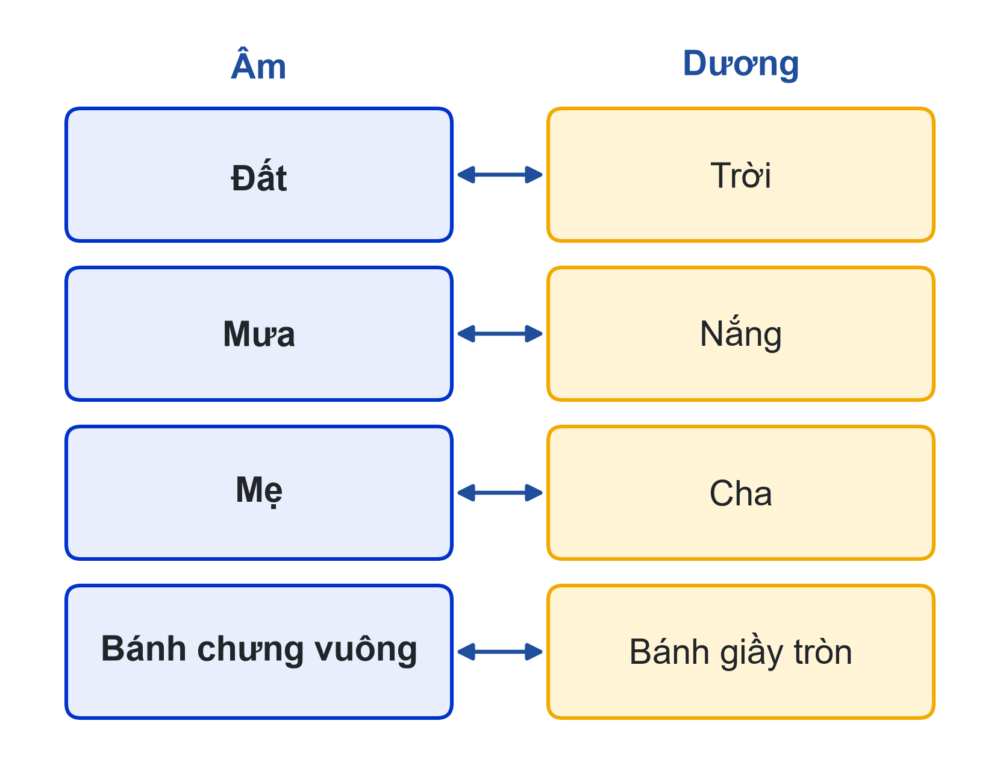
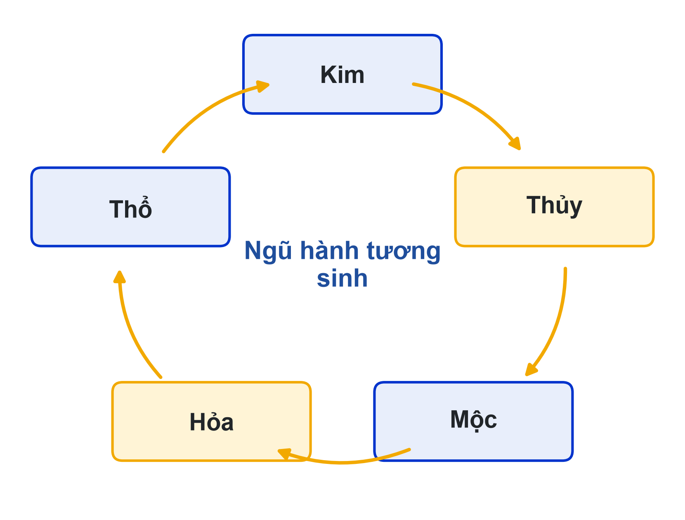
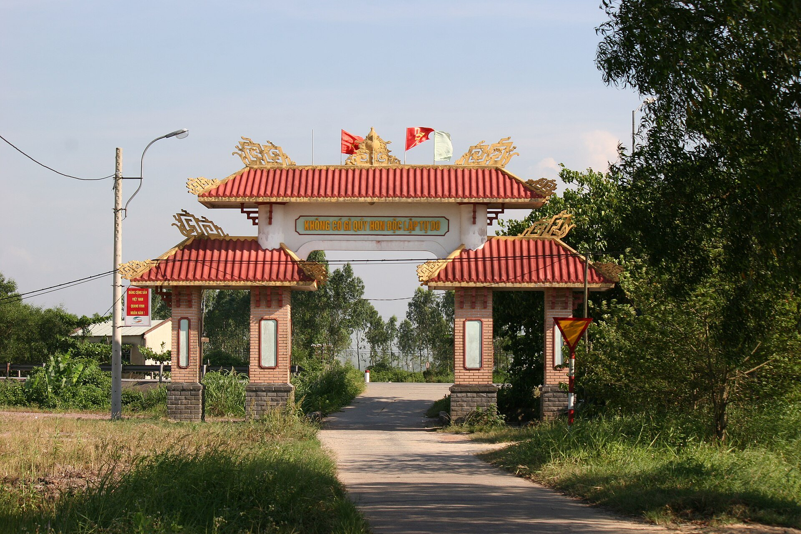
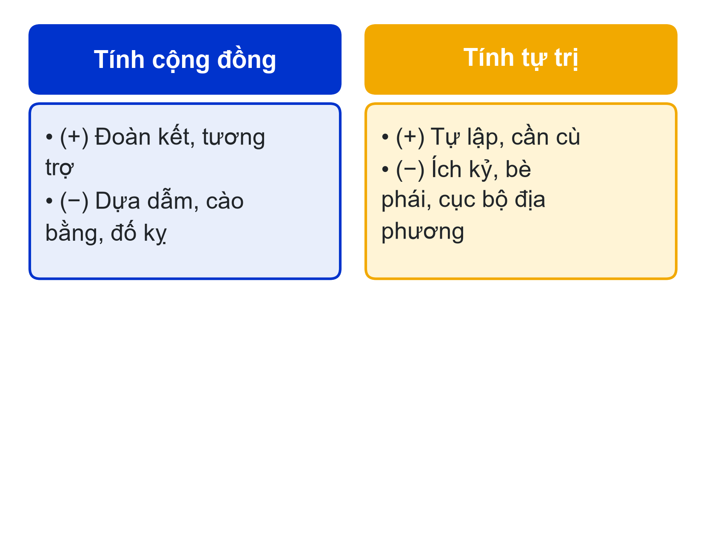
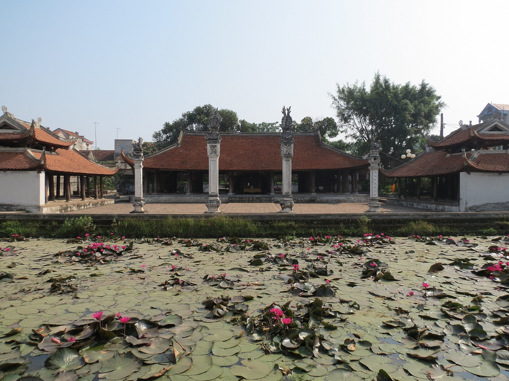
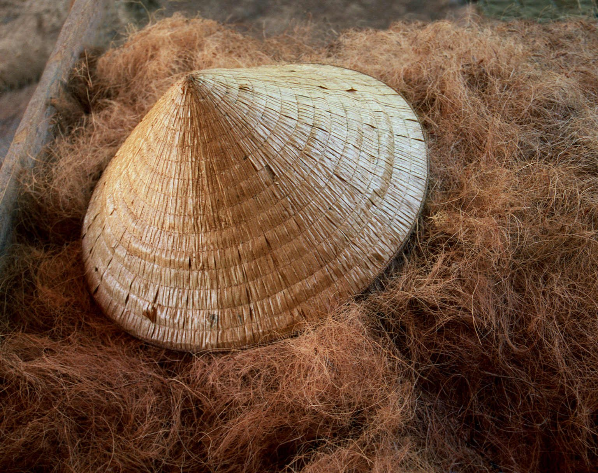
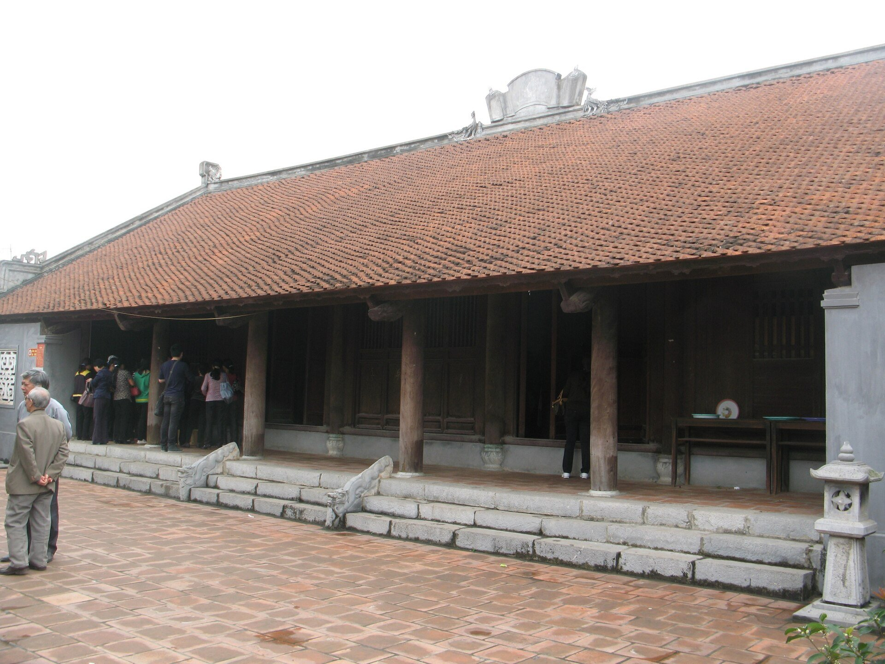
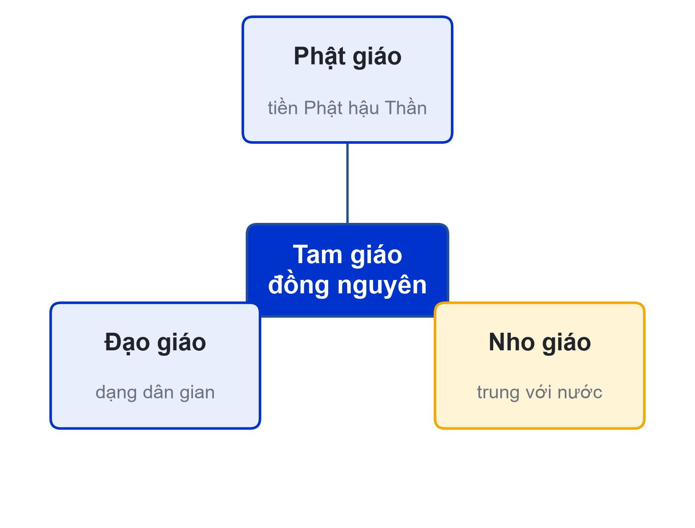

# Bài 02: Hệ thống thành tố văn hóa Việt Nam
Nhận thức – Tổ chức cộng đồng – Ứng xử với tự nhiên và xã hội

---

## Slide 1: Mục tiêu buổi học
**Nội dung chính**:
- Giải thích văn hóa nhận thức và văn hóa tổ chức cộng đồng của người Việt
- Phân tích ứng xử với môi trường tự nhiên và xã hội
- Xếp đúng sản phẩm văn hóa vào thành tố, tiểu hệ
- Đề xuất giá trị đáng đưa vào nội dung số
**Ghi chú giảng viên**:
- 5 tiết; CLO1, CLO2, CLO3. Giữa kỳ A2 cho nhóm 1–6.
- Tiến trình: nhóm 1–3 trình bày → chốt → nhóm 4–6 trình bày → chốt → thảo luận.

---

## Slide 2: Kế hoạch buổi học
**Nội dung chính**:
- Lượt 1: nhóm 1–3 (nhận thức, tổ chức cộng đồng), khoảng 25 phút
- Giảng viên chốt lần 1, khoảng 12 phút
- Lượt 2: nhóm 4–6 (ứng xử với tự nhiên và xã hội), khoảng 25 phút
- Giảng viên chốt lần 2, khoảng 12 phút; thảo luận cả lớp
**Hoạt động**: Phát phiếu chấm chéo cho nhóm 7–12
**Ghi chú giảng viên**:
- Bấm giờ nghiêm: 5 phút trình bày + 2–3 phút hỏi đáp mỗi nhóm.

---

## Slide 3: Tiêu chí chấm Portfolio (nhắc lại)
**Nội dung chính**:
- Phân tích đúng thành tố, giá trị (CLO1) · Tư liệu và nguồn (CLO1)
- Ý tưởng chuyển hóa, thiết kế slide (CLO2)
- Lý do lựa chọn, thái độ với di sản (CLO3)
- Cấu trúc – thời gian, thuyết trình, trả lời câu hỏi
**Ghi chú giảng viên**:
- Chiếu nhanh trước khi nhóm 1 lên trình bày.

---

## Slide 4: Triết lý âm dương
**Nội dung chính**:
- Gốc từ nhu cầu nông nghiệp: trời – đất, nắng – mưa, cha – mẹ
- Quy luật 1: không có gì hoàn toàn âm hoặc hoàn toàn dương
- Quy luật 2: âm dương chuyển hóa ("sông có khúc, người có lúc")
**Ví dụ**:
- Bánh chưng vuông – bánh giầy tròn; tư duy cặp đôi

**Ghi chú giảng viên**:
- Chốt sau lượt 1; liên hệ sản phẩm nhóm vừa trình bày.

---

## Slide 5: Hệ quả trong lối sống
**Nội dung chính**:
- Tư duy theo cặp đôi
- Triết lý quân bình: tránh thái quá trong ăn uống, ứng xử
- Tinh thần lạc quan: "trong rủi có may", "khổ tận cam lai"
**Ghi chú giảng viên**:
- Hỏi: sinh viên còn biết câu tục ngữ nào thể hiện âm dương chuyển hóa?

---

## Slide 6: Tam tài – ngũ hành
**Nội dung chính**:
- **Tam tài**: Thiên – Địa – Nhân; "thiên thời, địa lợi, nhân hòa"
- **Ngũ hành**: Thủy – Hỏa – Mộc – Kim – Thổ; tương sinh, tương khắc
- Ngũ sắc: đen, đỏ, xanh, trắng, vàng; gắn với phương hướng, mùa
**Ví dụ**:
- Mâm ngũ quả, cờ ngũ sắc trong lễ hội

**Ghi chú giảng viên**:
- Nhấn mạnh ứng dụng màu sắc trong thiết kế: chọn màu có lý do văn hóa.

---

## Slide 7: Lịch âm dương, can chi, 12 con giáp
**Nội dung chính**:
- Tháng theo Mặt Trăng, năm điều chỉnh theo Mặt Trời (24 tiết khí, tháng nhuận)
- 10 thiên can × 12 địa chi → chu kỳ 60 năm
- Con giáp Việt có con Mèo thay con Thỏ: một ví dụ tiếp biến
**Ghi chú giảng viên**:
- Gợi ý nội dung số dịp Tết: dùng đúng con giáp, đúng màu, giải thích ý nghĩa.

---

## Slide 8: Làng xã và hai đặc trưng
**Nội dung chính**:
- Người trong làng gắn kết theo huyết thống, nơi ở, nghề, sở thích, giới – tuổi
- **Tính cộng đồng**: cây đa, bến nước, sân đình
- **Tính tự trị**: lũy tre

**Ghi chú giảng viên**:
- Hai đặc trưng là hai mặt của cùng một tổ chức làng.

---

## Slide 9: Hai mặt của tính cộng đồng và tự trị
**Nội dung chính**:
- Cộng đồng: đoàn kết, tương trợ ↔ dựa dẫm, cào bằng, đố kỵ
- Tự trị: tự lập, cần cù ↔ ích kỷ, bè phái, cục bộ địa phương
**Hoạt động**: Thảo luận câu 2: trên mạng xã hội, tính cộng đồng là đùm bọc hay "ném đá"?

**Ghi chú giảng viên**:
- Gợi ý ví dụ chiến dịch quyên góp lan tỏa và hiện tượng "ném đá" tập thể.

---

## Slide 10: Đình làng và lễ hội
**Nội dung chính**:
- Đình: thờ Thành hoàng, trung tâm hành chính và sinh hoạt văn hóa
- Lễ hội: phần lễ (nghi thức) và phần hội (trò chơi, diễn xướng)
- Phần lớn lễ hội gắn với chu kỳ nông nghiệp

**Ghi chú giảng viên**:
- Nếu có nhóm trình bày đình làng hoặc lễ hội, dùng sản phẩm của nhóm làm ví dụ.

---

## Slide 11: Ứng xử với tự nhiên: tận dụng và ứng phó
**Nội dung chính**:
- **Ăn**: cơm – rau – cá, nước mắm; ăn chung mâm; cân bằng âm dương
- **Mặc**: tơ, lụa, đay, gai; yếm, áo tứ thân, nón lá
- **Ở**: nhà sàn, mái cong, hướng nam
- **Đi lại**: thuyền, ghe; "trên bến dưới thuyền"

**Ghi chú giảng viên**:
- Chốt sau lượt 2 cùng slide 12.

---

## Slide 12: Ứng xử với môi trường xã hội
**Nội dung chính**:
- **Phật giáo**: kết hợp tín ngưỡng bản địa, "tiền Phật hậu Thần", chùa Tứ pháp
- **Nho giáo**: chính thống thời Đại Việt; "trung" thành trung với nước
- **Đạo giáo**: chủ yếu dạng dân gian, hòa lẫn với tín ngưỡng dân gian
- **Phương Tây**: chữ Quốc ngữ, kiến trúc, báo chí, được Việt hóa dần

**Ghi chú giảng viên**:
- Đặc trưng chung: dung hợp và linh hoạt.

---

## Slide 13: Tam giáo đồng nguyên và tính dung hợp
**Nội dung chính**:
- Phật, Nho, Đạo cùng tồn tại, bổ sung cho nhau
- Tiếp nhận có chọn lọc, biến đổi cho hợp hoàn cảnh
- Câu chuyện "tiếp biến" là chất liệu hấp dẫn cho video ngắn

**Ghi chú giảng viên**:
- Câu chuyện tiếp biến có xung đột, bất ngờ và kết thúc tự hào: cấu trúc tốt cho video.

---

## Slide 14: Thảo luận cả lớp
**Nội dung chính**:
- Sản phẩm của nhóm bạn thuộc thành tố, tiểu hệ nào? Vì sao?
- Tính cộng đồng – tự trị trên mạng xã hội: đùm bọc hay "ném đá"?
- Giá trị nào đáng đưa vào nội dung số?
**Hoạt động**: Mỗi nhóm 7–12 chọn một câu, trả lời 1 phút
**Ghi chú giảng viên**:
- Thu phiếu chấm chéo cuối hoạt động.

---

## Slide 15: Khung Portfolio cho nhóm 7–12
**Nội dung chính**:
- Sản phẩm là gì → thuộc vùng nào, vì sao → giá trị văn hóa
- Đề xuất chuyển hóa (định dạng, kênh, cách kể)
- Lý do chọn và thái độ với di sản
- Nguồn tham khảo và prompt AI đã dùng
**Ghi chú giảng viên**:
- Nhắc lỗi thường gặp từ lượt hôm nay để nhóm 7–12 tránh.

---

## Slide 16: Chuẩn bị buổi 03
**Nội dung chính**:
- Nhóm 7–12 nộp Portfolio trước buổi 03
- Đọc giáo trình [1] phần các vùng văn hóa Việt Nam
- Làm quiz Bài 02; tham gia diễn đàn
**Ghi chú giảng viên**:
- Buổi 03 có Kahoot ôn tập chương 1–3 và đăng ký sản phẩm quay.
