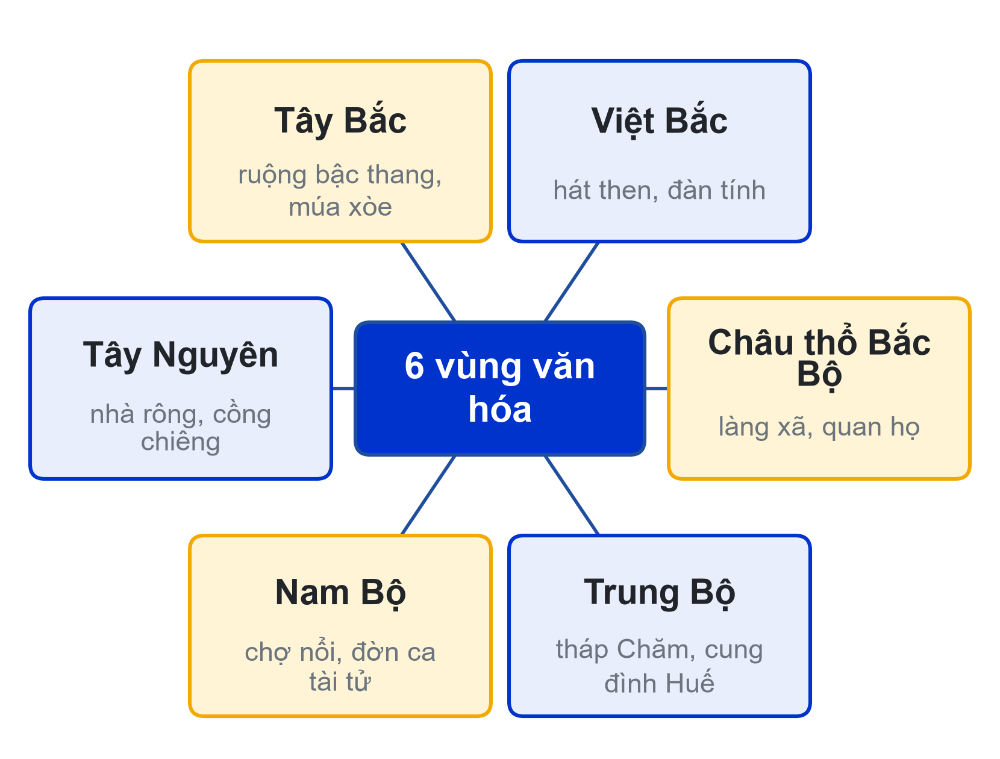
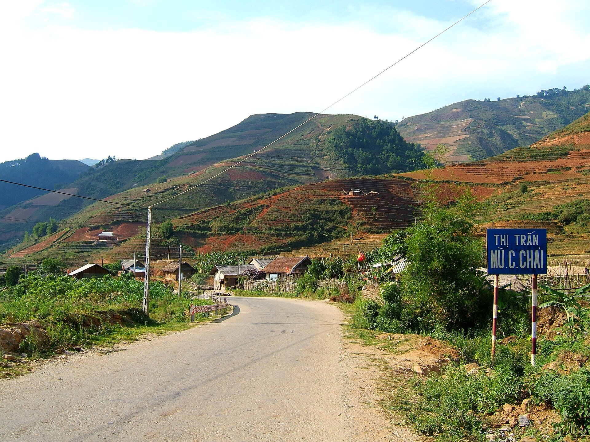
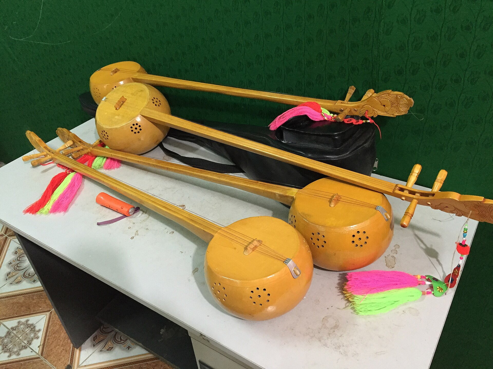
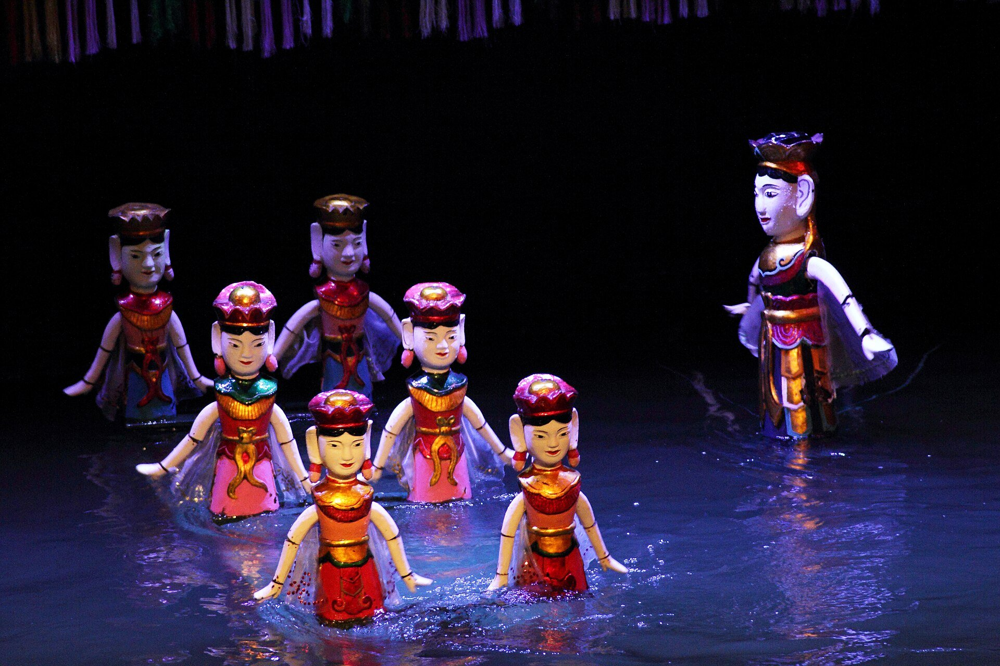
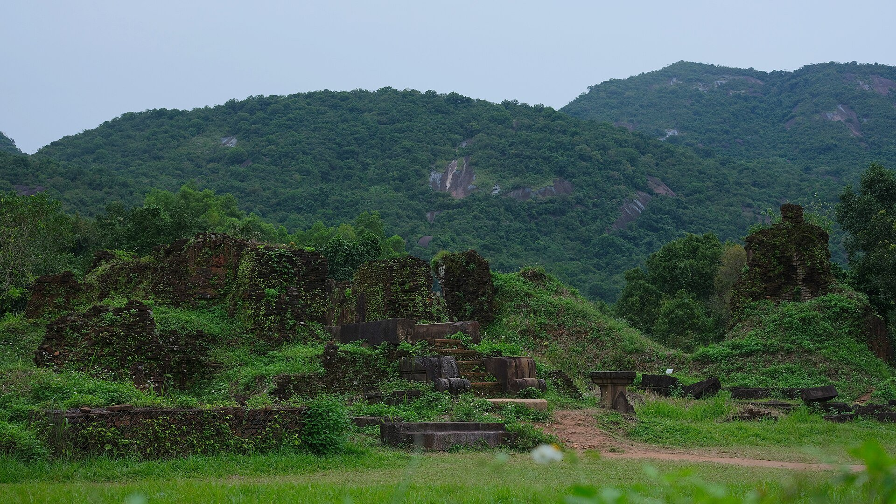
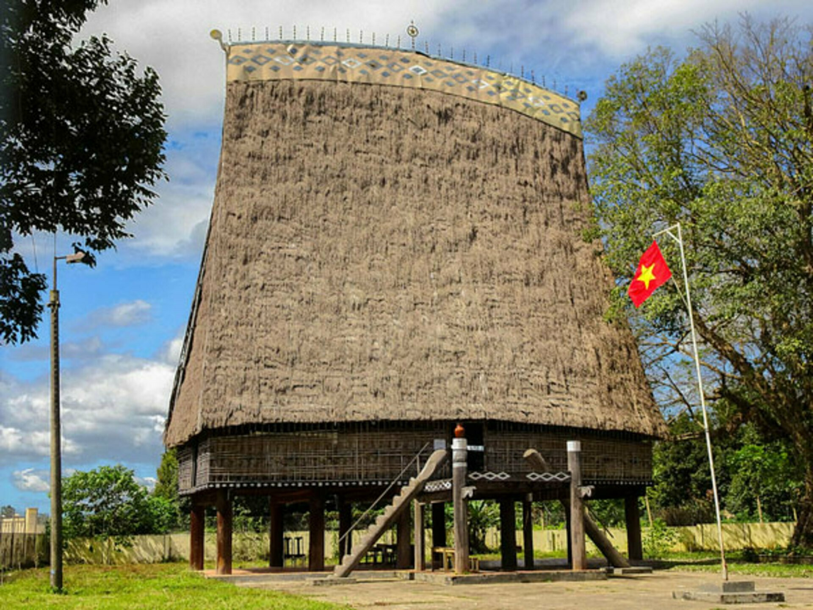
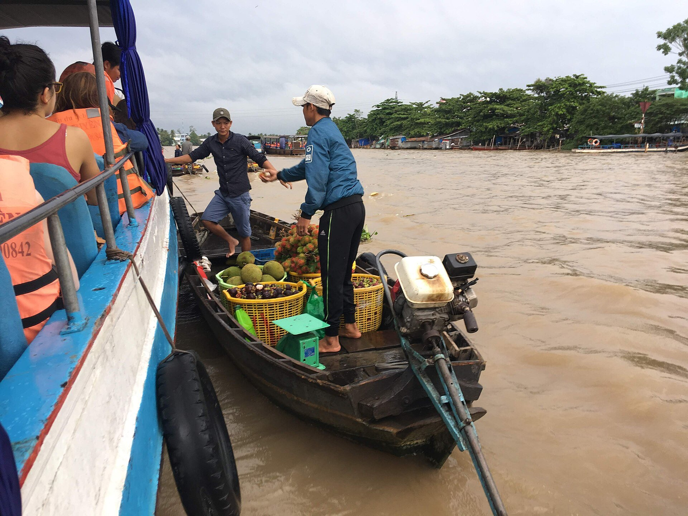
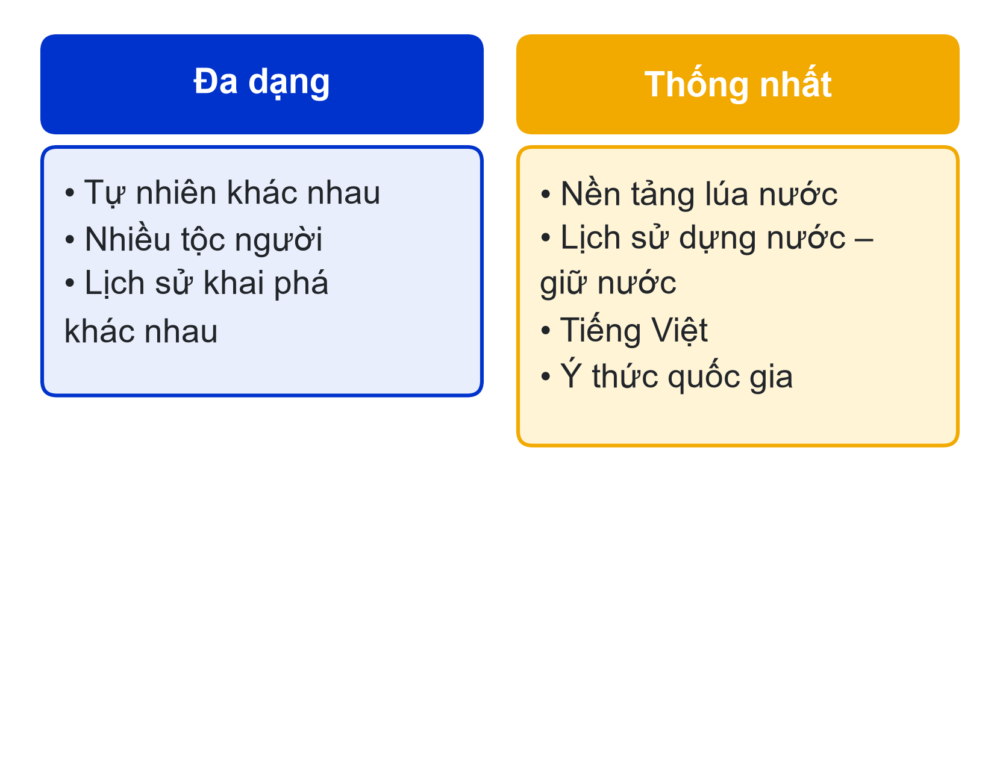
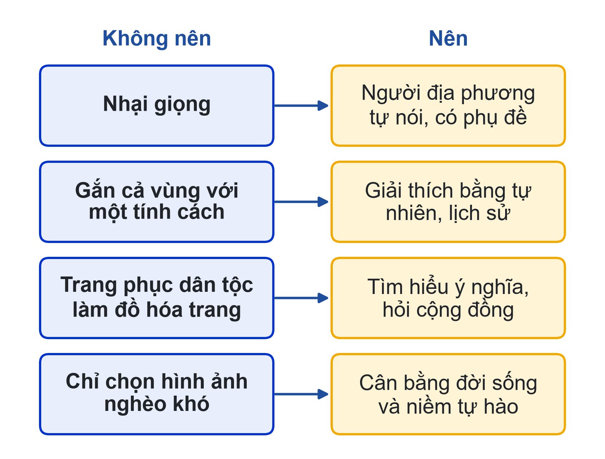

# Bài 03: Các vùng văn hóa Việt Nam
Thống nhất trong đa dạng · Ôn tập và giữa kỳ

---

## Slide 1: Mục tiêu buổi học
**Nội dung chính**:
- Phân biệt tự nhiên, chủ thể, sản phẩm văn hóa của 6 vùng
- Giải thích "thống nhất trong đa dạng"
- Đề xuất concept hình ảnh/video về địa phương mà không rập khuôn
- Hệ thống hóa chương 1–3; đăng ký sản phẩm cho dự án video
**Ghi chú giảng viên**:
- 5 tiết; CLO1, CLO2, CLO3. Giữa kỳ A2 cho nhóm 7–12.

---

## Slide 2: Kế hoạch buổi học
**Nội dung chính**:
- Lượt 1: nhóm 7–9 (Tây Bắc, Việt Bắc, châu thổ Bắc Bộ) → chốt
- Lượt 2: nhóm 10–12 (Trung Bộ, Tây Nguyên, Nam Bộ) → chốt, so sánh 6 vùng
- Ôn tập chương 1–3 bằng Kahoot
- Công bố danh sách sản phẩm, nhóm đăng ký
**Hoạt động**: Nhóm 1–6 chấm chéo bằng phiếu
**Ghi chú giảng viên**:
- Giữ giờ để còn khoảng 30 phút cho Kahoot và đăng ký.

---

## Slide 3: Vùng văn hóa là gì?
**Nội dung chính**:
- Không gian tương đồng về tự nhiên, chủ thể, lịch sử
- Hình thành nét văn hóa chung, phân biệt với vùng khác
- Giáo trình [1] chia thành 6 vùng
**Ghi chú giảng viên**:
- Nhấn mạnh cách lập luận: tự nhiên → chủ thể → sản phẩm.

---

## Slide 4: Bản đồ 6 vùng văn hóa
**Nội dung chính**:
- Tây Bắc · Việt Bắc · Châu thổ Bắc Bộ
- Trung Bộ · Tây Nguyên · Nam Bộ

**Ghi chú giảng viên**:
- Chèn bản đồ minh họa có ghi nguồn; hỏi sinh viên quê thuộc vùng nào.

---

## Slide 5: Tây Bắc
**Nội dung chính**:
- Núi cao, thung lũng lòng chảo; người Thái, Mường, H'Mông, Dao
- Ruộng bậc thang, thủy lợi mương phai; nhà sàn
- Múa xòe, khăn piêu; truyện thơ dân tộc

**Ghi chú giảng viên**:
- Chốt sau nhóm trình bày vùng Tây Bắc.

---

## Slide 6: Việt Bắc
**Nội dung chính**:
- Núi đá vôi, rừng, sông suối; người Tày, Nùng
- Hát then, đàn tính; trang phục nhuộm chàm
- Chợ phiên; lễ hội xuống đồng (Lồng tồng)

**Ghi chú giảng viên**:
- Phân biệt với Tây Bắc: vị trí, chủ thể tiêu biểu.

---

## Slide 7: Châu thổ Bắc Bộ
**Nội dung chính**:
- Đồng bằng sông Hồng, sông Thái Bình; người Việt; cái nôi văn hóa Việt
- Làng xã, đình, lũy tre; quan họ, chèo, ca trù, rối nước
- Tranh Đông Hồ, gốm Bát Tràng; truyền thống hiếu học

**Ghi chú giảng viên**:
- Gợi ý nối với dự án: kỹ thuật và hoa văn gốm truyền thống Bắc Bộ.

---

## Slide 8: Trung Bộ
**Nội dung chính**:
- Dải đất hẹp, khí hậu khắc nghiệt; người Việt và người Chăm
- Tháp Chăm, Mỹ Sơn; cung đình Huế, nhã nhạc; Hội An
- Cần kiệm, hiếu học; ẩm thực đậm vị

**Ghi chú giảng viên**:
- Liên hệ gốm Chăm nếu danh sách sản phẩm có hiện vật Chăm.

---

## Slide 9: Tây Nguyên
**Nội dung chính**:
- Cao nguyên đất đỏ; Ê Đê, Ba Na, Gia Rai, M'Nông, Xơ Đăng
- Nhà rông, nhà dài; không gian văn hóa cồng chiêng
- Sử thi Đăm Săn; tượng nhà mồ; lễ mừng lúa mới

**Ghi chú giảng viên**:
- Nhắc nguyên tắc tôn trọng khi quay lễ nghi của đồng bào.

---

## Slide 10: Nam Bộ
**Nội dung chính**:
- Đồng bằng sông Cửu Long, Đông Nam Bộ; vùng đất mới khai phá
- Người Việt, Hoa, Khmer, Chăm; chợ nổi, xuồng ghe
- Đờn ca tài tử, cải lương; cởi mở, phóng khoáng, trọng nghĩa
**Hoạt động**: Thảo luận câu 1: điều gì làm một sản phẩm "rất Nam Bộ" khác "rất Bắc Bộ"?

**Ghi chú giảng viên**:
- Yêu cầu trả lời theo ba bước tự nhiên → chủ thể → sản phẩm.

---

## Slide 11: Thống nhất trong đa dạng
**Nội dung chính**:
- Đa dạng: khác nhau về tự nhiên, tộc người, lịch sử
- Thống nhất: nền tảng lúa nước, lịch sử dựng nước – giữ nước, tiếng Việt, ý thức quốc gia
- Di sản UNESCO vùng miền: nhã nhạc Huế, cồng chiêng Tây Nguyên, quan họ, đờn ca tài tử

**Ghi chú giảng viên**:
- Nhắc kiểm tra tên gọi, năm ghi danh trên nguồn chính thức trước khi đăng.

---

## Slide 12: Làm nội dung về vùng miền: nên và không nên
**Nội dung chính**:
- Không nhại giọng → để người địa phương tự nói, có phụ đề
- Không gắn cả vùng với một tính cách → giải thích bằng tự nhiên, lịch sử
- Không biến trang phục dân tộc thành đồ hóa trang → tìm hiểu ý nghĩa, hỏi cộng đồng
- Không chỉ chọn hình ảnh nghèo khó → cân bằng đời sống và niềm tự hào
**Hoạt động**: Thảo luận câu 2: làm nội dung về vùng miền khác, cần tránh gì?

**Ghi chú giảng viên**:
- Đây là nền cho tiêu chí "thái độ với di sản" và Checklist văn hóa ở buổi 04.

---

## Slide 13: Ôn tập chương 1–3
**Nội dung chính**:
- Văn hóa: định nghĩa, 4 đặc trưng – chức năng
- Định vị: gốc nông nghiệp; chủ thể – không gian – thời gian; 3 lớp – 6 giai đoạn
- 4 thành tố → 6 vùng
**Hoạt động**: Kahoot khoảng 15 phút
**Ghi chú giảng viên**:
- Ghi kết quả Kahoot vào tiêu chí "Bài tập nhỏ" của A1.

---

## Slide 14: Dự án video: chọn sản phẩm
**Nội dung chính**:
- Danh sách tối thiểu 12 sản phẩm gốm/hiện vật tại địa điểm thực địa
- Mỗi nhóm một sản phẩm, không trùng
- Ghi lý do chọn và giá trị văn hóa dự kiến khai thác
**Ghi chú giảng viên**:
- Địa điểm: {{DIA_DIEM_THUC_DIA}}; chiếu danh sách và link Google Sheet đăng ký.

---

## Slide 15: Khảo sát địa điểm sau buổi học
**Nội dung chính**:
- Chụp ảnh bối cảnh đúng khung giờ dự định quay
- Ghi chú ánh sáng, tiếng ồn, quy định quay chụp
- Xác định người cần xin phép (nghệ nhân, bảo tàng)
**Ghi chú giảng viên**:
- Mang ảnh khảo sát đến buổi 04 để workshop kịch bản.

---

## Slide 16: Chuẩn bị buổi 04
**Nội dung chính**:
- Hoàn tất đăng ký sản phẩm và khảo sát
- Làm quiz Bài 03; tham gia diễn đàn
- Buổi 04: chất liệu văn hóa trong sáng tạo, Checklist văn hóa, workshop kịch bản
**Ghi chú giảng viên**:
- Nhắc chuẩn bị giấy xin phép quay để hoàn tất ở buổi 04.
