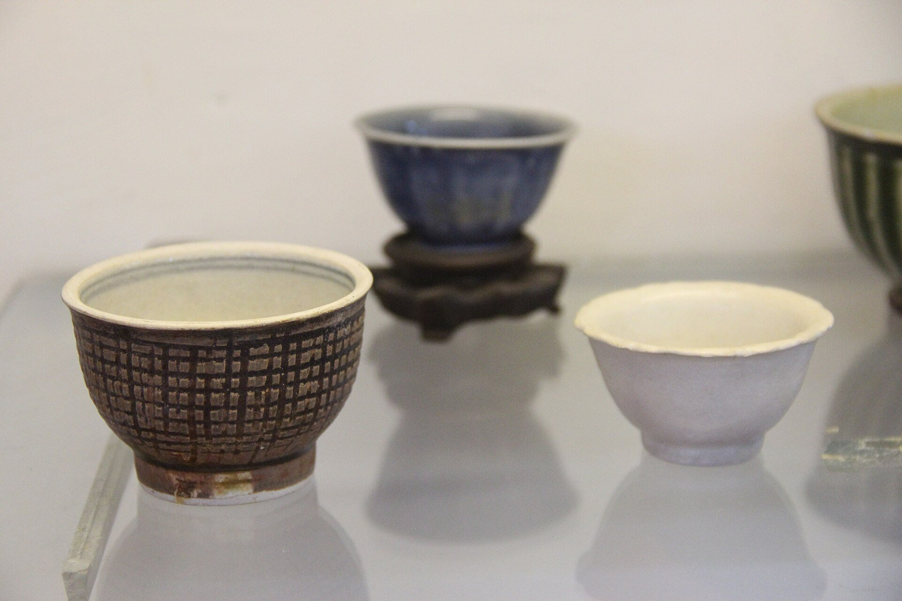
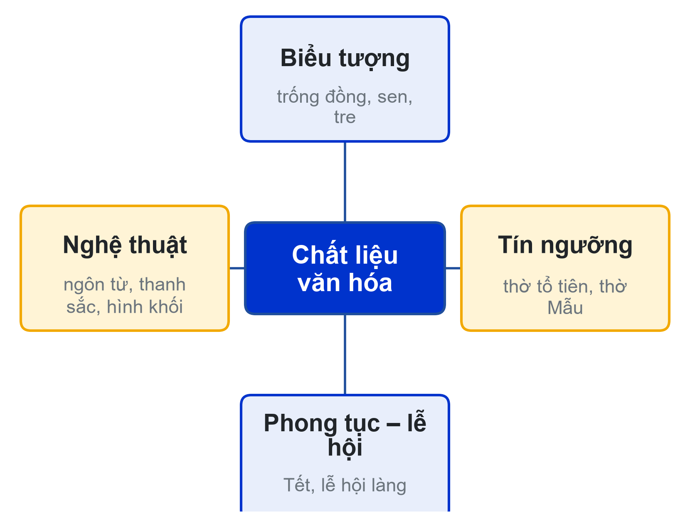
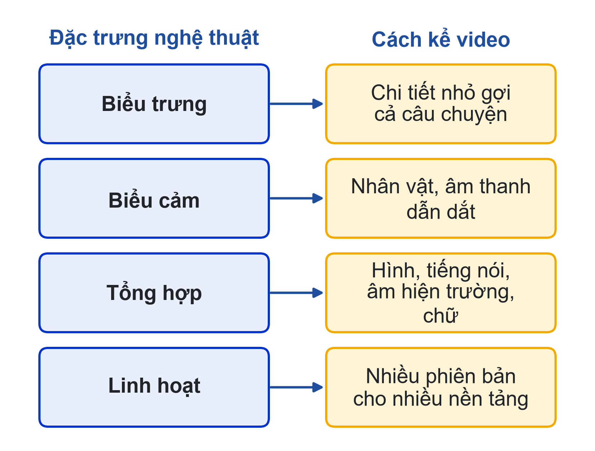
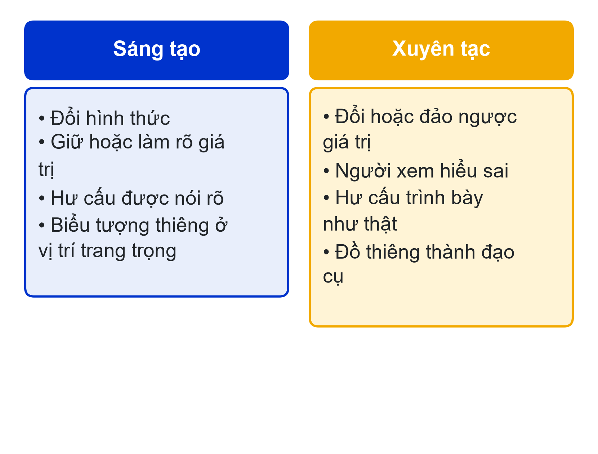
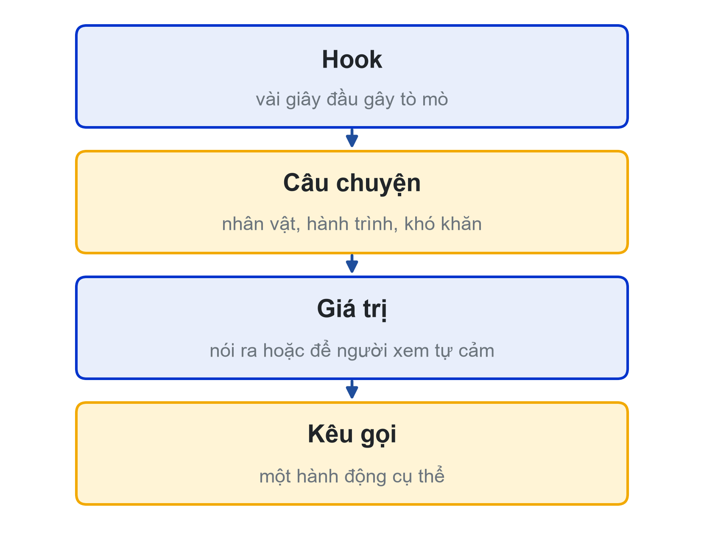

# Bài 04: Chất liệu văn hóa trong sáng tạo
Từ biểu tượng đến kịch bản video · Workshop kịch bản

---

## Slide 1: Mục tiêu buổi học
**Nội dung chính**:
- Khai thác biểu tượng, tín ngưỡng, phong tục, nghệ thuật để thiết lập ý tưởng
- Vận dụng nguyên tắc ứng dụng văn hóa, phân biệt sáng tạo và xuyên tạc
- Cả lớp soạn Checklist văn hóa
- Xây dựng kịch bản và shot list cho dự án video
**Ghi chú giảng viên**:
- 5 tiết; CLO2, CLO3. Nhóm mang ảnh khảo sát và thông tin sản phẩm đã đăng ký.

---

## Slide 2: Câu hỏi mở đầu
**Nội dung chính**:
- Cùng một chiếc bình gốm: video A giữ người xem đến giây cuối, video B quay lướt quanh tủ kính
- Khác biệt nằm ở đâu?
**Hoạt động**: Hỏi nhanh 3 nhóm: sản phẩm của nhóm có "câu chuyện" gì?

**Ghi chú giảng viên**:
- Dẫn vào ý: phải biết chất liệu văn hóa của mình là gì và kể bằng biểu tượng nào.

---

## Slide 3: Bốn nhóm chất liệu văn hóa
**Nội dung chính**:
- **Biểu tượng**: trống đồng, chim Lạc, rồng, sen, tre, hoa văn gốm
- **Tín ngưỡng**: thờ cúng tổ tiên, Thành hoàng, thờ Mẫu
- **Phong tục – lễ hội**: Tết, cưới hỏi, lễ hội làng, chợ phiên
- **Nghệ thuật**: ngôn từ, thanh sắc, hình khối

**Ghi chú giảng viên**:
- Mỗi nhóm xác định sản phẩm của mình thuộc nhóm chất liệu nào.

---

## Slide 4: Lưu ý khi dùng từng nhóm chất liệu
**Nội dung chính**:
- Biểu tượng: tìm hiểu ý nghĩa, ngữ cảnh trước khi đặt ở trung tâm
- Tín ngưỡng: phạm vi thiêng, không làm đạo cụ gây cười, gợi cảm
- Phong tục: khác nhau theo vùng, không gán một nơi cho cả nước
- Nghệ thuật: bản thu, bản dựng của nghệ nhân có quyền; xin phép, ghi nguồn
**Ghi chú giảng viên**:
- Nối sang nguyên tắc ứng dụng ở slide 6.

---

## Slide 5: Đặc trưng nghệ thuật truyền thống → cách kể video
**Nội dung chính**:
- **Biểu trưng**: gợi hơn tả → chi tiết nhỏ gợi cả câu chuyện
- **Biểu cảm**: thiên cảm xúc → để nhân vật, âm thanh dẫn dắt
- **Tổng hợp**: nhiều loại hình → hình, tiếng nói, âm hiện trường, chữ
- **Linh hoạt**: tùy biến → nhiều phiên bản cho nhiều nền tảng

**Ghi chú giảng viên**:
- Theo giáo trình [1]; nhấn mạnh tính biểu trưng cho hook.

---

## Slide 6: Sáu nguyên tắc ứng dụng văn hóa trong truyền thông
**Nội dung chính**:
- Hiểu đúng trước khi dùng (đối chiếu ít nhất 2 nguồn)
- Đúng ngữ cảnh · Tôn trọng chủ thể văn hóa
- Sáng tạo trên nền giá trị, không bóp méo giá trị cốt lõi
- Xin phép và ghi nguồn · Minh bạch khi dùng AI
**Ghi chú giảng viên**:
- Sáu nguyên tắc này là gốc của Checklist văn hóa.

---

## Slide 7: Ranh giới sáng tạo – xuyên tạc
**Nội dung chính**:
- Sáng tạo: đổi hình thức, giữ hoặc làm rõ giá trị
- Xuyên tạc: đổi hoặc đảo ngược giá trị, làm người xem hiểu sai
- Hư cấu phải được nói rõ là hư cấu
- Biểu tượng thiêng giữ vị trí trang trọng
**Hoạt động**: Thảo luận câu 1: ranh giới giữa sáng tạo và xuyên tạc nằm ở đâu?

**Ghi chú giảng viên**:
- Cho sinh viên lấy ví dụ từ sản phẩm họ từng xem.

---

## Slide 8: Vì sao sản phẩm bị phản ứng?
**Nội dung chính**:
- Đồ thờ, trang phục nghi lễ làm đạo cụ gợi cảm hoặc gây cười
- Rập khuôn, nhại giọng vùng miền, dân tộc
- Sai thông tin lịch sử, gán nguồn gốc sai
- Dùng bản thu dân ca không xin phép; ảnh AI sai hoa văn giới thiệu như thật
**Hoạt động**: Thảo luận câu 2: mỗi loại lỗi vi phạm nguyên tắc nào?
**Ghi chú giảng viên**:
- Phân tích theo loại lỗi, không nêu đích danh sản phẩm; giảng viên có thể bổ sung case cụ thể.

---

## Slide 9: Case tốt có gì chung?
**Nội dung chính**:
- Người trong nghề, người trong cộng đồng là nhân vật chính
- Thông tin đúng, có nguồn
- Chi tiết văn hóa ở trung tâm câu chuyện, không phải phông nền
**Ghi chú giảng viên**:
- Gợi ý nhóm tìm cách đưa nghệ nhân hoặc người hướng dẫn bảo tàng vào video.

---

## Slide 10: Checklist văn hóa của lớp
**Nội dung chính**:
- Thông tin: đối chiếu 2 nguồn; hư cấu được nói rõ
- Tôn trọng: đúng ngữ cảnh; không nhại giọng, rập khuôn
- Xin phép: người xuất hiện; nơi quay
- Bản quyền: nhạc có giấy phép; ghi nguồn tư liệu, ghi chú ảnh AI
- Thông điệp: tích cực; caption không giật tít
**Hoạt động**: 25 phút: mỗi nhóm bổ sung hoặc sửa ít nhất một dòng; lớp trưởng tổng hợp vào Google Doc
**Ghi chú giảng viên**:
- Chốt checklist cuối buổi; đây là căn cứ chấm tiêu chí 3.1 của A3.

---

## Slide 11: Cấu trúc kịch bản video ngắn
**Nội dung chính**:
- **Hook**: vài giây đầu, hình ảnh hoặc câu hỏi gây tò mò
- **Câu chuyện**: nhân vật, hành trình, khó khăn
- **Giá trị**: nói ra hoặc để người xem tự cảm
- **Kêu gọi**: một hành động cụ thể, vừa sức

**Ghi chú giảng viên**:
- Dùng ví dụ chiếc bình gốm trong bài học (mục 2.4).

---

## Slide 12: Ví dụ: kịch bản cho một chiếc bình gốm
**Nội dung chính**:
- Hook: đặc tả bàn tay lấm đất + "Bạn nghĩ mất bao lâu để có chiếc bình này?"
- Câu chuyện: nghệ nhân kể công đoạn, lần nung hỏng, bí quyết giữ màu men
- Giá trị: ý nghĩa hoa văn; sự nhẫn nại, tinh thần giữ nghề
- Kêu gọi: "Lần tới ghé bảo tàng, hãy tìm hoa văn này"
**Hoạt động**: Thảo luận câu 3: sản phẩm của nhóm mang giá trị gì, kể bằng biểu tượng nào?

**Ghi chú giảng viên**:
- Mỗi nhóm ghi ngay hook và giá trị của mình trước workshop.

---

## Slide 13: Shot list và moodboard
**Nội dung chính**:
- Mỗi dòng một cảnh: nội dung, cỡ cảnh, góc/chuyển động, thời lượng, âm thanh, cần xin phép
- Moodboard 6–9 ảnh: màu sắc, ánh sáng, cỡ cảnh
- AI tạo ảnh: phác thảo bố cục, không khí; không thay hiện vật thật; lưu prompt
**Ghi chú giảng viên**:
- Cột "cần xin phép" giúp nhóm chuẩn bị giấy tờ trước buổi 05.

---

## Slide 14: Workshop kịch bản
**Nội dung chính**:
- Mỗi nhóm pitch 3 phút: sản phẩm, giá trị, biểu tượng trung tâm, cấu trúc 4 phần, ảnh khảo sát
- Góp ý 2 phút theo Checklist văn hóa
- Ghi lại góp ý, sửa ngay sau phần pitch
**Hoạt động**: Khoảng 90 phút cho 12 nhóm
**Ghi chú giảng viên**:
- Hỏi ba câu cho mỗi nhóm: nguồn thông tin? cảnh nào cần xin phép? chỗ nào có nguy cơ thành phông nền?

---

## Slide 15: Nộp kịch bản và giấy xin phép
**Nội dung chính**:
- Google Doc: thông tin và nguồn; kịch bản 4 phần; shot list; moodboard; danh sách xin phép; prompt AI; mục "Đã sửa theo góp ý"
- Giảng viên duyệt trước buổi 05
- Hoàn tất giấy xin phép quay
**Ghi chú giảng viên**:
- Kịch bản là tiêu chí 6 của A1 (CLO2 + CLO3), trọng số 2.

---

## Slide 16: Chuẩn bị buổi 05
**Nội dung chính**:
- Sửa kịch bản theo góp ý, chờ duyệt
- Chuẩn bị thiết bị: điện thoại sạc đầy, pin dự phòng, micro, giá đỡ
- Làm quiz Bài 04; tham gia diễn đàn
**Ghi chú giảng viên**:
- Buổi 05: briefing 20 phút rồi quay thực địa; điểm danh tại địa điểm.
