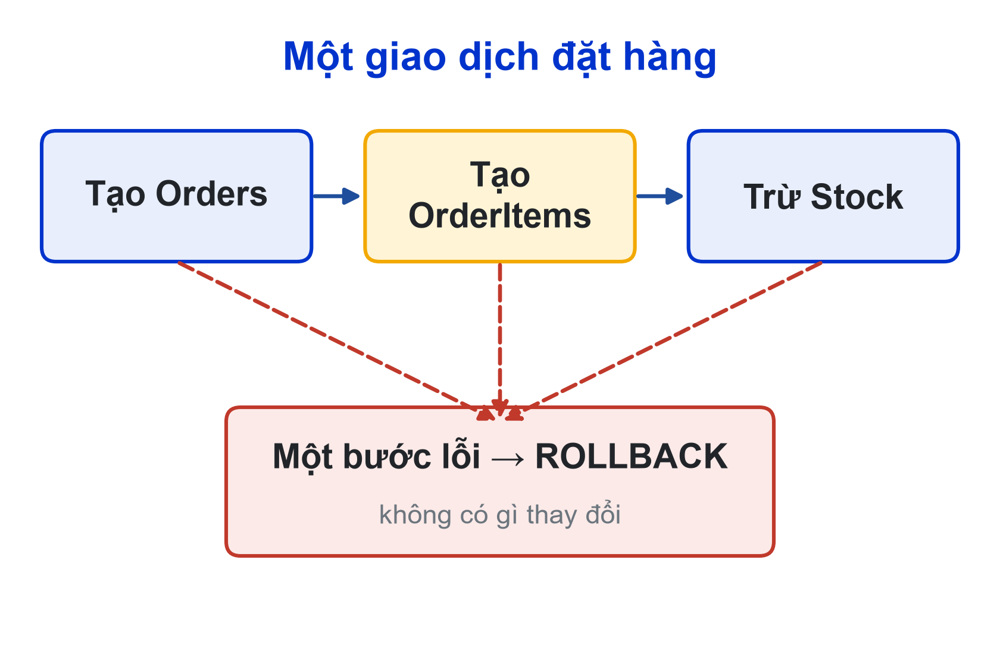
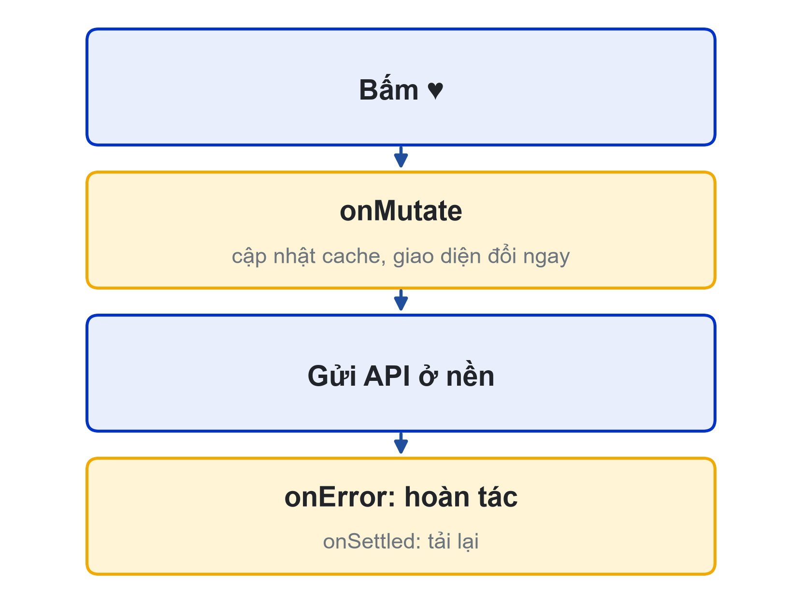

# Bài 07: CSDL SQL Server nâng cao & đồng bộ dữ liệu qua backend
Ràng buộc, chỉ mục, giao dịch, báo cáo và optimistic update

---

## Slide 1: Mục tiêu buổi học
**Nội dung chính**:
- Hoàn thiện ràng buộc và chỉ mục cho CSDL SQL Server
- Viết stored procedure có giao dịch và xử lý lỗi
- Viết thủ tục báo cáo; quản lý script CSDL theo phiên bản
- Đồng bộ ứng dụng với server: optimistic update, giữ giỏ hàng
**Ghi chú giảng viên**:
- 1 tiết lý thuyết, 4 tiết thực hành. CLO1, CLO2, CLO3.

---

## Slide 2: Câu hỏi mở đầu
**Nội dung chính**:
- Hai bạn cùng đặt suất cơm gà cuối cùng trong cùng một giây
- Ai được phần?
- Tạo đơn xong nhưng trừ tồn kho thất bại: đơn đó còn đúng không?
**Hoạt động**: Lớp đoán kết quả với thủ tục sp_Order_Create của bài 05

---

## Slide 3: Ràng buộc trong CSDL
**Nội dung chính**:
- Quy tắc đặt được ở CSDL thì đặt ở CSDL
```sql
ALTER TABLE Products ADD Stock INT NOT NULL CONSTRAINT DF_Products_Stock DEFAULT 0
  CONSTRAINT CK_Products_Stock CHECK (Stock >= 0);
ALTER TABLE Orders ADD CONSTRAINT CK_Orders_Status
  CHECK (Status IN (N'pending', N'preparing', N'ready', N'completed', N'cancelled'));
```
- Đặt tên rõ ràng: `CK_...`, `DF_...`, `IX_...`

---

## Slide 4: Chỉ mục
**Nội dung chính**:
```sql
CREATE INDEX IX_Orders_UserId_CreatedAt ON Orders (UserId, CreatedAt DESC);
CREATE INDEX IX_Products_CategoryId ON Products (CategoryId) WHERE IsAvailable = 1;
```
- Theo đúng `WHERE` và `ORDER BY` mà thủ tục hay dùng
- Không tạo chỉ mục cho mọi cột: ghi chậm hơn, tốn dung lượng

---

## Slide 5: Giao dịch là gì?
**Nội dung chính**:
- Gói nhiều lệnh thành một khối
- **Tất cả thành công**, hoặc **không có gì thay đổi**
- Đặt hàng = tạo Orders + tạo OrderItems + trừ Stock
**Ví dụ**:
- Bước trừ tồn kho lỗi → đơn và chi tiết đơn cũng phải bị hủy


---

## Slide 6: Khuôn mẫu TRY...CATCH
**Nội dung chính**:
```sql
SET XACT_ABORT ON;
BEGIN TRY
  BEGIN TRAN;
  -- kiểm tra tồn kho, INSERT Orders, INSERT OrderItems, UPDATE Stock
  COMMIT;
END TRY
BEGIN CATCH
  IF @@TRANCOUNT > 0 ROLLBACK;
  THROW;   -- ném lại lỗi gốc (giữ mã 50409)
END CATCH
```

---

## Slide 7: Chặn hai người cùng lấy suất cuối
**Nội dung chính**:
```sql
IF EXISTS (
  SELECT 1 FROM @Items i
  LEFT JOIN Products p WITH (UPDLOCK, HOLDLOCK) ON p.ProductId = i.ProductId
  WHERE p.ProductId IS NULL OR p.IsAvailable = 0 OR p.Stock < i.Quantity)
  THROW 50409, N'Có món đã hết hoặc không đủ số lượng', 1;
```
- Khóa dòng món tới khi giao dịch kết thúc; đơn thứ hai phải chờ
**Ghi chú giảng viên**:
- Demo bằng hai cửa sổ SSMS cùng đặt suất cuối.

---

## Slide 8: Thủ tục báo cáo
**Nội dung chính**:
```sql
SELECT CAST(o.CreatedAt AS DATE) AS day,
       COUNT(DISTINCT o.OrderId) AS orderCount,
       SUM(oi.Quantity * oi.UnitPrice) AS revenue
FROM Orders o JOIN OrderItems oi ON oi.OrderId = o.OrderId
WHERE o.Status <> N'cancelled'
GROUP BY CAST(o.CreatedAt AS DATE);
```
- Endpoint thống kê chỉ cho vai trò `staff`

---

## Slide 9: Script CSDL theo phiên bản
**Nội dung chính**:
```text
database/
├── 01-tables.sql
├── 02-procedures.sql
├── 03-auth.sql
├── 04-stock-reports.sql
└── 99-seed.sql
```
- Chạy từ 01 đến 99 trên CSDL trống → đúng CSDL của nhóm
- Bài 11 dùng chính các script này để triển khai lên server Khoa

---

## Slide 10: Optimistic update
**Nội dung chính**:
- Đổi giao diện ngay khi bấm, gửi API ở nền
- API lỗi → trả giao diện về như cũ
- TanStack Query: `onMutate` (cập nhật cache), `onError` (hoàn tác), `onSettled` (tải lại)
**Ví dụ**:
- Nút trái tim "Món yêu thích" đổi màu ngay


---

## Slide 11: Giữ giỏ hàng khi tắt app
**Nội dung chính**:
```ts
export const useCart = create<CartState>()(
  persist((set, get) => ({ /* items, add, remove... */ }),
    { name: 'lhufood-cart', storage: createJSONStorage(() => AsyncStorage) }),
);
```
- Giỏ hàng chỉ là "ý định mua"; server vẫn kiểm tra giá và tồn kho khi đặt

---

## Slide 12: Thực hành có hướng dẫn
**Nội dung chính**:
- Thêm Stock, ràng buộc trạng thái, chỉ mục
- Viết lại sp_Order_Create có giao dịch; thử đặt quá tồn kho
- Hai cửa sổ SSMS cùng đặt suất cuối
- sp_Report_RevenueByDay + màn hình Thống kê cho nhân viên
- Giỏ hàng dùng persist

---

## Slide 13: Thực hành không hướng dẫn & thử thách nhóm
**Nội dung chính**:
- **Cá nhân**: Món yêu thích (bảng Favorites n-n, thủ tục, API, optimistic update)
- **Nhóm**: ràng buộc, chỉ mục, thủ tục có giao dịch, 1 thủ tục báo cáo
- Mã backend không còn câu SQL trực tiếp
- Nộp ERD phiên bản cuối + thư mục `database/`

---

## Slide 14: Tóm tắt
**Nội dung chính**:
- Ràng buộc ở CSDL chặn dữ liệu sai từ mọi nguồn
- Giao dịch: TRY...CATCH, ROLLBACK, THROW; khóa dòng khi cần
- Script đánh số, chạy lại được từ đầu
- Dữ liệu chuẩn ở SQL Server; app chỉ giữ bản sao tạm
**Hoạt động**: Làm quiz Bài 07 ở cuối trang bài học

---

## Slide 15: Tài liệu của buổi
**Đọc thêm**:
- Giáo trình nội bộ, Chương 7: CSDL SQL Server nâng cao và đồng bộ dữ liệu qua backend
- Bài tập hướng dẫn theo dự án LHU Food (cuối Chương 7)
- SRS LHU Food: mục 5.5, 5.6, 5.10, 5.11, BR-07…BR-11
**Ghi chú giảng viên**:
- Các file Word/Excel nằm ở mục Tài liệu của bài trên LMS và trang học phần (giao-trinh/, srs/, rubric/).
