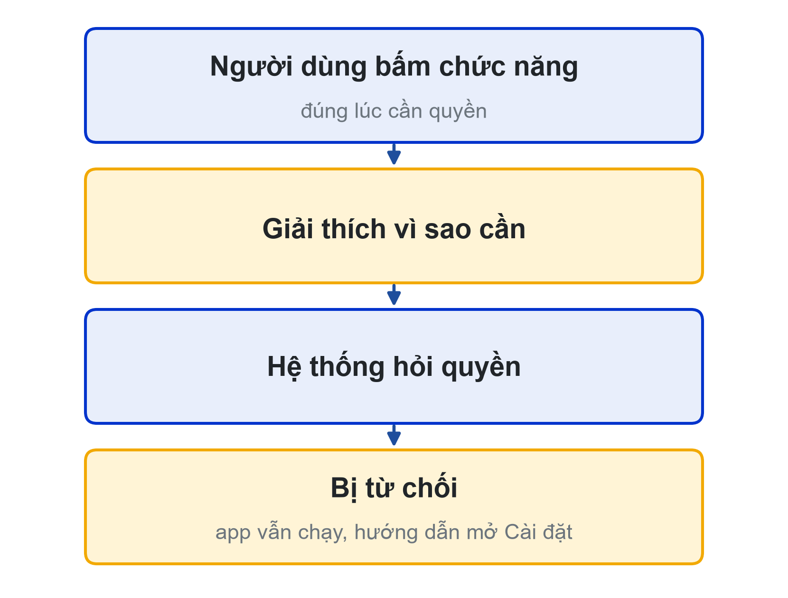
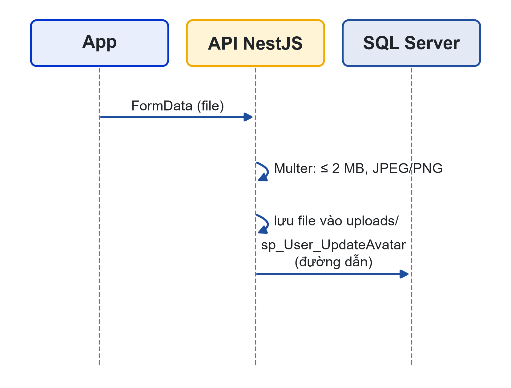
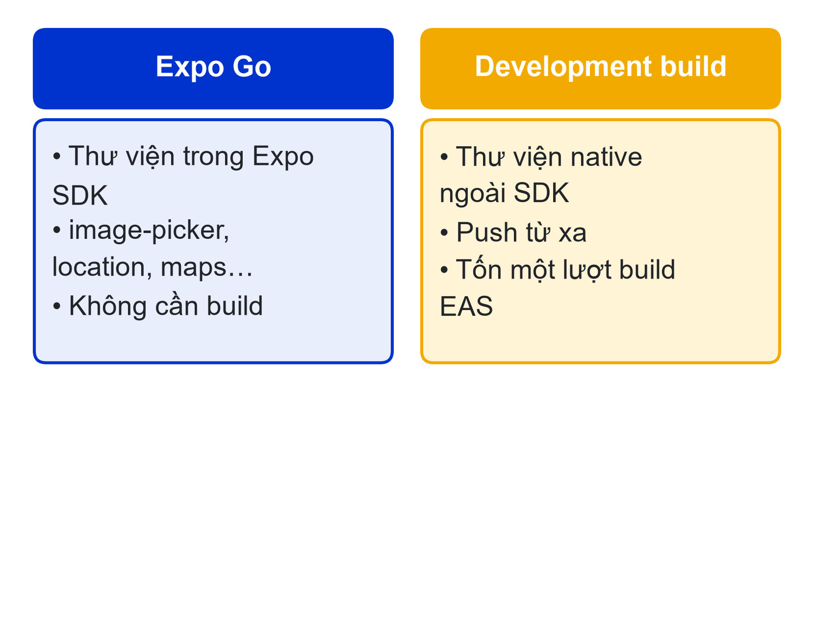

# Bài 08: Tính năng thiết bị: Camera, Ảnh, Vị trí & Bản đồ
Những gì ứng dụng di động làm tốt hơn web app

---

## Slide 1: Mục tiêu buổi học
**Nội dung chính**:
- Xin và xử lý quyền truy cập thiết bị
- Chụp/chọn ảnh, nén ảnh, tải ảnh lên NestJS
- Lấy vị trí hiện tại, hiển thị bản đồ và tính khoảng cách
- Phân biệt Expo Go và development build
**Ghi chú giảng viên**:
- 1 tiết lý thuyết, 4 tiết thực hành. CLO1.

---

## Slide 2: Câu hỏi mở đầu
**Nội dung chính**:
- Chụp ảnh, biết bạn đang ở đâu, chỉ đường tới quầy gần nhất
- Nhưng điện thoại sẽ hỏi: "Cho phép LHU Food truy cập camera?"
- Người dùng bấm "Từ chối" thì sao?

---

## Slide 3: Quyền truy cập
**Nội dung chính**:
- Camera, ảnh, vị trí là dữ liệu riêng tư
- **Xin đúng lúc**: khi người dùng bấm chức năng cần quyền
- **Giải thích trước** vì sao cần quyền
- **Xử lý từ chối**: app vẫn chạy, hướng dẫn mở Cài đặt
**Hoạt động**: Hỏi lớp: ứng dụng nào từng xin quyền khiến bạn khó chịu?


---

## Slide 4: Xin quyền camera
**Nội dung chính**:
```ts
const { status, canAskAgain } = await ImagePicker.requestCameraPermissionsAsync();
if (status !== 'granted') {
  // canAskAgain = false → hướng dẫn Linking.openSettings()
}
```
- Lời giải thích quyền khai báo trong `app.json` (plugin của thư viện)

---

## Slide 5: Chụp hoặc chọn ảnh
**Nội dung chính**:
```ts
const options = { mediaTypes: ['images'], allowsEditing: true, aspect: [1, 1], quality: 0.6 };
const result = fromCamera
  ? await ImagePicker.launchCameraAsync(options)
  : await ImagePicker.launchImageLibraryAsync(options);
if (!result.canceled) await uploadAvatar(result.assets[0].uri);
```
- `quality` và cắt vuông giúp ảnh nhỏ, tải lên nhanh

---

## Slide 6: Tải ảnh lên server
**Nội dung chính**:
```ts
const form = new FormData();
form.append('file', { uri, name: 'avatar.jpg', type: 'image/jpeg' } as any);
await fetch(`${API_URL}/users/me/avatar`, {
  method: 'POST', body: form, headers: { Authorization: `Bearer ${token}` },
});
```
- **Không** tự đặt Content-Type: fetch tự thêm boundary

---

## Slide 7: NestJS nhận file
**Nội dung chính**:
- `FileInterceptor('file')` (Multer): giới hạn 2 MB, chỉ JPEG/PNG
- Server tự đặt tên file: mã người dùng + thời điểm
- Lưu file vào `uploads/`, SQL Server **chỉ lưu đường dẫn** qua `sp_User_UpdateAvatar`
- Phục vụ file tĩnh bằng `useStaticAssets`


**Ghi chú giảng viên**:
- Mã đầy đủ ở mục 2.2 của bài học.

---

## Slide 8: Vị trí hiện tại
**Nội dung chính**:
```ts
const { status } = await Location.requestForegroundPermissionsAsync();
if (status === 'granted') {
  const pos = await Location.getCurrentPositionAsync({ accuracy: Location.Accuracy.Balanced });
}
```
- Chỉ xin quyền **khi dùng ứng dụng** (foreground)
- `Balanced` đủ cho khuôn viên, tiết kiệm pin

---

## Slide 9: Bản đồ quầy căn tin
**Nội dung chính**:
```tsx
<MapView style={{ flex: 1 }} showsUserLocation initialRegion={region}>
  {counters.map((c) => (
    <Marker key={c.id} coordinate={{ latitude: c.lat, longitude: c.lng }} title={c.name} />
  ))}
</MapView>
```
- Tọa độ quầy lấy từ bảng Counters qua API
- Khoảng cách: công thức Haversine → sắp xếp quầy gần nhất

---

## Slide 10: Expo Go hay development build?
**Nội dung chính**:
- **Expo Go**: thư viện thuộc Expo SDK (image-picker, location, maps…)
- **Development build**: thư viện native ngoài SDK, push từ xa
- Development build tốn một lượt build EAS
- Bản cài đặt dùng Google Maps cần API key trong `app.json`


**Ghi chú giảng viên**:
- Nhắc sinh viên kiểm tra thư viện AI gợi ý có trong tài liệu Expo không.

---

## Slide 11: Thực hành có hướng dẫn
**Nội dung chính**:
- Cột AvatarUrl, sp_User_UpdateAvatar, endpoint upload
- Đổi ảnh đại diện: chụp hoặc chọn → cắt vuông → tải lên
- Thử từ chối quyền: app không treo, có hướng dẫn
- Bảng Counters, màn hình Bản đồ, sắp xếp theo khoảng cách

---

## Slide 12: Thực hành không hướng dẫn & thử thách nhóm
**Nội dung chính**:
- **Cá nhân**: Báo cáo sự cố (ảnh + vị trí + mô tả → sp_Incident_Create)
- Từ chối quyền vẫn gửi được; ảnh > 2 MB bị từ chối có thông báo rõ
- **Nhóm**: ít nhất 1 tính năng thiết bị có ý nghĩa với đề tài
- README: quyền gì, xin lúc nào, xử lý khi bị từ chối

---

## Slide 13: Tóm tắt
**Nội dung chính**:
- Xin quyền đúng lúc, giải thích, xử lý khi bị từ chối
- Ảnh: nén, tải bằng FormData, server lưu file, CSDL lưu đường dẫn
- Vị trí khi dùng ứng dụng; bản đồ lấy dữ liệu từ API
- Ưu tiên thư viện Expo SDK để dùng Expo Go
**Hoạt động**: Làm quiz Bài 08 ở cuối trang bài học

---

## Slide 14: Tài liệu của buổi
**Đọc thêm**:
- Giáo trình nội bộ, Chương 8: Tính năng thiết bị: Camera, Ảnh, Vị trí và Bản đồ
- Bài tập hướng dẫn theo dự án LHU Food (cuối Chương 8)
- SRS LHU Food: mục 5.7 (M06), 5.8 (F07.2, F07.4), BR-12, BR-13
**Ghi chú giảng viên**:
- Các file Word/Excel nằm ở mục Tài liệu của bài trên LMS và trang học phần (giao-trinh/, srs/, rubric/).
