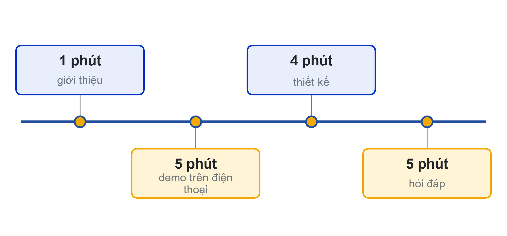
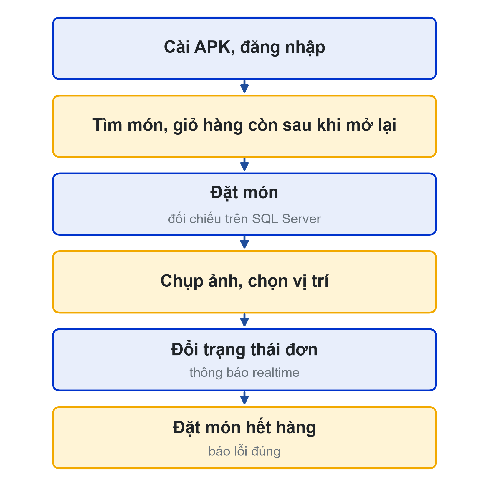
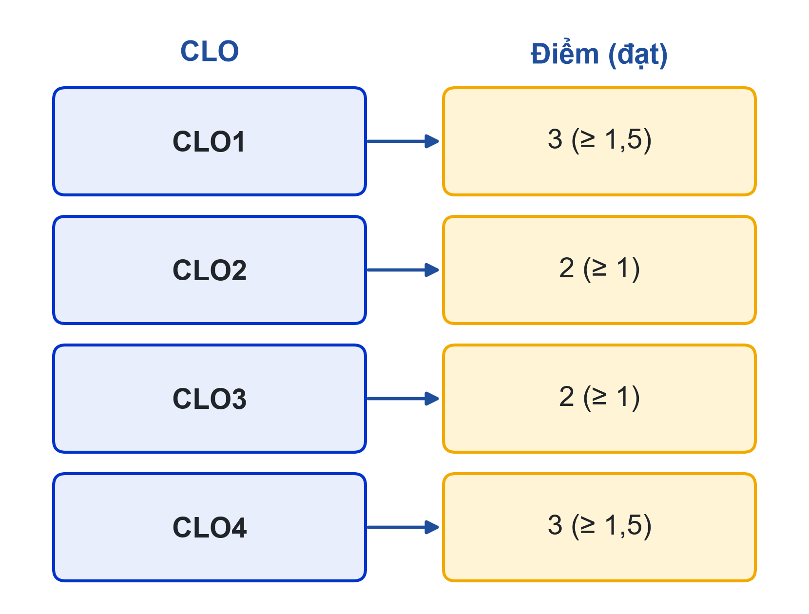

# Bài 12: Demo Day - báo cáo đồ án & tổng kết
Đánh giá cuối kỳ · CLO1, CLO2, CLO3, CLO4

---

## Slide 1: Demo Day
**Nội dung chính**:
- Trình diễn sản phẩm trên điện thoại Android thật
- Bảo vệ thiết kế chức năng và thiết kế dữ liệu
- Mỗi thành viên giải thích phần mã mình phụ trách
- Review chéo và nhìn lại học phần
**Ghi chú giảng viên**:
- 5 tiết thực hành. Công bố thứ tự trình bày, kiểm tra server Khoa và máy chiếu trước giờ học.

---

## Slide 2: 15 phút của mỗi nhóm
**Nội dung chính**:
- **1 phút** giới thiệu: vấn đề, người dùng, thành viên và vai trò
- **5 phút** demo theo kịch bản trên điện thoại thật
- **4 phút** thiết kế: sơ đồ chức năng, ERD, sơ đồ tuần tự realtime
- **5 phút** hỏi đáp và bảo vệ kỹ thuật
- Mọi thành viên đều trình bày phần của mình

---

## Slide 3: Kịch bản demo
**Nội dung chính**:
- APK (không phải Expo Go) → đăng nhập
- Duyệt, tìm món, giỏ hàng còn sau khi mở lại app
- Đặt món → đối chiếu đơn trên SQL Server của Khoa
- Chụp ảnh, chọn vị trí trên bản đồ
- Đổi trạng thái đơn → thông báo realtime
- Đặt món hết hàng → thông báo lỗi đúng

---

## Slide 4: Bảo vệ thiết kế
**Nội dung chính**:
- Sơ đồ chức năng: đã xong gì, chưa xong gì, vì sao
- ERD cuối khớp CSDL thật; có thể được yêu cầu mở SQL Server đối chiếu
- Thủ tục quan trọng nhất: tham số, giao dịch, mã lỗi THROW
- Sơ đồ tuần tự realtime: API → thủ tục → Socket.IO → room → client

---

## Slide 5: Bảo vệ kỹ thuật
**Nội dung chính**:
- Giảng viên chọn ngẫu nhiên đoạn mã, hỏi người đã commit
- Đoạn này làm gì? Xóa dòng này thì sao?
- Hai người cùng đặt suất cuối thì thủ tục xử lý thế nào?
- Token lưu ở đâu, hết hạn thì app làm gì?
- **Không hiểu thì không merge**: không giải thích được thì không tính điểm

---

## Slide 6: Rubric cuối kỳ (thang 10)
**Nội dung chính**:
- **CLO1** (3 điểm, đạt ≥ 1,5): sơ đồ chức năng, luồng chính, xác thực, thiết bị, realtime
- **CLO2** (2 điểm, đạt ≥ 1): CSDL, stored procedure, script chạy trên server Khoa
- **CLO3** (2 điểm, đạt ≥ 1): ERD cuối, tuần tự realtime, luồng màn hình
- **CLO4** (3 điểm, đạt ≥ 1,5): báo cáo cá nhân, commit/PR, trình bày và trả lời
- Điểm cuối kỳ chiếm 40% điểm học phần

---

## Slide 7: Sản phẩm nộp và review chéo
**Nội dung chính**:
- Báo cáo đồ án, bộ sơ đồ, script CSDL và thủ tục
- Link repo app và API, PROMPTS.md, README, file APK
- Báo cáo vai trò cá nhân (mỗi thành viên nộp riêng)
- Review chéo: chấm theo rubric, mỗi điểm kèm 1 điểm mạnh và 1 đề xuất
**Hoạt động**: Phát phiếu review chéo cho các nhóm trước phần trình bày đầu tiên

---

## Slide 8: Nhìn lại học phần
**Nội dung chính**:
- AI đã giúp nhóm tiết kiệm thời gian ở đâu?
- Lỗi nào do AI gây ra khiến nhóm mất công tìm nhất?
- Nếu làm lại, bạn sẽ dùng AI khác đi thế nào?
- Mở rộng: đưa app lên Google Play, đưa đồ án vào portfolio
**Ghi chú giảng viên**:
- Mời 2–3 nhóm chia sẻ; ghi nhận ý kiến để điều chỉnh học phần kỳ sau.

---

## Slide 9: Tài liệu của buổi
**Đọc thêm**:
- Rubric chấm cuối kỳ: 27 tiêu chí theo 4 CLO (Excel)
- Đề cương học phần: mục Đánh giá môn học
- Giáo trình nội bộ, Chương 12: Báo cáo đồ án, Demo Day và tổng kết
- Bài tập hướng dẫn theo dự án LHU Food (cuối Chương 12)
- SRS LHU Food: mục 4 (user story), 7 (dữ liệu), 10.1 (truy vết)
- Kế hoạch Agile & Product Backlog (Definition of Done, tiêu chí nghiệm thu)
**Ghi chú giảng viên**:
- Các file Word/Excel nằm ở mục Tài liệu của bài trên LMS và trang học phần (giao-trinh/, srs/, rubric/).
