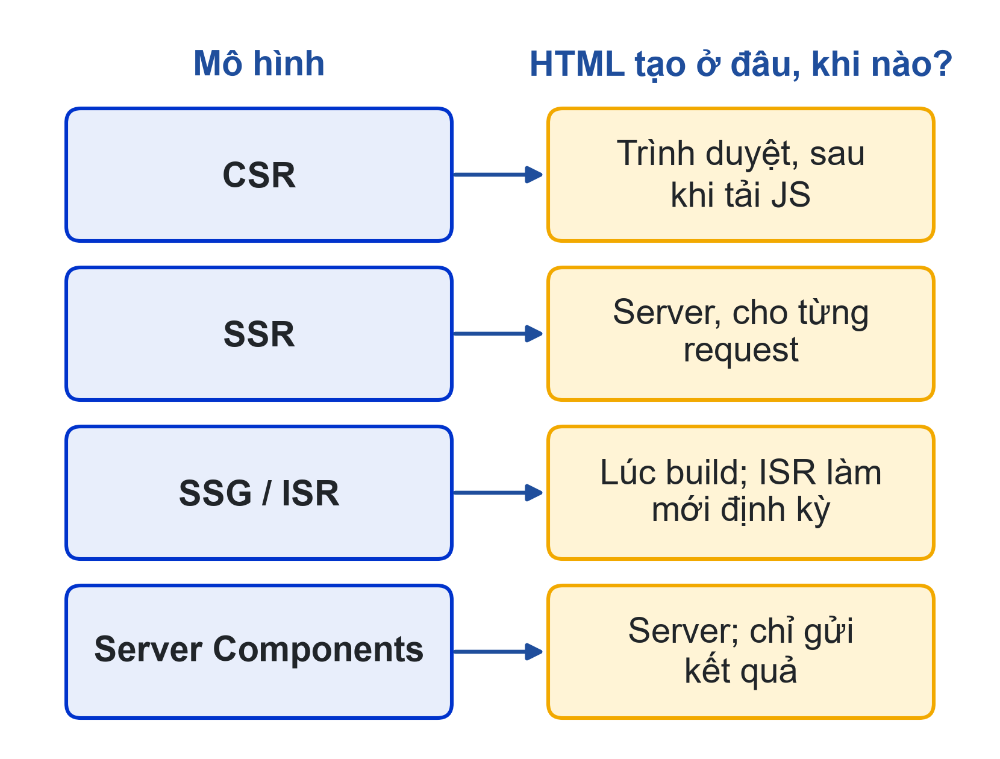
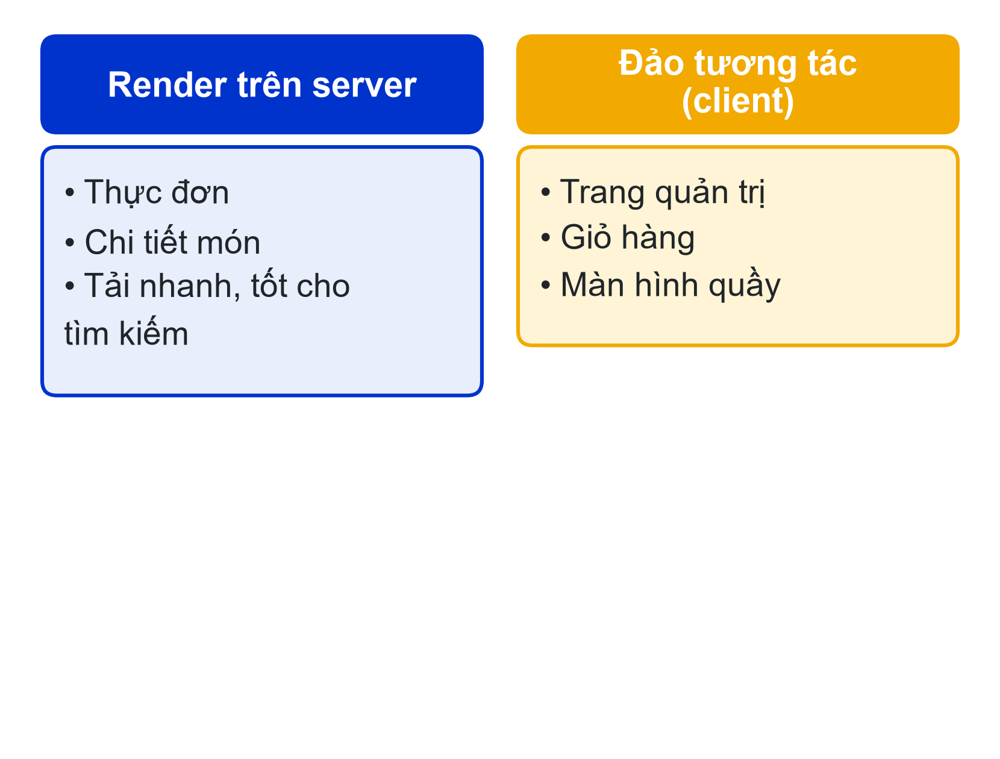
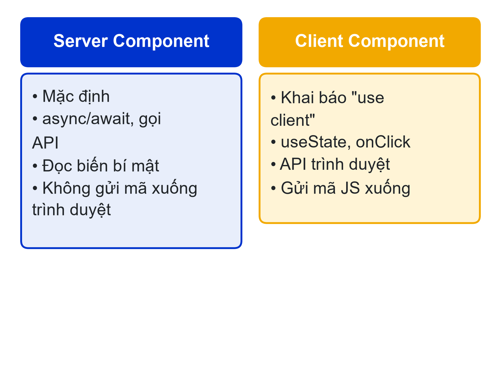
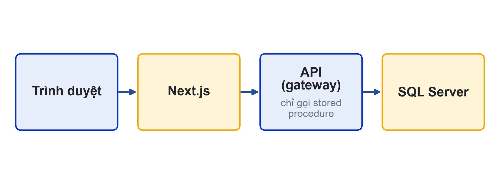
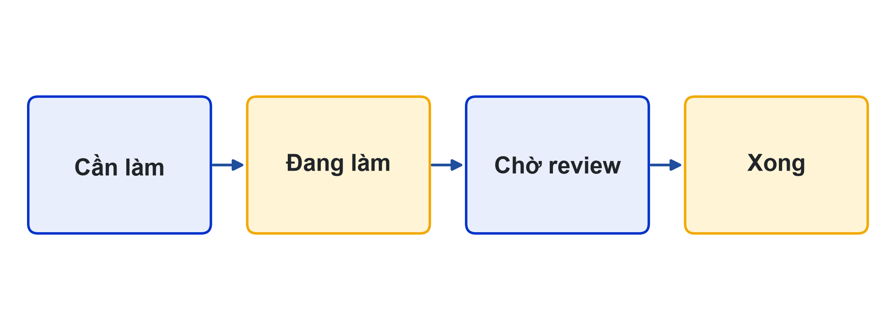

# Bài 01: Ứng dụng web hiện đại với Next.js & khởi động dự án
Sprint 1 · Nền tảng & Giao diện

---

## Slide 1: Mục tiêu buổi học
**Nội dung chính**:
- So sánh CSR, SSR, SSG/ISR và React Server Components
- Hiểu vai trò của Next.js App Router
- Phân tích phạm vi web của LHU Food từ SRS
- Lập kế hoạch Sprint 1 và phân vai nhóm
**Ghi chú giảng viên**:
- 2 tiết lý thuyết, 3 tiết thực hành. CLO1, CLO4.

---

## Slide 2: Câu hỏi mở đầu
**Nội dung chính**:
- Trang thực đơn: cần hiện ngay, được Google tìm thấy
- Trang quản trị: tương tác nhiều, chỉ quản lý được vào
- Một framework làm được cả hai thế nào?

---

## Slide 3: Các mô hình render
**Nội dung chính**:
- **CSR**: trình duyệt tải JS rồi vẽ giao diện (React SPA đã học)
- **SSR**: server tạo HTML cho từng request
- **SSG/ISR**: tạo sẵn lúc build, ISR làm mới định kỳ
- **Server Components**: chạy trên server, chỉ gửi kết quả


---

## Slide 4: Next.js trong LHU Food
**Nội dung chính**:
- Thực đơn: render trên server, tải nhanh, tốt cho tìm kiếm
- Quản trị, giỏ hàng, màn hình quầy: "đảo" tương tác ở trình duyệt
- Một ứng dụng, kết hợp nhiều mô hình


---

## Slide 5: Tạo dự án
**Nội dung chính**:
```bash
npx create-next-app@latest lhu-food-web --ts --tailwind --eslint --app --import-alias "@/*"
cd lhu-food-web
npm run dev
```
- Kiểm tra phiên bản: npx next --version

---

## Slide 6: Cấu trúc App Router
**Nội dung chính**:
```text
app/
  layout.tsx      bố cục gốc
  page.tsx        /
  menu/page.tsx   /menu
  admin/page.tsx  /admin
```
- Thư mục = đoạn đường dẫn; page.tsx = trang

---

## Slide 7: Server và Client Component
**Nội dung chính**:
- Mặc định là Server Component: đọc dữ liệu, không có state
- "use client": dùng useState, onClick
- Chỉ dùng Client Component cho phần cần tương tác
**Hoạt động**: Lớp phân loại 5 thành phần của trang thực đơn


---

## Slide 8: Kiến trúc dữ liệu
**Nội dung chính**:
- Next.js KHÔNG kết nối CSDL trực tiếp
- Sprint 1–2: API mẫu; Sprint 3–4: backend của nhóm


---

## Slide 9: Phạm vi web theo SRS
**Nội dung chính**:
- **Bắt buộc**: trang quản trị (US-A01…A07)
- **Bắt buộc**: màn hình quầy (US-S02, S03, S05, S06, S07)
- **Cơ bản**: web đặt món cho khách (US-G01…G05, C01…C13)
- Mỗi trang phải truy vết được tới một user story (CLO1)

---

## Slide 10: Sắp xếp công việc (CLO4)
**Nội dung chính**:
- Chọn story web từ Product Backlog dùng chung
- Ước lượng story point, đặt Sprint Goal
- Board: Cần làm → Đang làm → Chờ review → Xong
- Mỗi thẻ: người phụ trách + liên kết Pull Request


---

## Slide 11: AGENTS.md cho Next.js
**Nội dung chính**:
- App Router, TypeScript, Tailwind CSS + shadcn/ui
- Không Pages Router, không kết nối SQL Server
- Gọi API tập trung ở lib/api.ts
- Server Component mặc định, "use client" khi cần

---

## Slide 12: Lỗi AI hay mắc với Next.js
**Nội dung chính**:
- Sinh mã Pages Router (getServerSideProps)
- Dùng hook trong Server Component
- Thêm "use client" tràn lan
- Không hiểu thì không merge; ghi prompt vào PROMPTS.md

---

## Slide 13: Thực hành
**Nội dung chính**:
- **Có hướng dẫn**: tạo lhu-food-web, 3 trang, repo, AGENTS.md, thử API mẫu
- **Không hướng dẫn**: Hồ sơ cá nhân 4 trang dùng chung layout
- **Nhóm**: phạm vi web, kế hoạch Sprint 1, board, phân vai

---

## Slide 14: Tổng kết
**Nội dung chính**:
- Next.js kết hợp render server và tương tác client
- App Router: thư mục, page.tsx, layout.tsx
- Phân tích phạm vi trước khi code; lập kế hoạch trên board
- Buổi sau: routing, layout và Tailwind CSS

---

## Slide 15: Tài liệu của buổi
**Đọc thêm**:
- SRS LHU Food: mục 2.4 (mobile/web), 3 (actor), 4 (user story web)
- Kế hoạch Agile & Product Backlog: story point, MoSCoW, Definition of Done
- Next.js Documentation: Installation, Server and Client Components
**Ghi chú giảng viên**:
- Thông báo địa chỉ API mẫu và tài khoản thử trên Moodle trước buổi học.
