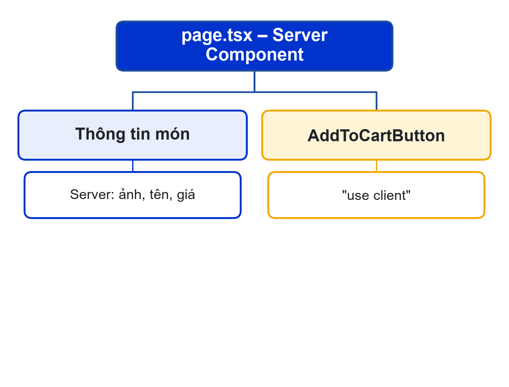
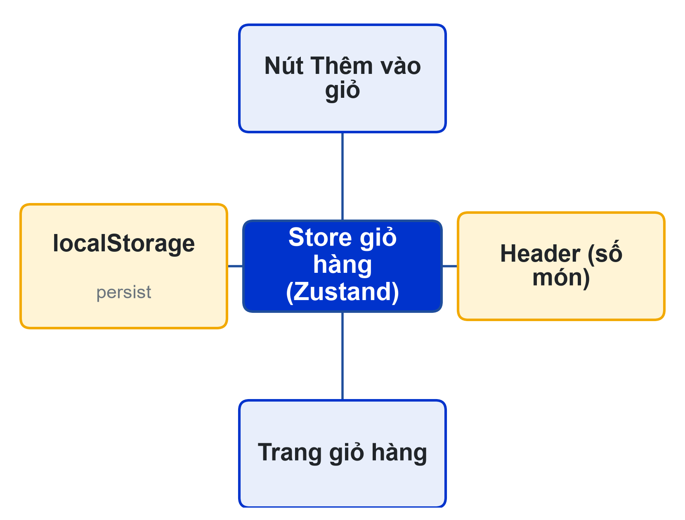
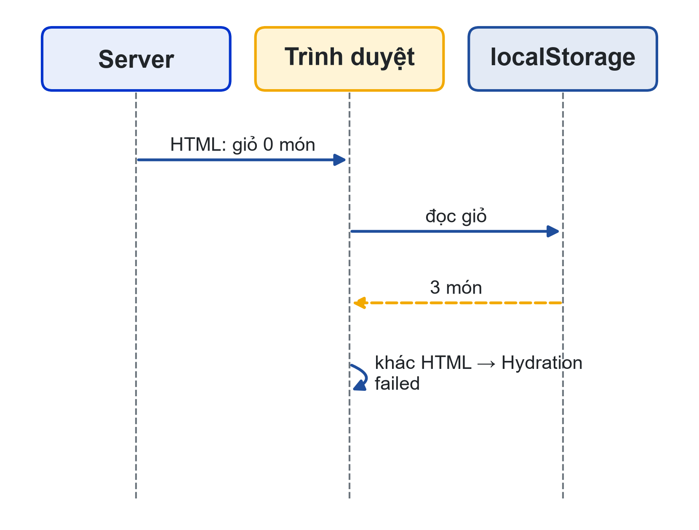
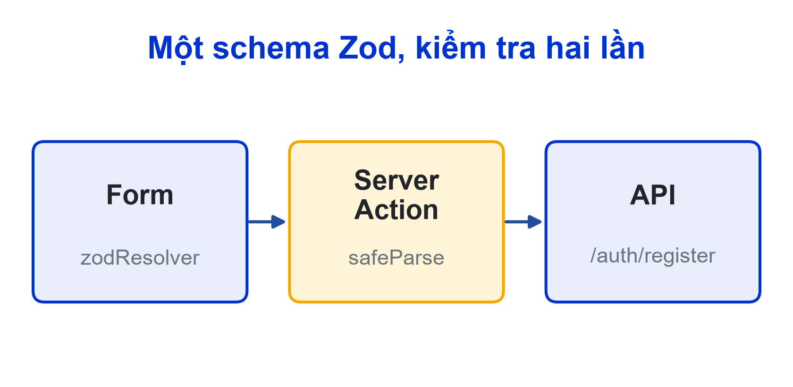

# Bài 04: Client Components, trạng thái & form
Sprint 2 · Người dùng & Tương tác

---

## Slide 1: Mục tiêu buổi học
**Nội dung chính**:
- Phân tích phần nào của trang chạy ở client
- Giỏ hàng có lưu trạng thái với Zustand
- Form kiểm tra dữ liệu ở cả client và server
- Ghi dữ liệu qua API mẫu, test case giá trị biên
**Ghi chú giảng viên**:
- 1 tiết lý thuyết, 4 tiết thực hành. CLO1, CLO2. Chuẩn bị token tài khoản thử trên /docs của API mẫu.

---

## Slide 2: Câu hỏi mở đầu
**Nội dung chính**:
- Thực đơn có món thật, nhưng khách chưa làm được gì
- Bấm thêm món, tải lại trang: giỏ còn không?
- Form đã kiểm tra ở trình duyệt, server có cần kiểm tra lại?

---

## Slide 3: "Đảo tương tác"
**Nội dung chính**:
- Trang chi tiết món: Server Component
- Chỉ nút "Thêm vào giỏ" là Client Component
- "use client" đặt ở lá, không đặt ở layout/page
- Props truyền xuống phải tuần tự hóa được
**Hoạt động**: Đánh dấu Server/Client cho 6 thành phần của trang giỏ hàng


---

## Slide 4: AddToCartButton
**Nội dung chính**:
```tsx
'use client';
export function AddToCartButton({ product }) {
  const add = useCart((s) => s.add);
  const soldOut = !product.isAvailable || product.stock === 0;
  return <button disabled={soldOut} onClick={() => add(product)}>
    {soldOut ? 'Hết món' : 'Thêm vào giỏ'}</button>;
}
```

---

## Slide 5: Store giỏ hàng
**Nội dung chính**:
- Zustand: một store chung cho nút, header, trang giỏ
- add: món trùng thì cộng dồn (US-C01)
- setQuantity: về 0 thì xóa (US-C02)
- persist: lưu localStorage, tải lại trang vẫn còn


---

## Slide 6: Lỗi hydration
**Nội dung chính**:
- Server không có localStorage → giỏ rỗng
- Trình duyệt đọc được giỏ 3 món
- Hai bản HTML khác nhau → "Hydration failed"
- Cách xử lý: cờ mounted, chỉ hiện số sau khi gắn vào trình duyệt


---

## Slide 7: Giá tiền ở đâu?
**Nội dung chính**:
- Giỏ chỉ lưu id, tên, giá để hiển thị
- Giá tính tiền: backend lấy từ CSDL lúc đặt
- Sửa localStorage không đổi được giá
- Không tin dữ liệu từ trình duyệt

---

## Slide 8: Một schema Zod, hai phía
**Nội dung chính**:
```ts
export const registerSchema = z.object({
  fullName: z.string().trim().min(2, 'Họ tên tối thiểu 2 ký tự'),
  email: z.string().email('Email không đúng định dạng'),
  password: z.string().min(8, 'Mật khẩu tối thiểu 8 ký tự'),
  confirm: z.string(),
}).refine((d) => d.password === d.confirm, { path: ['confirm'], ... });
```
---

## Slide 9: Form với React Hook Form
**Nội dung chính**:
- useForm + zodResolver(registerSchema)
- Lỗi dưới từng ô, tiếng Việt
- Lỗi từ server (409) ở vùng role="alert"
- Nút gửi bị vô hiệu khi đang gửi

---

## Slide 10: Server Action kiểm tra lại
**Nội dung chính**:
- 'use server': chạy trên server, gọi như hàm thường
- safeParse lại cùng schema
- Gọi POST /auth/register; 409 → "Email đã được sử dụng"
- Lý do: ai cũng tắt được JavaScript hoặc gửi request thẳng


---

## Slide 11: Đặt món qua API mẫu
**Nội dung chính**:
- POST /orders cần token: tạm lấy ở /docs, đọc qua getAccessToken()
- Bài 05 chỉ sửa hàm này để đọc cookie
- 409 → "Có món đã hết hoặc không đủ số lượng"
- Thành công: xóa giỏ, chuyển tới /orders/{id}

---

## Slide 12: Giá trị biên (CLO2)
**Nội dung chính**:
- Họ tên: 1 ký tự (sai), 2 ký tự (đạt)
- Mật khẩu: 7 (sai), 8 (đạt)
- Nhập lại khác 1 ký tự → báo không khớp
- Đặt quá tồn kho → 409, giỏ còn nguyên
**Hoạt động**: Mỗi nhóm viết bảng giá trị biên cho form của đề tài

---

## Slide 13: Lỗi AI hay mắc
**Nội dung chính**:
- "use client" ở page.tsx
- Lưu token hoặc giá vào localStorage rồi gửi lên
- Chỉ kiểm tra ở client, Server Action không kiểm tra
- Dùng useEffect gọi API thay vì Server Component

---

## Slide 14: Thực hành
**Nội dung chính**:
- **Có hướng dẫn**: giỏ hàng, /register, /checkout, TC-11…TC-17
- **Không hướng dẫn**: form "Góp ý căn tin" + 8 test case biên
- **Nhóm**: form chính của web nhóm, sơ đồ Server/Client, test case

---

## Slide 15: Tổng kết
**Nội dung chính**:
- Client Component nhỏ nhất có thể
- Store chung + persist, cẩn thận hydration
- Kiểm tra ở client cho trải nghiệm, ở server cho an toàn
- Buổi sau: đăng nhập, phân quyền, bảo mật web

---

## Slide 16: Tài liệu của buổi
**Đọc thêm**:
- SRS LHU Food: tiêu chí US-G04, C01, C02, C04; mục 8 (định dạng lỗi)
- Kế hoạch Agile: story Sprint 2, tiêu chí Given-When-Then
- Next.js: Server and Client Components; Zustand; React Hook Form; Zod
**Ghi chú giảng viên**:
- Nhắc sinh viên không commit .env.local chứa token tạm.
