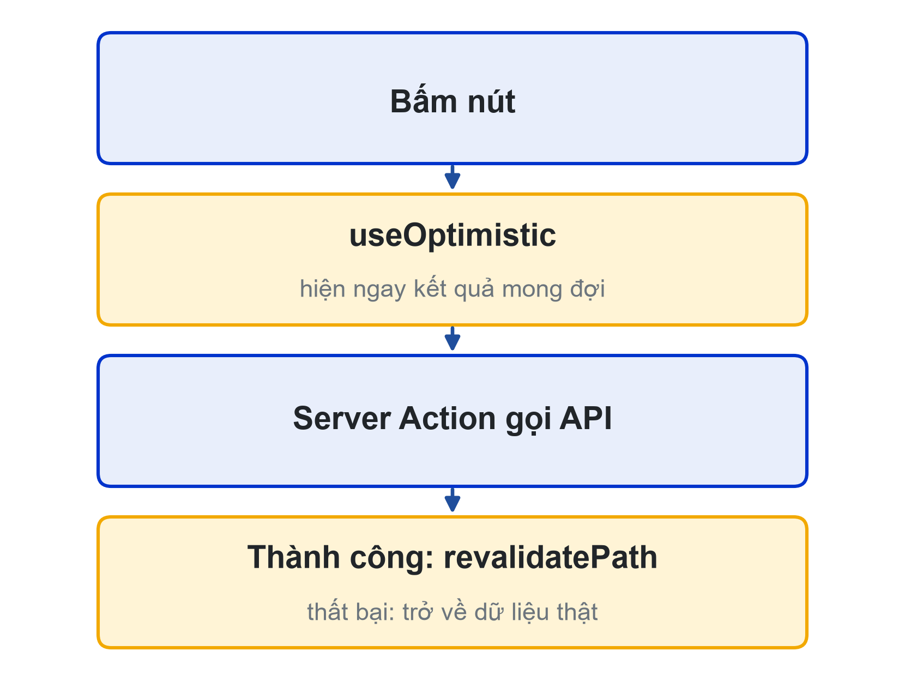
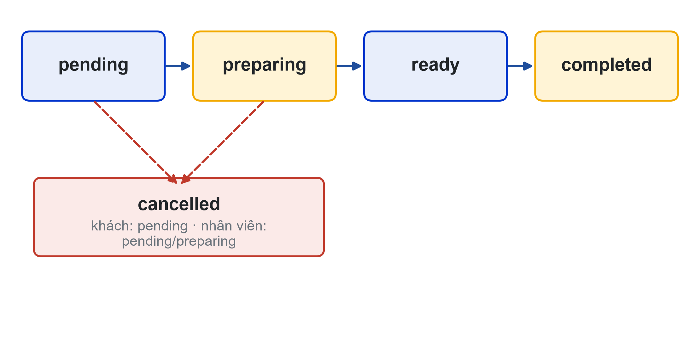
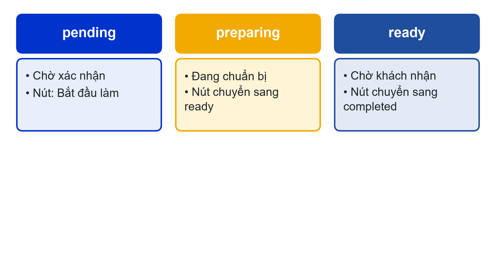
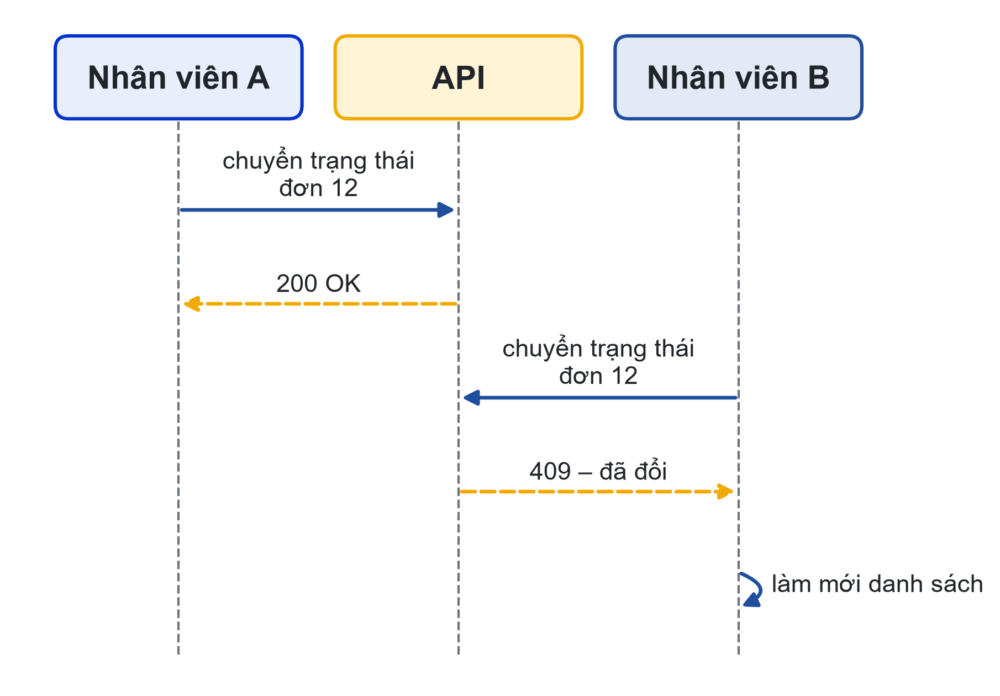

# Bài 06: Server Actions, bảng dữ liệu & màn hình quầy
Sprint 2 · Checkpoint Sprint 2

---

## Slide 1: Mục tiêu buổi học
**Nội dung chính**:
- Ghi dữ liệu bằng Server Actions
- Bảng dữ liệu có lọc, sắp xếp, phân trang
- Màn hình quầy đúng trình tự nghiệp vụ
- Kiểm thử luồng, báo cáo Sprint 2, velocity
**Ghi chú giảng viên**:
- 1 tiết lý thuyết, 4 tiết thực hành. CLO1–CLO4. Cuối buổi là Checkpoint Sprint 2.

---

## Slide 2: Câu hỏi mở đầu
**Nội dung chính**:
- 11 giờ 30, 20 đơn chờ
- Hai nhân viên cùng bấm một đơn
- Khách hủy khi bếp đã nấu xong
- Màn hình quầy xử lý thế nào?

---

## Slide 3: Server Actions
**Nội dung chính**:
- Hàm async có 'use server', gọi từ form hoặc Client Component
- Không cần tự viết Route Handler cho mỗi thao tác ghi
- Mỗi Server Action là endpoint công khai
- Luôn kiểm tra quyền và dữ liệu bên trong

---

## Slide 4: advanceStatus
**Nội dung chính**:
```ts
export async function advanceStatus(orderId, status) {
  await requireRole('staff', 'admin');
  try { await apiAuth(`/orders/${orderId}/status`, { method: 'PATCH', ... }); }
  catch (e) { if (e.status === 409) return { ok: false, message: '...' }; }
  finally { revalidatePath('/admin/orders'); }
}
```

---

## Slide 5: useActionState và useOptimistic
**Nội dung chính**:
- useActionState → [state, formAction, isPending]
- revalidatePath: trang vẽ lại với dữ liệu mới
- useOptimistic: hiện ngay kết quả mong đợi
- Thất bại: giao diện trở về dữ liệu thật


---

## Slide 6: Bảng món cho nhân viên
**Nội dung chính**:
- includeUnavailable=true: thấy cả món ngừng bán
- Lọc, trang trong URL: ?q=com&page=2
- Server Component gọi API đúng trang
- TanStack Table: hiển thị và sắp xếp cột

---

## Slide 7: Phân trang không có tổng số
**Nội dung chính**:
- API trả mảng, không trả tổng
- Còn trang sau khi số phần tử = pageSize
- Nút bật/tắt "còn bán": Server Action + revalidatePath (US-S04)

---

## Slide 8: Trạng thái đơn (BR-15)
**Nội dung chính**:
- Sai trình tự: API trả 409
**Hoạt động**: Vẽ sơ đồ trạng thái cho thực thể chính của đề tài nhóm


---

## Slide 9: Màn hình quầy
**Nội dung chính**:
- GET /orders/staff: đơn pending, preparing, ready trong ngày
- Ba cột theo trạng thái, lọc ?status= (US-S06)
- OrderCard: nút theo trạng thái kế tiếp
- Trạng thái bằng chữ, không chỉ bằng màu


---

## Slide 10: Hủy đơn và xung đột
**Nội dung chính**:
- Hủy kèm lý do ≥ 3 ký tự (US-S07)
- Hai người cùng bấm: người sau nhận 409, danh sách làm mới
- Tạm làm mới mỗi 15 giây bằng router.refresh()
- Bài 09: Socket.IO, đơn mới hiện ngay


---

## Slide 11: Test luồng nghiệp vụ (CLO2)
**Nội dung chính**:
- TC-31 khách đặt → đơn hiện ở "Chờ xác nhận" kèm ghi chú
- TC-32 "Bắt đầu làm" → khách thấy "Đang chuẩn bị"
- TC-33 khách hủy đơn preparing → 409
- TC-34 hai nhân viên cùng bấm → người sau được báo
- TC-35 hủy kèm lý do → khách thấy lý do, tồn kho hoàn lại

---

## Slide 12: Velocity (CLO4)
**Nội dung chính**:
- Story point thật sự hoàn thành, đạt Definition of Done
- So cam kết và hoàn thành của Sprint 1, 2
- Sprint 3 chuyển sang backend nhóm: tính thêm việc backend
- Cam kết không vượt trung bình velocity

---

## Slide 13: Báo cáo Sprint 2 (CLO3)
**Nội dung chính**:
- Cấu trúc 6 mục như Sprint 1
- Thêm ma trận phân quyền, kết quả test bảo mật
- Sơ đồ trạng thái có số hình, chú thích
- Đúng quy định định dạng ở trang Đánh giá

---

## Slide 14: Checkpoint Sprint 2
**Nội dung chính**:
- Demo: khách đặt trên web → nhân viên xử lý → khách thấy trạng thái
- Ma trận phân quyền, sơ đồ trạng thái, sơ đồ thành phần (CLO1)
- Test case form, phân quyền, luồng + kết quả (CLO2)
- Báo cáo Sprint 2 (CLO3); kế hoạch Sprint 3, bản nháp báo cáo vai trò cá nhân (CLO4)

---

## Slide 15: Tổng kết
**Nội dung chính**:
- Server Action: kiểm tra quyền, dữ liệu, revalidate
- Bảng dữ liệu: bộ lọc trong URL
- Màn hình quầy: đúng trình tự, xử lý xung đột
- Buổi sau: Sprint 3, module quản trị trên backend nhóm

---

## Slide 16: Tài liệu của buổi
**Đọc thêm**:
- SRS LHU Food: tiêu chí US-S02, S03, S04, S06, S07, C08; BR-15
- Kế hoạch Agile: velocity, release burndown, story Sprint 3
- Next.js: Updating Data; React: useOptimistic; TanStack Table
**Ghi chú giảng viên**:
- Chấm checkpoint theo đủ 4 sản phẩm; nhắc nhóm chuẩn bị backend riêng cho Sprint 3.
