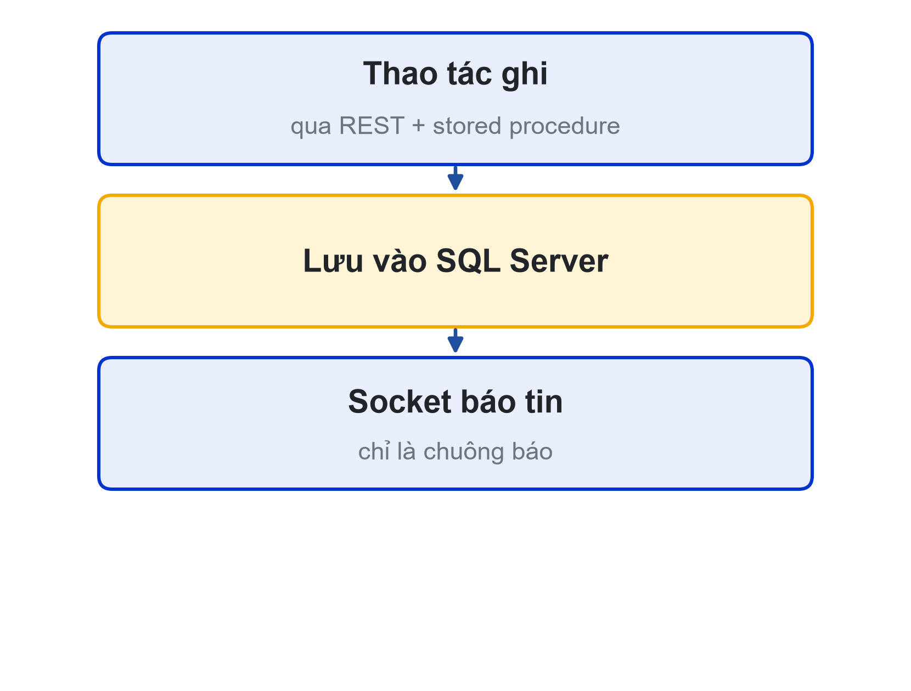
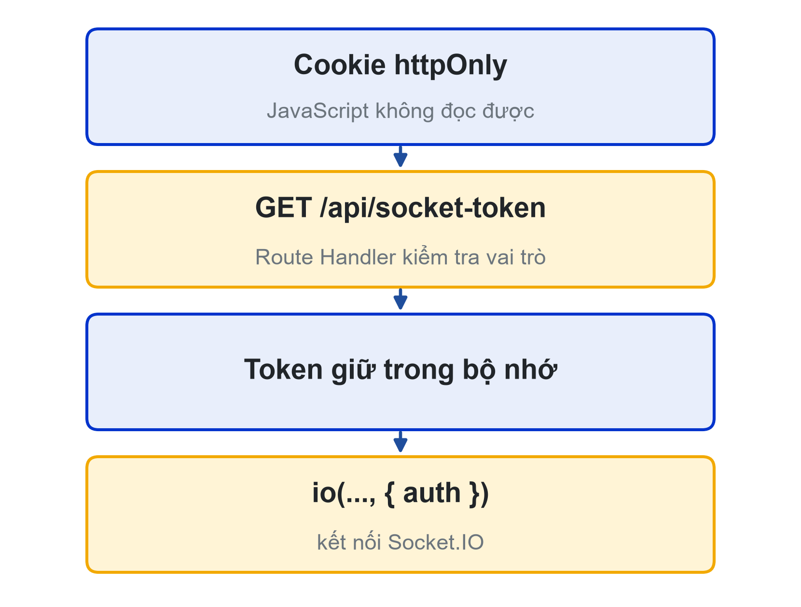
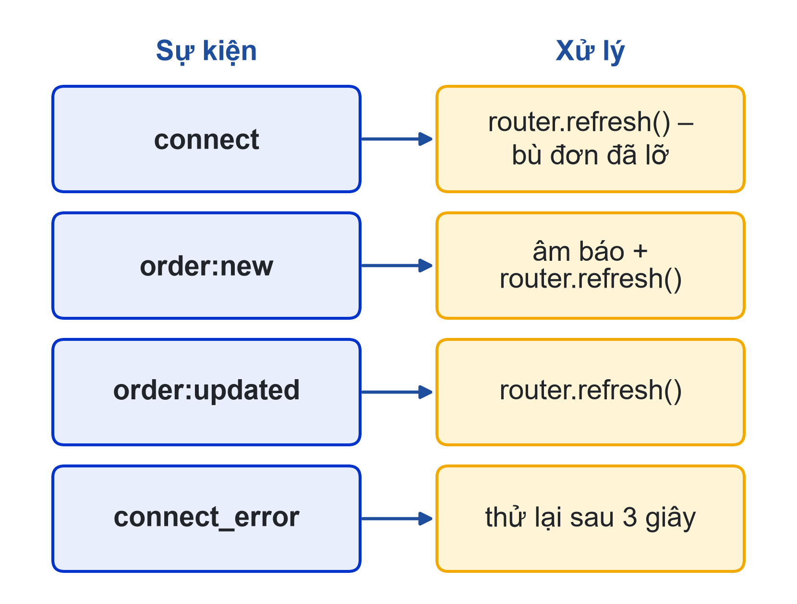
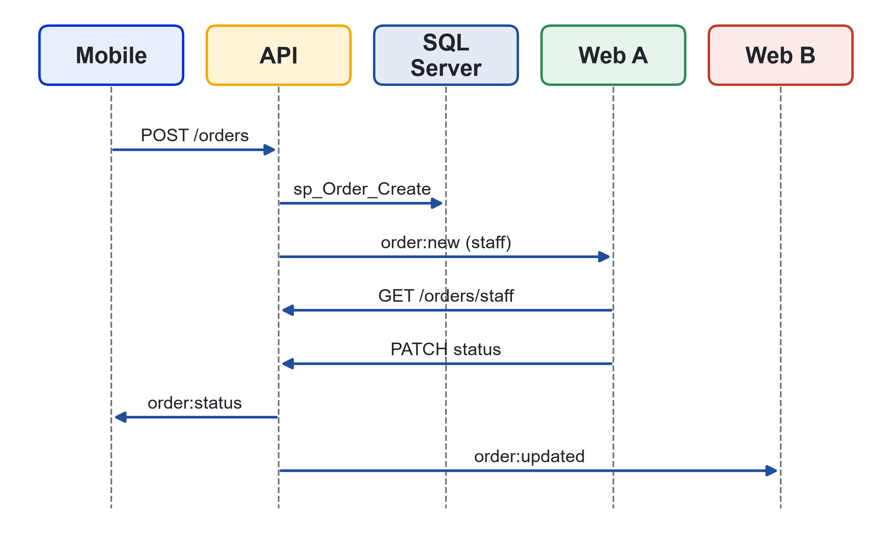

# Bài 09: Màn hình quầy thời gian thực với Socket.IO
Sprint 3 · Checkpoint Sprint 3

---

## Slide 1: Mục tiêu buổi học
**Nội dung chính**:
- Socket.IO trong Client Component có xác thực
- Kết nối lại, token hết hạn
- Sơ đồ tuần tự web – mobile – backend
- Kiểm thử realtime, báo cáo Sprint 3, kế hoạch Sprint 4
**Ghi chú giảng viên**:
- 1 tiết lý thuyết, 4 tiết thực hành. CLO1–CLO4. Cuối buổi là Checkpoint Sprint 3.

---

## Slide 2: Câu hỏi mở đầu
**Nội dung chính**:
- Màn hình quầy tải lại 15 giây một lần
- Giờ cao điểm: 15 giây = ba sinh viên đứng chờ
- Mục tiêu: dưới 1 giây, có tiếng "ting"

---

## Slide 3: Hai quy tắc giữ nguyên
**Nội dung chính**:
- Socket chỉ để báo tin
- Thao tác ghi vẫn qua REST và stored procedure
- Lưu trước, gửi sau
- Như Chương 9 giáo trình di động


---

## Slide 4: Khác biệt trên web
**Nội dung chính**:
- Socket chỉ tạo trong Client Component, trong useEffect
- Token trong cookie httpOnly: JS không đọc được
- Xin token qua /api/socket-token, giữ trong bộ nhớ
- Bị từ chối (connect_error): không tự kết nối lại


---

## Slide 5: Route Handler cấp token
**Nội dung chính**:
```ts
export async function GET() {
  const user = await getCurrentUser();
  if (!user || !['staff', 'admin'].includes(user.role))
    return Response.json({}, { status: 401 });
  return Response.json({ token: await getAccessToken() });
}
```
- Thêm vào matcher của proxy để token được làm mới

---

## Slide 6: Kết nối với auth dạng hàm
**Nội dung chính**:
```ts
const socket = io(process.env.NEXT_PUBLIC_SOCKET_URL!, {
  transports: ['websocket'],
  auth: (cb) => fetch('/api/socket-token')
    .then((r) => r.json()).then((d) => cb({ token: d.token })),
});
```
- Gọi lại ở mỗi lần kết nối lại → luôn có token mới

---

## Slide 7: Lắng nghe sự kiện
**Nội dung chính**:
- connect → router.refresh(): bù đơn đã lỡ
- order:new → âm báo + router.refresh()
- order:updated → router.refresh(): đồng bộ nhiều nhân viên
- connect_error → thử lại sau 3 giây


---

## Slide 8: Socket là chuông báo
**Nội dung chính**:
- Dữ liệu luôn lấy lại từ API
- Không chèn thẳng dữ liệu sự kiện vào danh sách
- Một nguồn sự thật: SQL Server qua API
**Hoạt động**: Thảo luận khi nào có thể dùng dữ liệu trong sự kiện

---

## Slide 9: Trải nghiệm nhân viên
**Nội dung chính**:
- Nút "Bật âm báo": trình duyệt chặn tự phát âm thanh
- Trạng thái kết nối bằng chữ, aria-live
- Strict Mode: kết nối rồi ngắt một lần khi dev là bình thường

---

## Slide 10: Backend nhóm cần bổ sung
**Nội dung chính**:
- admin cũng vào room staff
- toStaff('order:updated') sau đổi trạng thái, hủy đơn
- CORS cho địa chỉ web
- Cùng JWT_SECRET cho REST và socket

---

## Slide 11: Sơ đồ tuần tự (CLO1)
**Nội dung chính**:


---

## Slide 12: Test realtime (CLO2)
**Nội dung chính**:
- TC-51 khách đặt trên điện thoại → hai cửa sổ quầy hiện đơn ≤ 2 giây
- TC-52 nhân viên A đổi trạng thái → cửa sổ B tự cập nhật
- TC-53 mất mạng 30 giây → có lại thì hiện đơn đã lỡ
- TC-54 token hết hạn → kết nối lại không phải đăng nhập
- TC-55, 56 token customer / token sai → không vào room staff

---

## Slide 13: Báo cáo Sprint 3 (CLO3)
**Nội dung chính**:
- Phân tích module quản trị, ERD quản trị
- Danh mục stored procedure
- Sơ đồ tuần tự realtime (số hình, chú thích)
- Kết quả hồi quy trên backend nhóm

---

## Slide 14: Kế hoạch Sprint 4 (CLO4)
**Nội dung chính**:
- Sprint cuối: kiểm thử tự động, triển khai, báo cáo, Demo Day
- Velocity ba sprint → phạm vi phát hành
- Bỏ story "Could" nếu không đủ năng lực
- Dành thời gian sửa lỗi và viết báo cáo

---

## Slide 15: Checkpoint Sprint 3
**Nội dung chính**:
- Demo quản trị + quầy realtime, web và mobile cùng backend
- Phân tích quản trị, ERD, danh mục thủ tục, sơ đồ tuần tự (CLO1)
- Test quản trị, realtime, hồi quy + kết quả (CLO2)
- Báo cáo Sprint 3 (CLO3); kế hoạch Sprint 4, báo cáo vai trò cá nhân (CLO4)

---

## Slide 16: Tổng kết
**Nội dung chính**:
- Socket trong Client Component, token xin từ server
- Kết nối lại thì làm mới dữ liệu
- Kiểm thử realtime cần nhiều phiên
- Buổi sau: Sprint 4, kiểm thử tự động, hiệu năng, accessibility

---

## Slide 17: Tài liệu của buổi
**Đọc thêm**:
- SRS LHU Food: US-S02, S03, US-SYS01; F08.1, F09.1–F09.2
- Giáo trình di động: Chương 9 (Socket.IO trong NestJS)
- Socket.IO: use with Next.js, client options (auth); MDN Web Audio API
**Ghi chú giảng viên**:
- Chuẩn bị một điện thoại cài ứng dụng của nhóm để demo TC-51; chấm checkpoint theo đủ 4 sản phẩm.
