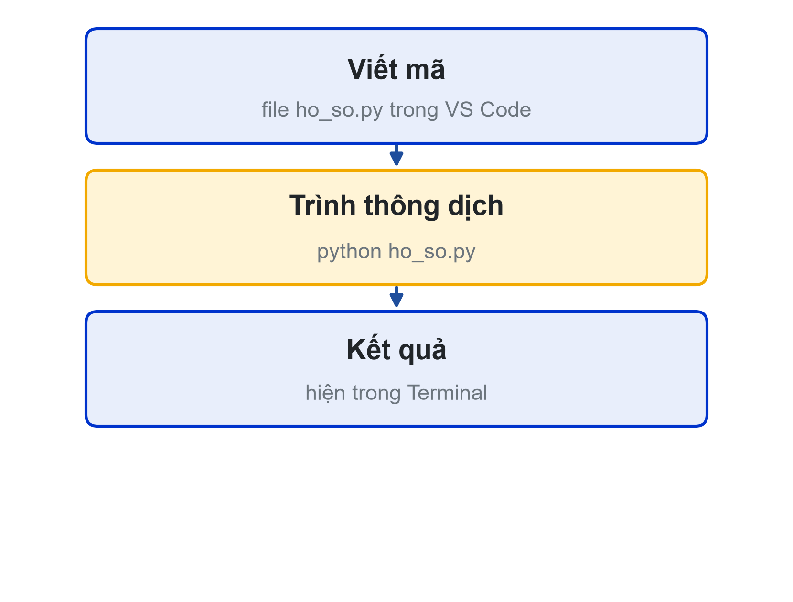
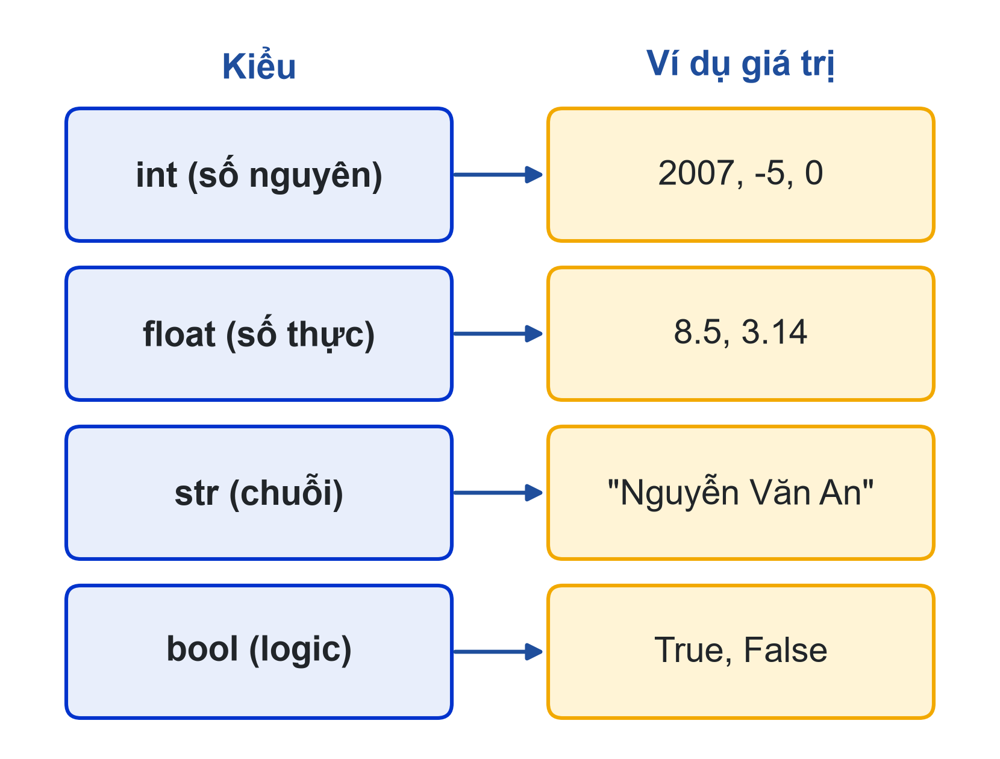
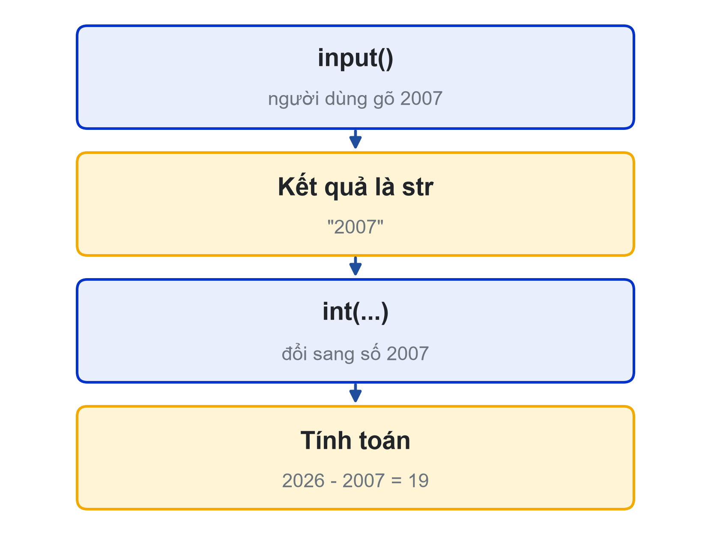

# Bài 01: Làm quen Python và tư duy Input – Process – Output
Nghĩ trước, code sau: chương trình đầu tiên của Student Dashboard

---

## Slide 1: Mục tiêu buổi học
**Nội dung chính**:
- Cài đặt Python 3 và VS Code, chạy chương trình đầu tiên
- Phân tích bài toán thành Input – Process – Output
- Khai báo biến với 4 kiểu: int, float, str, bool
- Nhập, xuất dữ liệu bằng input(), print() và f-string
**Ghi chú giảng viên**:
- 1,5 tiết lý thuyết, 3,5 tiết thực hành. CLO1, CLO2.
- Phổ biến luôn quy định điểm cộng truyền thông (trang Đánh giá học phần).

---

## Slide 2: Câu hỏi mở đầu
**Nội dung chính**:
- Phòng Đào tạo cần in 3.000 thẻ hồ sơ tân sinh viên
- Làm tay: cả tuần. Chương trình 10 dòng: vài giây
- Nhưng trước hết phải biết: nhận vào gì? xử lý gì? in ra gì?
**Hoạt động**: Mỗi bàn liệt kê các thông tin cần có trên một thẻ hồ sơ.
**Ghi chú giảng viên**:
- Gom ý kiến lên bảng, phân loại thành thông tin nhập vào và thông tin tính ra (tuổi).

---

# Phần 1: Chương trình và Python

---

## Slide 3: Chương trình là gì?
**Nội dung chính**:
- Dãy lệnh viết bằng ngôn ngữ lập trình, máy tính làm đúng thứ tự
- Máy tính không đoán ý: thiếu một dấu ngoặc là báo lỗi
- Python: ngôn ngữ thông dịch, cú pháp gần tiếng Anh
- Dùng nhiều trong dữ liệu, AI, tự động hóa


---

## Slide 4: Cài đặt môi trường
**Nội dung chính**:
- python.org/downloads: Python 3.10 trở lên
- Windows: tick "Add python.exe to PATH" khi cài
- VS Code + extension Python (Microsoft)
- Kiểm tra: python --version (hoặc py --version)
**Ghi chú giảng viên**:
- Đi từng máy kiểm tra trong 15 phút đầu. Máy lỗi PATH: dùng lệnh py hoặc cài lại, chọn Modify.

---

## Slide 5: Chương trình đầu tiên
**Nội dung chính**:
- Tạo file hello.py, bấm ▶ Run Python File
```python
print("Hello, LHU!")
```
- Chế độ tương tác: gõ python, dấu nhắc >>>, thử 2026 - 2007
- Thoát chế độ tương tác: exit()

---

# Phần 2: Tư duy Input – Process – Output

---

## Slide 6: Ba câu hỏi trước khi code
**Nội dung chính**:
- Input: cần những dữ liệu nào?
- Process: tính toán, so sánh gì?
- Output: in ra gì, theo dạng nào?


---

## Slide 7: Vì sao phải viết bảng IPO?
**Nội dung chính**:
- Phát hiện thiếu dữ liệu ngay từ đầu: muốn in tuổi thì phải hỏi năm sinh
- Chia bài toán thành phần nhỏ, dễ code từng phần
- Là mô tả rõ ràng để hỏi AI đúng trọng tâm
**Hoạt động**: Viết bảng IPO cho bài toán "tính tiền gửi xe theo số giờ".

---

# Phần 3: Biến và kiểu dữ liệu

---

## Slide 8: Biến và phép gán
**Nội dung chính**:
- Biến: tên gắn với một giá trị; dấu = là phép gán
```python
ho_ten = "Nguyễn Văn An"     # str
nam_sinh = 2007              # int
diem_tb = 8.25               # float
la_tan_sinh_vien = True      # bool
print(type(nam_sinh))        # <class 'int'>
```

---

## Slide 9: Bốn kiểu dữ liệu cơ bản
**Nội dung chính**:
- int, float, str, bool
- type(x) cho biết kiểu của x
- Chuyển kiểu: int("2007"), float("8.5"), str(19)


---

## Slide 10: Đặt tên biến
**Nội dung chính**:
- Chỉ gồm chữ, số, gạch dưới; không bắt đầu bằng số
- Phân biệt hoa thường: diem khác Diem
- Không trùng từ khóa: if, for, while...
- Tên có nghĩa, kiểu snake_case: nam_sinh, không phải ns hay x1
**Hoạt động**: Tên nào hợp lệ: 2nam, nam-sinh, nam_sinh, for?

---

# Phần 4: Nhập, xuất và f-string

---

## Slide 11: input() luôn trả về chuỗi
**Nội dung chính**:
- Người dùng gõ 2007, chương trình nhận "2007"
- Muốn tính toán phải đổi kiểu: int(input(...))
- "2007" + 1 gây lỗi TypeError


---

## Slide 12: Student Dashboard v1: thẻ hồ sơ
**Nội dung chính**:
```python
ho_ten = input("Họ tên: ")
nam_sinh = int(input("Năm sinh: "))
lop = input("Lớp: ")
tuoi = 2026 - nam_sinh
print("=" * 36)
print(f"  HỒ SƠ SỐ HÓA: {ho_ten}")
print(f"  Lớp: {lop}  |  Tuổi: {tuoi}")
print("=" * 36)
```
**Ghi chú giảng viên**:
- Yêu cầu sinh viên gõ tay, không sao chép. Hỏi: bỏ chữ f thì in ra gì?

---

## Slide 13: Dùng AI đúng cách
**Nội dung chính**:
- AI là trợ giảng: giải thích, gợi ý, tìm lỗi. Bạn là người viết code
- Prompt tốt = bối cảnh + câu hỏi cụ thể + giới hạn
- Ví dụ: "Tôi mới học Python buổi đầu. Giải thích dòng print(f"Tuổi: {tuoi}"). Đừng viết thêm code."
- Ghi mọi prompt vào nhat-ky-prompt.md: prompt, AI trả lời, mình kiểm tra gì

---

## Slide 14: Thực hành
**Nội dung chính**:
- Có hướng dẫn: kiểm tra cài đặt, hello.py, cố ý gõ sai để đọc lỗi, gõ ho_so.py
- Tự làm: thêm MSSV, quê quán, chiều cao (float), ở ký túc xá (bool)
- Nộp: ho_so.py, bảng IPO, Nhật ký Prompt (2–3 prompt)
**Ghi chú giảng viên**:
- Link nộp bài: {{LINK_NOP_BAI_01}}.

---

## Slide 15: Tóm tắt
**Nội dung chính**:
- Nghĩ trước, code sau: viết bảng Input – Process – Output
- 4 kiểu cơ bản: int, float, str, bool; dùng type() để kiểm tra
- input() trả về chuỗi, nhớ int() hoặc float() trước khi tính
- f-string chèn giá trị biến vào chuỗi; AI giúp giải thích, bạn tự viết
**Hoạt động**: Làm quiz luyện tập Bài 01 trên trang bài học trước buổi 02.
