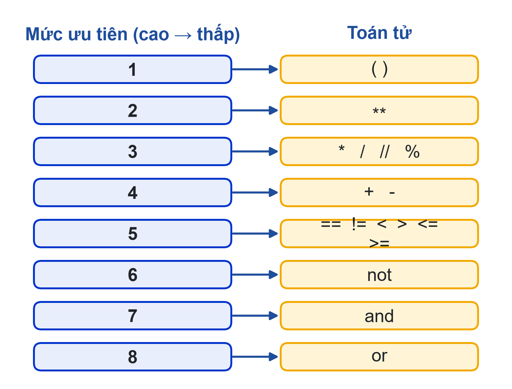
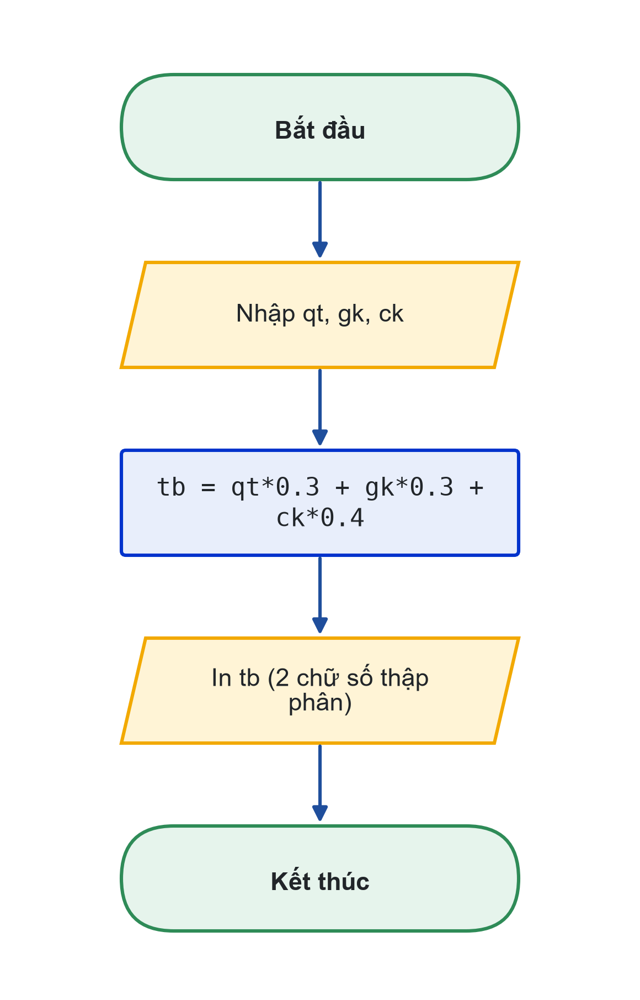

# Bài 02: Toán tử, biểu thức và bài toán tính toán
Viết công thức đúng: thứ tự ưu tiên, dấu ngoặc và sai số số thực

---

## Slide 1: Mục tiêu buổi học
**Nội dung chính**:
- Dùng toán tử số học, so sánh, logic, gán kết hợp
- Tính một biểu thức theo đúng thứ tự ưu tiên
- Làm tròn, định dạng số; hiểu sai số số thực
- Viết chương trình tính toán từ bảng IPO
**Ghi chú giảng viên**:
- 1,5 tiết lý thuyết, 3,5 tiết thực hành. CLO1, CLO2.

---

## Slide 2: Câu hỏi mở đầu
**Nội dung chính**:
- Quá trình 8, giữa kỳ 7, cuối kỳ 9 (trọng số 30-30-40)
- Điểm học phần là 8,0 hay 8,1?
- Sai một dấu ngoặc: chương trình tính sai cho cả lớp, không báo lỗi
**Hoạt động**: Cả lớp tự tính trên giấy rồi so kết quả.
**Ghi chú giảng viên**:
- Đáp án 8 × 0,3 + 7 × 0,3 + 9 × 0,4 = 8,1.

---

# Phần 1: Toán tử số học

---

## Slide 3: Bảy toán tử số học
**Nội dung chính**:
- + − * : cộng, trừ, nhân
- / : chia, luôn ra số thực: 7 / 2 = 3.5
- // : chia lấy phần nguyên: 7 // 2 = 3
- % : chia lấy phần dư: 7 % 2 = 1
- ** : lũy thừa: 2 ** 10 = 1024

---

## Slide 4: Ví dụ: đổi phút sang giờ
**Nội dung chính**:
```python
tong_phut = int(input("Số phút: "))
gio = tong_phut // 60
phut = tong_phut % 60
print(f"{tong_phut} phút = {gio} giờ {phut} phút")
```
- 135 phút → 2 giờ 15 phút
- Tách chữ số: 2007 % 10 = 7, 2007 // 10 = 200

---

# Phần 2: Thứ tự ưu tiên

---

## Slide 5: Python tính theo thứ tự nào?
**Nội dung chính**:
- Ngoặc → ** → * / // % → + − → so sánh → not → and → or
- Cùng mức: tính từ trái sang phải
- Không chắc thì thêm ngoặc


---

## Slide 6: Tính từng bước một biểu thức
**Nội dung chính**:
- 2 + 3 * 4 ** 2 // 5 = ?
- ** trước, rồi * và // từ trái sang phải, cuối cùng +

**Hoạt động**: Hỏi AI trình bày từng bước, đối chiếu với cách tính của bạn.

---

## Slide 7: Lỗi hay gặp
**Nội dung chính**:
- 8 + 9 / 2 = 12.5, không phải trung bình của 8 và 9
- Đúng: (8 + 9) / 2 = 8.5
- Code chạy không lỗi nhưng kết quả sai: lỗi logic, khó phát hiện nhất
**Ghi chú giảng viên**:
- Nhấn mạnh: luôn tính tay một bộ dữ liệu để đối chiếu với kết quả chương trình.

---

# Phần 3: So sánh, logic, gán kết hợp

---

## Slide 8: So sánh và logic
**Nội dung chính**:
- So sánh: == != < > <= >= cho True/False
- Đừng nhầm == (so sánh) với = (gán)
- Logic: and, or, not
- So sánh nối: 0 <= diem <= 10
```python
diem = 8.5
hop_le = 0 <= diem <= 10            # True
du_hoc_bong = diem >= 8 and hop_le  # True
```

---

## Slide 9: Gán kết hợp
**Nội dung chính**:
- tong += 5 nghĩa là tong = tong + 5
- Tương tự: -=, *=, /=
- tong = 10; tong += 5; tong *= 2 → tong = 30
**Hoạt động**: Đoán giá trị cuối của x sau x = 3; x **= 2; x -= 4.

---

# Phần 4: Làm tròn và định dạng số

---

## Slide 10: Làm tròn và định dạng
**Nội dung chính**:
- round(x, 2): làm tròn giá trị
- f"{x:.2f}": chỉ định dạng khi in
- f"{tien:,}": 315000 → 315,000
- Kiểu Việt Nam: f"{tien:,}".replace(",", ".") → 315.000

---

## Slide 11: Sai số số thực
**Nội dung chính**:
- 0.1 + 0.2 cho 0.30000000000000004
- Số thực lưu ở hệ nhị phân nên có sai số nhỏ
- Không so sánh hai số thực bằng ==
- In kết quả với :.2f
**Ghi chú giảng viên**:
- Cho sinh viên gõ thử trong chế độ tương tác. Tài liệu: Python Tutorial, mục Floating-Point Arithmetic.

---

## Slide 12: Ví dụ: tiền điện theo bậc
**Nội dung chính**:
- Bảng giá giả định: 50 kWh đầu 2.000 đ, 50 kWh tiếp 2.500 đ, còn lại 3.000 đ
```python
kwh = int(input("Số kWh tiêu thụ: "))
bac1 = min(kwh, 50)
bac2 = min(max(kwh - 50, 0), 50)
bac3 = max(kwh - 100, 0)
tien = bac1 * 2000 + bac2 * 2500 + bac3 * 3000
print(f"Tiền điện: {tien:,} đồng")
```
**Ghi chú giảng viên**:
- 130 kWh → 315,000 đồng. Bảng giá là giả định cho bài tập, không phải giá điện thực tế.

---

## Slide 13: Student Dashboard v2: điểm học phần

**Ghi chú giảng viên**:
- Input: qt, gk, ck. Process: tb = qt×0,3 + gk×0,3 + ck×0,4, kiểm tra cả ba điểm trong 0–10.
- Output: điểm học phần, 2 chữ số thập phân. Nhập 8, 7, 9 cho 8.10.

---

## Slide 14: Thực hành
**Nội dung chính**:
- Có hướng dẫn: tính tay 5 biểu thức rồi kiểm tra; đổi phút; tiền điện với 40, 100, 130 kWh
- Tự làm: Student Dashboard v2; đổi °C sang °F; tổng các chữ số của số có 3 chữ số
- Nộp: 3 file .py, bảng IPO từng bài, Nhật ký Prompt
**Ghi chú giảng viên**:
- Link nộp bài: {{LINK_NOP_BAI_02}}.

---

## Slide 15: Tóm tắt
**Nội dung chính**:
- / ra số thực, // lấy phần nguyên, % lấy phần dư
- Thứ tự ưu tiên: ngoặc → ** → * / // % → + −; không chắc thì thêm ngoặc
- So sánh cho True/False; and, or, not; tong += 5
- In số với :.2f và :, ; không so sánh số thực bằng ==
