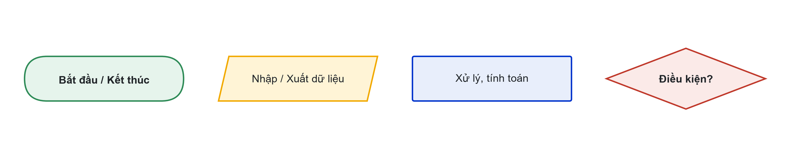
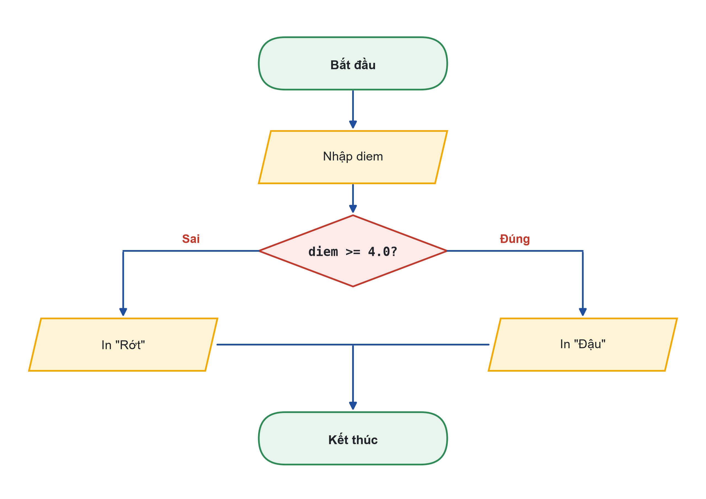
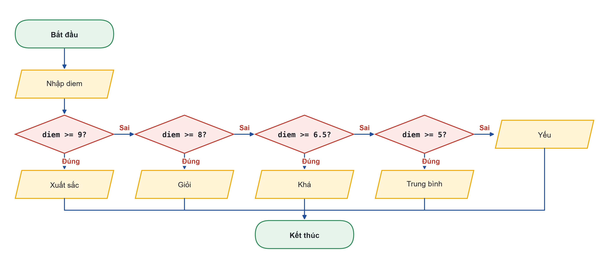
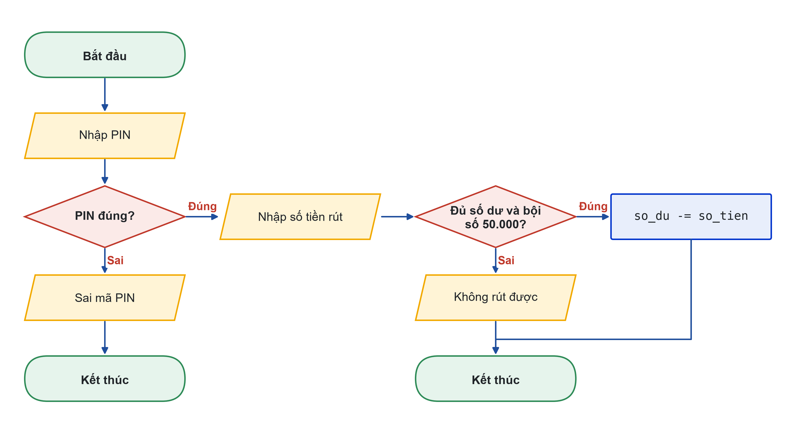

# Bài 03: Cấu trúc rẽ nhánh if – elif – else và lưu đồ thuật toán
Vẽ hết các nhánh trước, rồi mới viết code

---

## Slide 1: Mục tiêu buổi học
**Nội dung chính**:
- Vẽ lưu đồ thuật toán đúng ký hiệu trên Draw.io
- Viết if, if-else, if-elif-else và rẽ nhánh lồng nhau
- Dùng điều kiện kết hợp với and, or
- Kiểm thử bằng các giá trị biên
**Ghi chú giảng viên**:
- 1,5 tiết lý thuyết, 3,5 tiết thực hành. CLO1, CLO2 (lưu đồ là minh chứng CLO2).

---

## Slide 2: Câu hỏi mở đầu
**Nội dung chính**:
- ATM chỉ cho rút khi: PIN đúng, đủ số dư, bội số 50.000
- Thiếu một điều kiện, hoặc kiểm tra sai thứ tự, ngân hàng mất tiền
- Làm sao mô tả các lựa chọn này cho rõ trước khi code?
**Hoạt động**: Mỗi nhóm liệt kê các tình huống có thể xảy ra khi rút tiền.

---

# Phần 1: Lưu đồ thuật toán

---

## Slide 3: Bốn ký hiệu cơ bản

**Ghi chú giảng viên**:
- Bốn ký hiệu: bắt đầu/kết thúc (bo tròn), nhập/xuất (bình hành), xử lý (chữ nhật), điều kiện (hình thoi).
- Mũi tên chỉ thứ tự thực hiện; hình thoi có hai lối ra Đúng / Sai.

---

## Slide 4: Vẽ trên Draw.io
**Nội dung chính**:
- app.diagrams.net hoặc extension Draw.io Integration trong VS Code
- Dùng nhóm hình Flowchart ở thanh bên trái
- Ghi Đúng/Sai trên mũi tên ra khỏi hình thoi
- Xuất ảnh: File → Export as → PNG
**Ghi chú giảng viên**:
- Demo trực tiếp lưu đồ kiểm tra số chẵn lẻ (n % 2 == 0) trong 5 phút.

---

# Phần 2: if và if-else

---

## Slide 5: Lưu đồ đậu / rớt

**Ghi chú giảng viên**:
- Một điều kiện, hai nhánh. Ngưỡng 4,0 dùng làm ví dụ.
- Cho lớp chỉ đường đi trên lưu đồ với điểm 3,5 và 7.

---

## Slide 6: if-else và thụt lề
**Nội dung chính**:
```python
diem = float(input("Điểm học phần: "))

if diem >= 4.0:
    print("Đậu")
else:
    print("Rớt, đăng ký học lại")
print("Kết thúc chương trình")   # luôn chạy
```
- Sau dấu : là khối lệnh thụt vào 4 dấu cách
- Thụt sai: IndentationError hoặc chạy sai nhánh

---

# Phần 3: if-elif-else nhiều nhánh

---

## Slide 7: Lưu đồ xếp loại học lực

**Ghi chú giảng viên**:
- Kiểm tra từ trên xuống, gặp điều kiện đúng đầu tiên thì dừng.
- Thang ví dụ, không phải quy chế của Trường.

---

## Slide 8: Code xếp loại
**Nội dung chính**:
```python
if diem >= 9:
    xep_loai = "Xuất sắc"
elif diem >= 8:
    xep_loai = "Giỏi"
elif diem >= 6.5:
    xep_loai = "Khá"
elif diem >= 5:
    xep_loai = "Trung bình"
else:
    xep_loai = "Yếu"
```

---

## Slide 9: Thứ tự điều kiện và giá trị biên
**Nội dung chính**:
- Đặt if diem >= 5 lên đầu: điểm 9,5 cũng thành "Trung bình"
- Kiểm thử đúng ở ngưỡng: 9; 8,99; 8; 6,5; 6,49; 5; 4,99
- Thêm một giá trị ngoài khoảng: 11
**Hoạt động**: Đảo thứ tự điều kiện, chạy với 9,5 và giải thích kết quả.

---

# Phần 4: Điều kiện kết hợp và rẽ nhánh lồng

---

## Slide 10: Lưu đồ ATM

**Ghi chú giảng viên**:
- Chưa đúng PIN thì không hỏi số tiền: rẽ nhánh lồng.
- Hai điều kiện rút tiền (đủ số dư, bội số 50.000) nối bằng and.

---

## Slide 11: Code ATM
**Nội dung chính**:
```python
so_du = 2000000
pin = input("Nhập PIN: ")
if pin == "1234":
    so_tien = int(input("Số tiền rút: "))
    if so_tien <= so_du and so_tien % 50000 == 0:
        so_du -= so_tien
        print(f"Rút thành công. Số dư còn: {so_du:,} đồng")
    else:
        print("Không rút được")
else:
    print("Sai mã PIN")
```

---

## Slide 12: Phân loại khách hàng
**Nội dung chính**:
```python
if tong_chi >= 5000000 and so_nam >= 2:
    hang = "VIP"
elif tong_chi >= 2000000 or so_nam >= 3:
    hang = "Thân thiết"
else:
    hang = "Thường"
```
**Hoạt động**: Tổng chi 6.000.000 đồng, 1 năm thành viên: hạng gì?
**Ghi chú giảng viên**:
- Đáp án: Thân thiết (không đủ 2 năm để lên VIP, nhưng tổng chi từ 2 triệu).

---

## Slide 13: Dùng AI có giới hạn
**Nội dung chính**:
- "Viết 1 ví dụ if-elif-else mức nhập môn về tính phí gửi xe theo giờ"
- "Chỉ dùng biến, input, print, if-elif-else; không dùng hàm, list, vòng lặp"
- Vẽ lưu đồ cho lời giải của AI; không khớp thì tìm chỗ sai

---

## Slide 14: Thực hành
**Nội dung chính**:
- Có hướng dẫn: lưu đồ chẵn lẻ, lưu đồ ATM, đảo thứ tự điều kiện
- Tự làm: Student Dashboard v3 kiểm tra điểm hợp lệ, in đậu/rớt và xếp loại
- Nộp: ho_so.py, lưu đồ (.drawio và .png), bảng kiểm thử 7 dòng, Nhật ký Prompt
**Ghi chú giảng viên**:
- Link nộp bài: {{LINK_NOP_BAI_03}}.

---

## Slide 15: Tóm tắt
**Nội dung chính**:
- Vẽ lưu đồ trước: bắt đầu/kết thúc, nhập/xuất, xử lý, điều kiện
- Khối lệnh xác định bằng thụt lề 4 dấu cách
- if-elif-else kiểm tra từ trên xuống: thứ tự điều kiện quyết định kết quả
- Luôn kiểm thử ở giá trị biên
