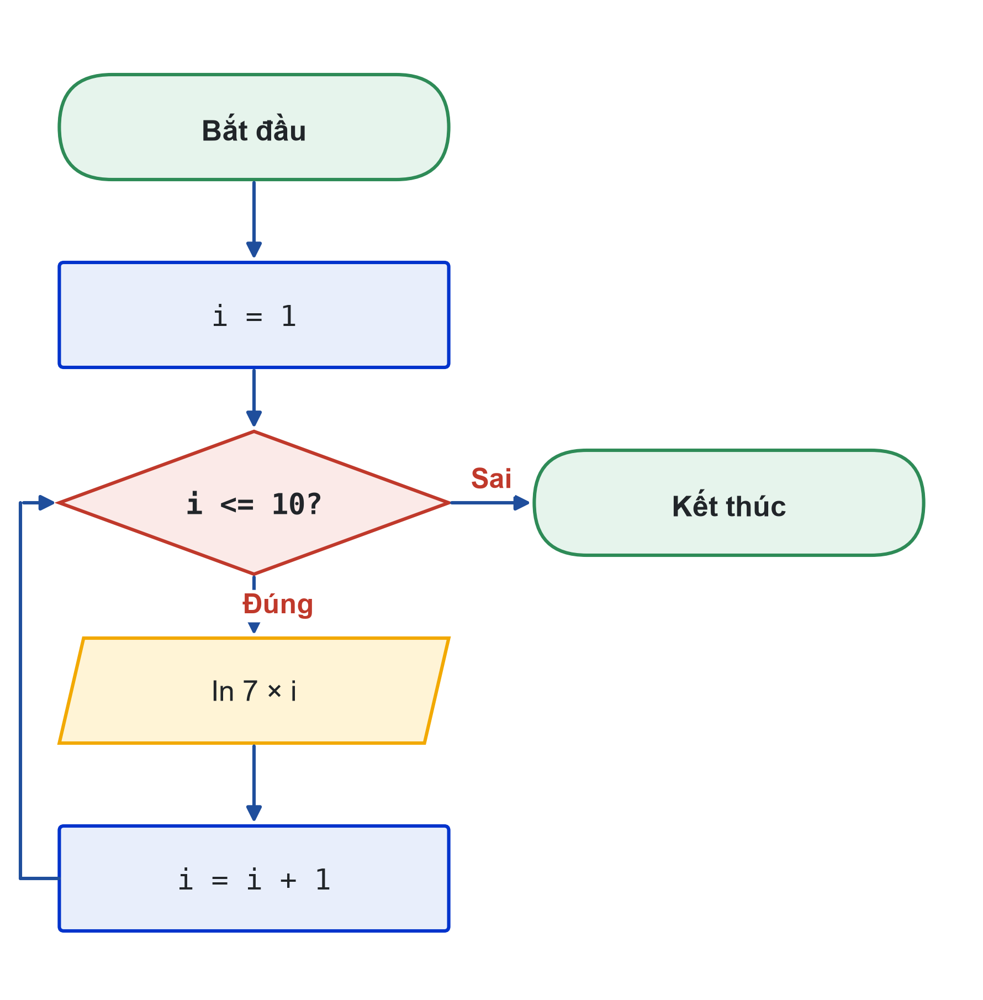
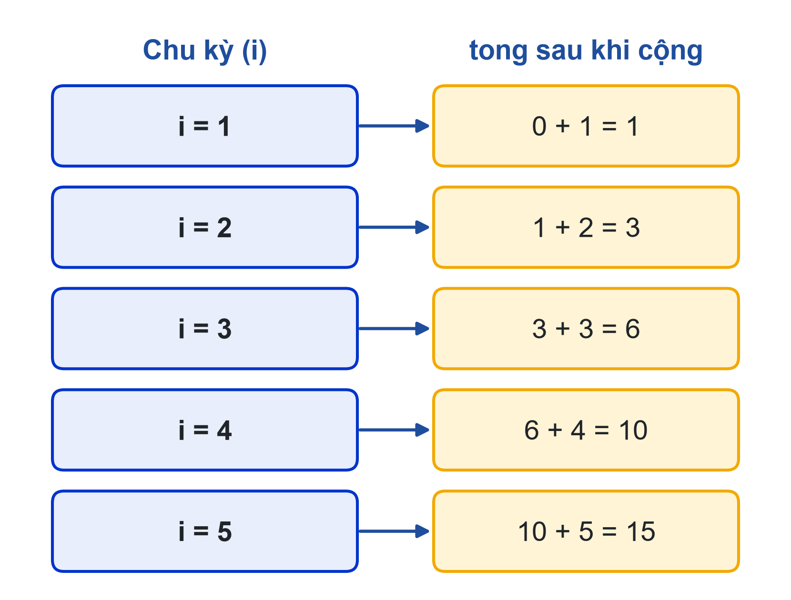
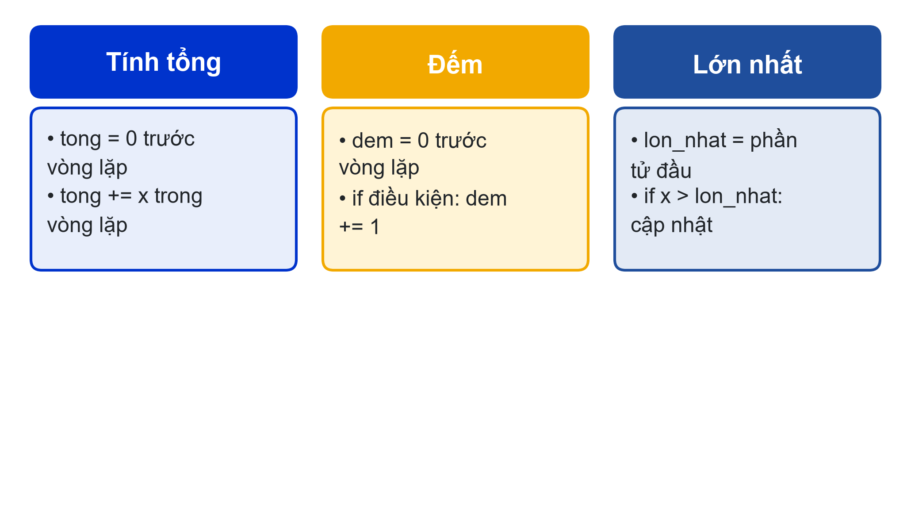
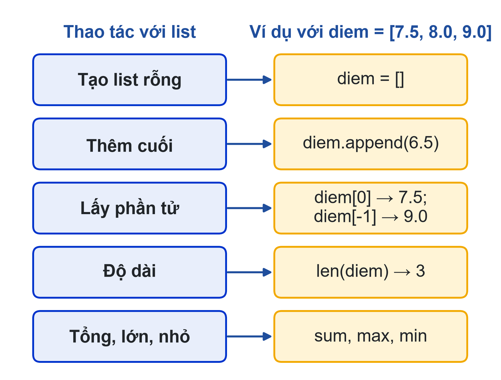

# Bài 04: Vòng lặp for, chuỗi và list cơ bản
Để máy tính lặp lại thay bạn: range, mẫu tích lũy, list

---

## Slide 1: Mục tiêu buổi học
**Nội dung chính**:
- Dùng for với range(), với chuỗi và với list
- Viết mẫu tích lũy: tổng, đếm, lớn nhất
- Lần theo vòng lặp bằng bảng giá trị biến
- Viết vòng lặp lồng nhau
**Ghi chú giảng viên**:
- 1,5 tiết lý thuyết, 3,5 tiết thực hành. CLO1, CLO2. Bài này dạy list cơ bản theo dàn ý đã duyệt.

---

## Slide 2: Câu hỏi mở đầu
**Nội dung chính**:
- Học kỳ này 8 học phần: viết 8 lần input() thì được
- Cả khóa 40 học phần thì sao?
- Máy tính giỏi nhất ở việc lặp lại mà không sai
**Hoạt động**: Đếm xem chương trình Student Dashboard v3 có bao nhiêu dòng gần giống nhau.

---

# Phần 1: Vòng lặp for và range()

---

## Slide 3: for và range()
**Nội dung chính**:
- range(5) → 0, 1, 2, 3, 4 (không gồm 5)
- range(1, 11) → 1 đến 10
- range(0, 21, 5) → 0, 5, 10, 15, 20
- range(10, 0, -1) → đếm ngược 10 đến 1
```python
for i in range(1, 11):
    print(f"7 x {i} = {7 * i}")
```

---

## Slide 4: Lưu đồ vòng lặp

**Ghi chú giảng viên**:
- Chỉ cho lớp mũi tên từ "i = i + 1" quay ngược lên khối điều kiện: đó là dấu hiệu của vòng lặp trên lưu đồ.
- for i in range(1, 11) làm thay ba việc: khởi tạo i, kiểm tra điều kiện, tăng i.

---

## Slide 5: Bảng giá trị biến (trace table)
**Nội dung chính**:
- Mỗi dòng là một chu kỳ, mỗi cột là một biến
- tong = 0; for i in range(1, 6): tong += i
- Lập bảng trước khi chạy, so với kết quả máy


---

# Phần 2: Mẫu tích lũy

---

## Slide 6: Ba mẫu tích lũy
**Nội dung chính**:
- Khởi tạo trước vòng lặp
- Cập nhật trong vòng lặp
- Dùng kết quả sau vòng lặp


---

## Slide 7: Ví dụ: tổng và đếm
**Nội dung chính**:
```python
n = int(input("Nhập n: "))
tong = 0
dem_chia_het_3 = 0
for i in range(1, n + 1):
    tong += i
    if i % 3 == 0:
        dem_chia_het_3 += 1
print(f"Tổng = {tong}; {dem_chia_het_3} số chia hết cho 3")
```
**Ghi chú giảng viên**:
- n = 9 → tổng 45, có 3 số chia hết cho 3. Hỏi lớp: đặt tong = 0 trong vòng lặp thì sao?

---

# Phần 3: Chuỗi và list

---

## Slide 8: Duyệt chuỗi
**Nội dung chính**:
- len(s), s[0] ký tự đầu, s[-1] ký tự cuối
- for ch in s: lấy lần lượt từng ký tự
```python
ma_sv = input("Mã số sinh viên: ")
so_chu_so = 0
for ch in ma_sv:
    if ch in "0123456789":
        so_chu_so += 1
```

---

## Slide 9: List cơ bản
**Nội dung chính**:
- Nhiều giá trị trong một biến: diem = [7.5, 8.0, 9.0]
- Chỉ số bắt đầu từ 0; [-1] là phần tử cuối
- append, len, sum, max, min


---

## Slide 10: Student Dashboard v4
**Nội dung chính**:
```python
n = int(input("Số học phần: "))
diem_list = []
for i in range(n):
    d = float(input(f"Điểm học phần {i + 1}: "))
    diem_list.append(d)
tb = sum(diem_list) / len(diem_list)
print(f"TB: {tb:.2f} | Cao nhất: {max(diem_list)}")
```
**Ghi chú giảng viên**:
- Cho thử n = 0 để thấy ZeroDivisionError; hẹn xử lý ở bài 06.

---

# Phần 4: Vòng lặp lồng nhau

---

## Slide 11: Vẽ tam giác bằng ký tự
**Nội dung chính**:
```python
n = 4
for hang in range(1, n + 1):
    for cot in range(hang):
        print("*", end="")
    print()
```
- Vòng ngoài chạy 1 lần, vòng trong chạy trọn một lượt
**Hoạt động**: Sửa để in tam giác ngược (4, 3, 2, 1 dấu *).

---

## Slide 12: Thực hành
**Nội dung chính**:
- Có hướng dẫn: cửu chương số k; tổng số chẵn; đảo chuỗi; hình vuông rỗng; nhờ AI giải thích một chu kỳ
- Tự làm: Student Dashboard v4 với tên và điểm từng học phần, bảng điểm, học phần điểm cao nhất, số học phần chưa đạt
- Nộp: ho_so.py, lưu đồ vòng lặp, bảng giá trị biến, Nhật ký Prompt
**Ghi chú giảng viên**:
- Link nộp bài: {{LINK_NOP_BAI_04}}.

---

## Slide 13: Tóm tắt
**Nội dung chính**:
- for lặp số lần biết trước; range(a, b) dừng trước b
- Mẫu tích lũy: khởi tạo trước, cập nhật trong, dùng sau vòng lặp
- Chuỗi và list: chỉ số từ 0, len, append, sum, max, min
- Không hiểu vòng lặp thì lập bảng giá trị biến
