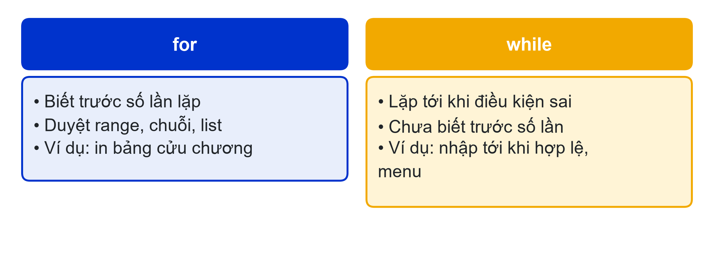
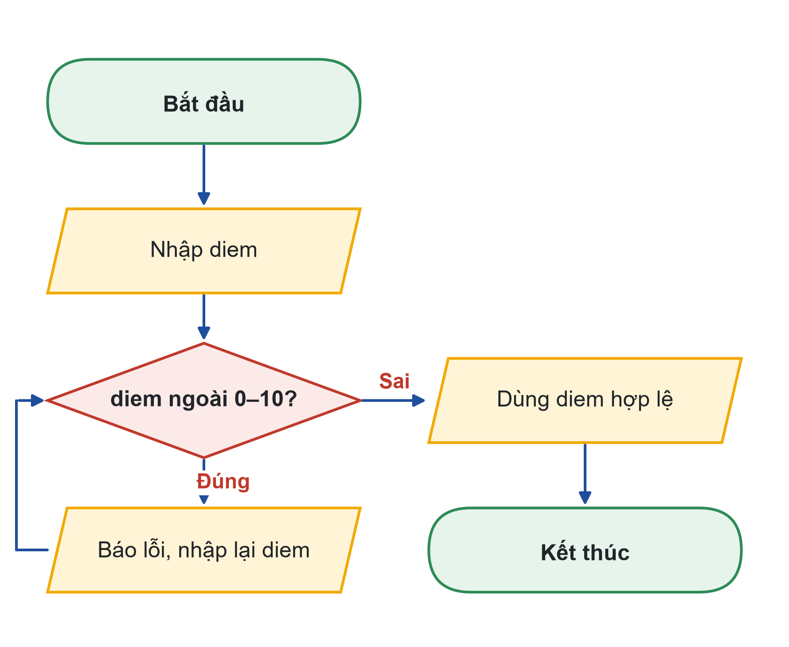
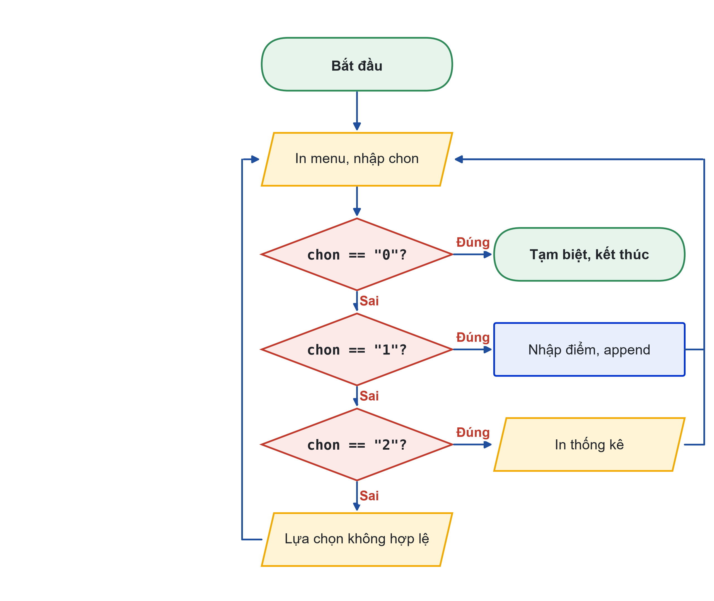

# Bài 05: Vòng lặp while và menu tương tác
Lặp tới khi điều kiện thay đổi: điều kiện dừng, break, menu dòng lệnh

---

## Slide 1: Mục tiêu buổi học
**Nội dung chính**:
- Phân biệt khi nào dùng for, khi nào dùng while
- Thiết lập điều kiện dừng, tránh vòng lặp vô hạn
- Dùng break, continue
- Xây dựng menu dòng lệnh chạy tới khi chọn Thoát
**Ghi chú giảng viên**:
- 1,5 tiết lý thuyết, 3,5 tiết thực hành. CLO1, CLO2.

---

## Slide 2: Câu hỏi mở đầu
**Nội dung chính**:
- Máy bán nước không biết trước có bao nhiêu khách
- Hiện menu → nhận lựa chọn → trả nước → quay lại chờ
- Chương trình của bạn cần chạy tới khi người dùng chọn "Thoát"
**Hoạt động**: Kể tên 3 ứng dụng hằng ngày hoạt động theo kiểu "lặp tới khi thoát".

---

# Phần 1: while và điều kiện dừng

---

## Slide 3: for hay while?

**Ghi chú giảng viên**:
- for: biết trước số lần. while: lặp tới khi điều kiện sai, chưa biết trước số lần.

---

## Slide 4: while và vòng lặp vô hạn
**Nội dung chính**:
```python
dem = 5
while dem > 0:
    print(dem)
    dem -= 1          # thiếu dòng này: lặp vô hạn
print("Hết giờ!")
```
- Dừng chương trình treo: Ctrl + C trong Terminal
- Tự hỏi: dòng nào làm điều kiện tiến dần tới sai?

---

## Slide 5: Lưu đồ nhập điểm hợp lệ

**Ghi chú giảng viên**:
- Mũi tên từ "Báo lỗi, nhập lại" quay lên khối điều kiện: vòng lặp while.
- Code tương ứng: while diem < 0 or diem > 10: báo lỗi, nhập lại.

---

## Slide 6: Code nhập điểm hợp lệ
**Nội dung chính**:
```python
diem = float(input("Điểm (0-10): "))
while diem < 0 or diem > 10:
    print("Điểm không hợp lệ, hãy nhập lại.")
    diem = float(input("Điểm (0-10): "))
print(f"Đã ghi nhận điểm {diem}")
```
- Gõ chữ thay vì số vẫn làm chương trình dừng: xử lý ở bài 06

---

# Phần 2: break, continue và trò chơi đoán số

---

## Slide 7: break và continue
**Nội dung chính**:
- break: thoát khỏi vòng lặp ngay
- continue: bỏ phần còn lại của chu kỳ, sang chu kỳ sau
- Biến cờ (flag): ghi nhớ điều đã xảy ra trong vòng lặp
- random.randint(1, 100): số nguyên ngẫu nhiên, gồm cả 1 và 100

---

## Slide 8: Trò chơi đoán số
**Nội dung chính**:
```python
bi_mat = random.randint(1, 100)
so_lan = 0
doan_dung = False
while so_lan < 7:
    so_lan += 1
    doan = int(input(f"Lần {so_lan}/7 - Đoán số: "))
    if doan == bi_mat:
        doan_dung = True
        break
    elif doan < bi_mat:
        print("Lớn hơn nữa.")
    else:
        print("Nhỏ hơn nữa.")
```
**Ghi chú giảng viên**:
- Sau vòng lặp: if doan_dung in "Chính xác", ngược lại in số bí mật. Hỏi lớp: chiến lược nào luôn thắng trong 7 lần? (Đoán giữa khoảng.)

---

# Phần 3: Menu dòng lệnh

---

## Slide 9: Lưu đồ menu

**Ghi chú giảng viên**:
- Mọi nhánh trừ "0" đều quay về khối in menu. Nhánh "0" là lối ra duy nhất.

---

## Slide 10: Student Dashboard v5: menu
**Nội dung chính**:
```python
while True:
    print("1. Nhập điểm   2. Xem thống kê   0. Thoát")
    chon = input("Chọn: ")
    if chon == "1":
        diem_list.append(float(input("Điểm: ")))
    elif chon == "2":
        ...   # in thống kê, báo nếu chưa có điểm
    elif chon == "0":
        print("Tạm biệt!")
        break
    else:
        print("Lựa chọn không hợp lệ.")
```
**Ghi chú giảng viên**:
- So sánh với chuỗi "1", không phải số 1, vì input() trả về chuỗi.

---

## Slide 11: Nhờ AI tìm lỗi vòng lặp
**Nội dung chính**:
- "Vòng lặp while dưới đây không dừng khi tôi nhập 0."
- "Chỉ ra dòng gây lỗi, giải thích vì sao, đừng viết lại toàn bộ code."
- Tự sửa, chạy lại, ghi vào Nhật ký Prompt

---

## Slide 12: Thực hành
**Nội dung chính**:
- Có hướng dẫn: đếm ngược và vòng lặp vô hạn; lưu đồ nhập hợp lệ; đoán số có "Chơi tiếp?"
- Tự làm: Student Dashboard v5 với menu 5 lựa chọn, chỉ thoát khi chọn 0
- Nộp: ho_so.py, lưu đồ menu, Nhật ký Prompt
**Ghi chú giảng viên**:
- Link nộp bài: {{LINK_NOP_BAI_05}}.

---

## Slide 13: Tóm tắt
**Nội dung chính**:
- while lặp khi điều kiện còn đúng; luôn có dòng làm điều kiện tiến tới sai
- break thoát vòng lặp; continue sang chu kỳ sau
- Menu: while True + if-elif + break ở lựa chọn Thoát
- Trên lưu đồ, vòng lặp là mũi tên quay ngược lên
