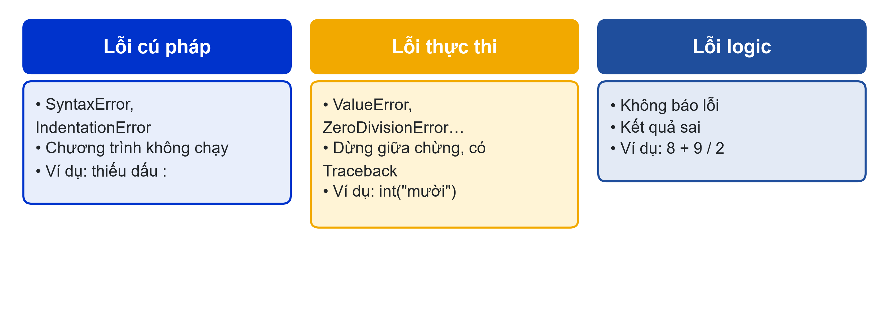
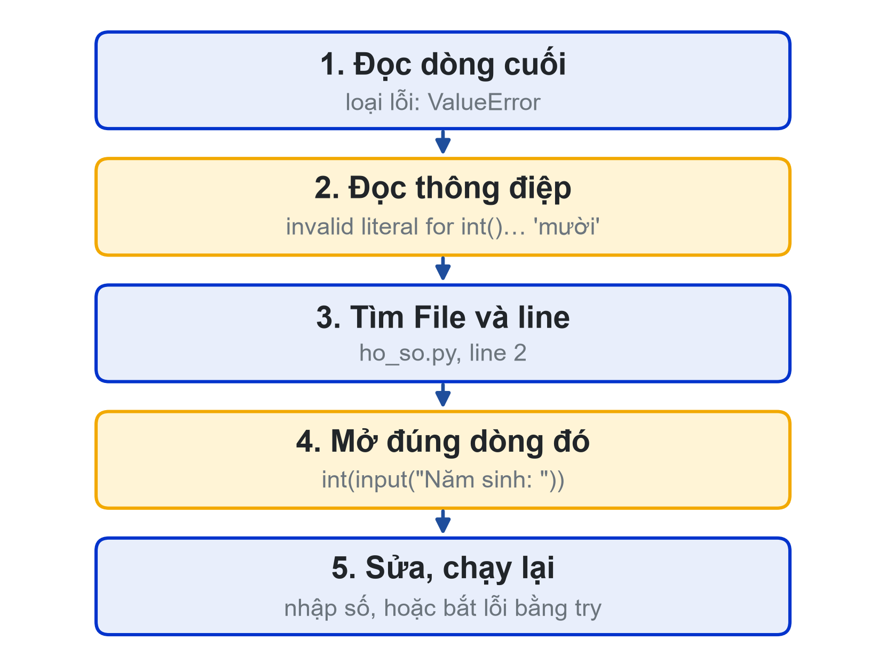
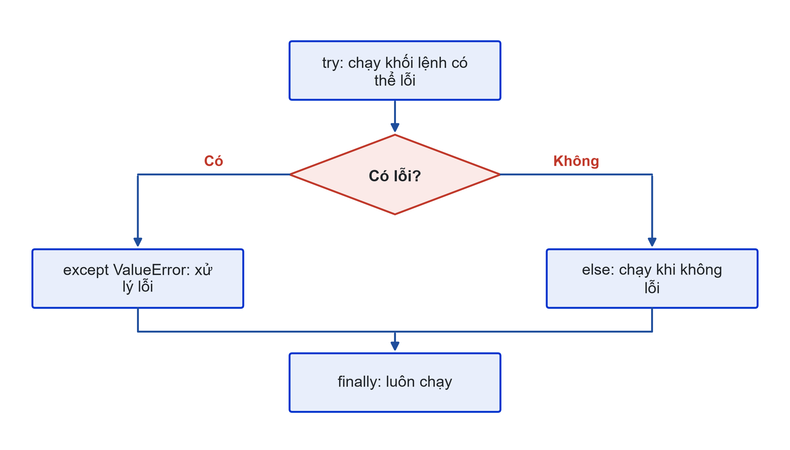

# Bài 06: Xử lý ngoại lệ try – except và debugging
Chương trình không được dừng chỉ vì người dùng gõ sai

---

## Slide 1: Mục tiêu buổi học
**Nội dung chính**:
- Phân biệt lỗi cú pháp, lỗi thực thi, lỗi logic
- Đọc Traceback để tìm loại lỗi và dòng lỗi
- Dùng try – except – else – finally
- Debug bằng print và breakpoint trong VS Code
**Ghi chú giảng viên**:
- 1,5 tiết lý thuyết, 3,5 tiết thực hành (lab "săn lỗi"). CLO1.

---

## Slide 2: Câu hỏi mở đầu
**Nội dung chính**:
- Bạn của bạn dùng thử Student Dashboard
- Ô "Điểm" gõ "tám rưỡi" → chữ đỏ, chương trình tắt
- Người dùng không sai: chương trình chưa sẵn sàng cho dữ liệu thật
**Hoạt động**: Liệt kê 5 cách người dùng có thể nhập sai vào Student Dashboard.

---

# Phần 1: Ba loại lỗi và Traceback

---

## Slide 3: Ba loại lỗi

**Ghi chú giảng viên**:
- try – except chỉ xử lý lỗi thực thi. Lỗi cú pháp phải sửa code; lỗi logic phải phát hiện bằng kiểm thử với kết quả tính tay.

---

## Slide 4: Một Traceback thật
**Nội dung chính**:
```text
Traceback (most recent call last):
  File "...\ho_so.py", line 2, in <module>
    nam_sinh = int(input("Năm sinh: "))
               ^^^^^^^^^^^^^^^^^^^^^^^^
ValueError: invalid literal for int() with base 10: 'mười'
```
- Từ Python 3.11: dòng ^ đánh dấu biểu thức gây lỗi

---

## Slide 5: Đọc Traceback từ dưới lên
**Nội dung chính**:
- Dòng cuối: loại lỗi và thông điệp
- Phía trên: file, số dòng, nội dung dòng
- Mở đúng dòng đó, sửa, chạy lại


---

# Phần 2: try – except – else – finally

---

## Slide 6: Cấu trúc try – except

**Ghi chú giảng viên**:
- except chạy khi có đúng loại lỗi đã ghi; else khi không lỗi; finally luôn chạy.
- Không dùng except: trống vì nó nuốt cả lỗi gõ sai tên biến.

---

## Slide 7: Nhập điểm an toàn
**Nội dung chính**:
```python
while True:
    try:
        diem = float(input("Điểm (0-10): "))
    except ValueError:
        print("Hãy nhập số, dùng dấu chấm.")
    else:
        if 0 <= diem <= 10:
            break
        print("Điểm phải trong khoảng 0-10.")
```
**Ghi chú giảng viên**:
- Thử với: tám, 8,5, 11, -1, 8.5. Bốn lần đầu được hỏi lại, lần cuối ghi nhận.

---

## Slide 8: Chia cho 0
**Nội dung chính**:
```python
try:
    tb = sum(diem_list) / len(diem_list)
except ZeroDivisionError:
    print("Chưa có điểm nào để tính trung bình.")
else:
    print(f"Điểm trung bình: {tb:.2f}")
```
- Đoán trước được (list rỗng) thì dùng if cũng được
- try dùng cho lỗi khó kiểm tra trước: chuỗi có đổi được thành số không

---

# Phần 3: Debugging

---

## Slide 9: Debug trong VS Code
**Nội dung chính**:
- print("DEBUG tong =", tong) ở điểm nghi ngờ
- F9: đặt breakpoint · F5: Run and Debug
- F10: chạy từng dòng (Step Over)
- Khung Variables: giá trị mọi biến
**Ghi chú giảng viên**:
- Demo trực tiếp breakpoint trong vòng lặp tính tổng, cho lớp đoán giá trị tong trước mỗi lần F10.

---

## Slide 10: Nhờ AI đọc lỗi
**Nội dung chính**:
- Dán Traceback và đoạn code liên quan
- "Giải thích bằng ngôn ngữ dễ hiểu: lỗi gì, ở dòng nào, vì sao"
- "Gợi ý chỗ cần sửa, không viết lại toàn bộ code"
- AI cũng có thể sai: chạy lại để kiểm chứng

---

## Slide 11: Lab "săn lỗi"
**Nội dung chính**:
- 5 đoạn code có lỗi: tự đoán trước, rồi mới chạy và hỏi AI
- Bảng 5 cột: lỗi, loại lỗi, nguyên nhân, cách sửa, đoán đúng chưa
- Tự làm: Student Dashboard v6 không dừng với 6 kiểu dữ liệu xấu
- Nộp: ho_so.py, bảng săn lỗi, bảng "phá chương trình", Nhật ký Prompt
**Ghi chú giảng viên**:
- Chuẩn bị sẵn 5 đoạn code: 1 SyntaxError, 1 IndentationError, 1 ValueError, 1 ZeroDivisionError, 1 lỗi logic. Link nộp bài: {{LINK_NOP_BAI_06}}.

---

## Slide 12: Tóm tắt
**Nội dung chính**:
- Ba loại lỗi: cú pháp, thực thi, logic
- Đọc Traceback từ dòng cuối lên
- try – except bắt đúng loại lỗi; else khi không lỗi; finally luôn chạy
- Debug: print, breakpoint, F10, khung Variables
