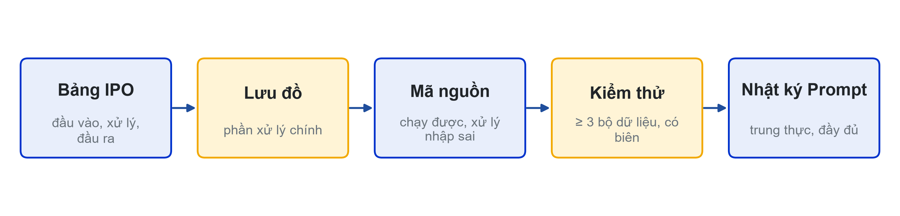

# Bài 07: Kiểm tra giữa kỳ
Thực hành cá nhân tại lớp, 5 tiết, 30% điểm học phần

---

## Slide 1: Hình thức
**Nội dung chính**:
- Bài cá nhân, 5 tiết, trên máy phòng lab
- Kiến thức buổi 01–06; chưa yêu cầu viết hàm
- Được xem tài liệu của chính mình; không trao đổi với người khác
- Nộp: MSSV_HoTen_GK.py, lưu đồ, bảng kiểm thử, Nhật ký Prompt
**Ghi chú giảng viên**:
- Phát đề đầu buổi. Link nộp bài: {{LINK_NOP_GIUA_KY}}.

---

## Slide 2: Cấu trúc bài làm

**Ghi chú giảng viên**:
- Bảng IPO, lưu đồ phần xử lý chính, mã nguồn, bảng kiểm thử (≥ 3 bộ: bình thường, biên, nhập sai), Nhật ký Prompt.

---

## Slide 3: Quy định dùng AI
**Nội dung chính**:
- Được: hỏi cú pháp, hỏi giải thích thông báo lỗi
- Không được: dán đề hoặc một phần đề cho AI; nhờ AI viết lời giải
- Bắt buộc: ghi mọi prompt vào Nhật ký Prompt
- Vấn đáp ngẫu nhiên: không giải thích được thì không tính điểm phần đó

---

## Slide 4: Tiêu chí chấm (thang 10)
**Nội dung chính**:
- Bảng IPO và lưu đồ: 2 điểm (CLO2)
- Chương trình chạy đúng yêu cầu: 4 điểm (CLO1)
- Xử lý nhập sai và giá trị biên: 2 điểm (CLO1)
- Trình bày mã, Nhật ký Prompt: 1 điểm · Vấn đáp: 1 điểm

---

## Slide 5: Phân bổ thời gian gợi ý
**Nội dung chính**:
- 30 phút: đọc đề, viết bảng IPO
- 30 phút: vẽ lưu đồ
- 2 tiết: viết code
- 30 phút: kiểm thử, sửa lỗi · 15 phút: hoàn thiện, nộp bài
- Ưu tiên phần chạy được hơn phần đầy đủ mà không chạy

---

## Slide 6: Chúc các bạn làm bài tốt
**Nội dung chính**:
- Đọc kỹ đề, viết IPO trước khi code
- Kiểm thử với dữ liệu sai trước khi nộp
- Gặp sự cố máy: báo ngay giảng viên
