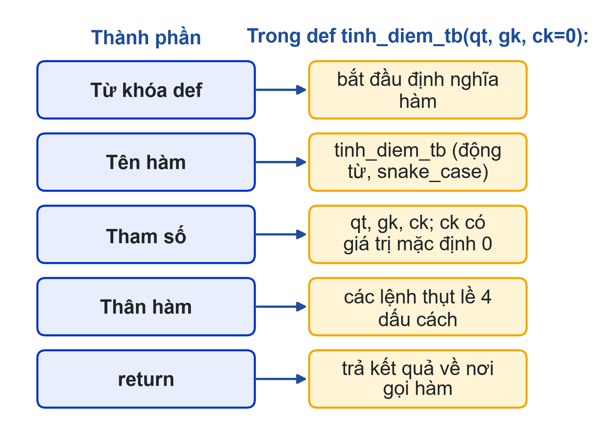
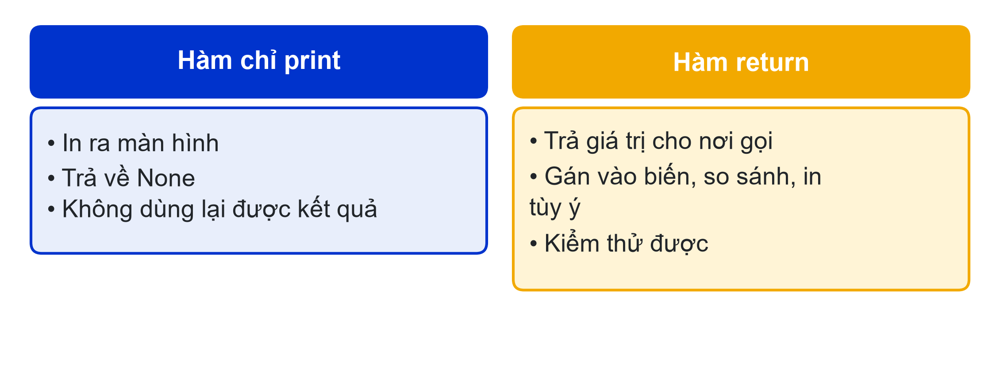
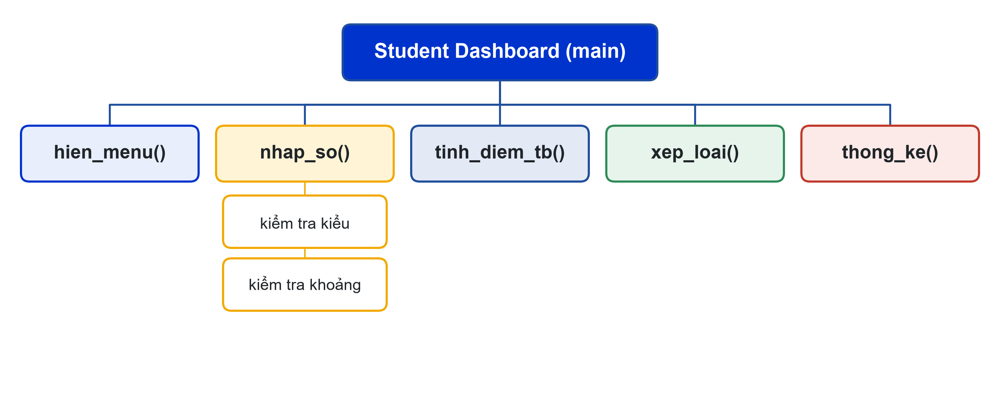
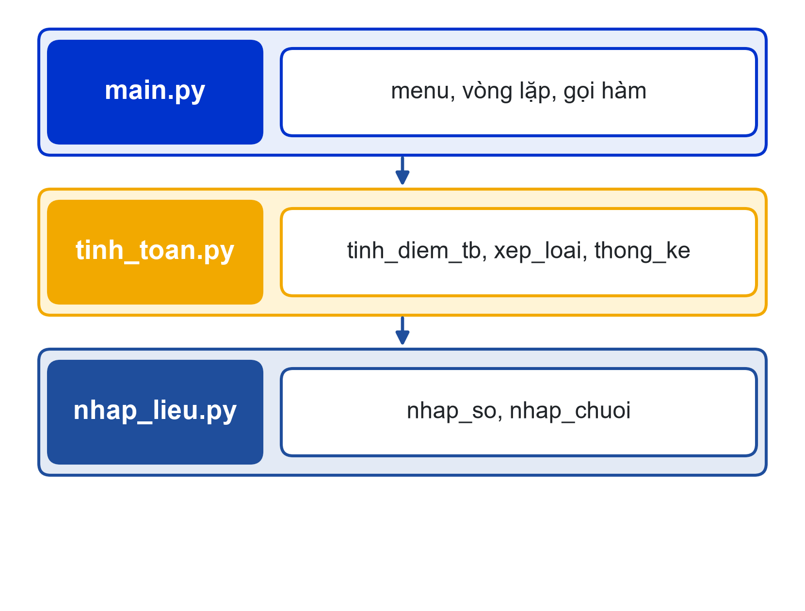

# Bài 08: Hàm cơ bản và tách module
Viết một lần, gọi nhiều lần: chia chương trình thành các hàm đơn nhiệm

---

## Slide 1: Mục tiêu buổi học
**Nội dung chính**:
- Định nghĩa và gọi hàm: tham số, giá trị mặc định, return
- Phân biệt hàm trả về giá trị với hàm chỉ in
- Phân rã bài toán thành các hàm đơn nhiệm
- Tách chương trình thành nhiều file, dùng import
**Ghi chú giảng viên**:
- 1,5 tiết lý thuyết, 3,5 tiết thực hành. CLO1, CLO2 (sơ đồ phân rã).

---

## Slide 2: Câu hỏi mở đầu
**Nội dung chính**:
- Đoạn "nhập số an toàn" trong Student Dashboard v6 bị chép mấy lần?
- Đổi câu báo lỗi: phải sửa ở mấy chỗ?
- Quên một chỗ thì sao?
**Hoạt động**: Mở bài v6 của mình, đánh dấu các đoạn code gần giống nhau.

---

# Phần 1: def và return

---

## Slide 3: Cấu trúc một hàm

**Ghi chú giảng viên**:
- Tham số là tên trong def; đối số là giá trị truyền vào khi gọi. Hàm không có return trả về None.

---

## Slide 4: Hàm đầu tiên
**Nội dung chính**:
```python
def tinh_diem_tb(qt, gk, ck):
    """Trả về điểm học phần theo trọng số 30-30-40."""
    return qt * 0.3 + gk * 0.3 + ck * 0.4


diem = tinh_diem_tb(8, 7, 9)
print(f"{diem:.2f}")             # 8.10
```
- Trả nhiều giá trị: thap, cao, tb = thong_ke(ds)

---

## Slide 5: Hàm nhập số an toàn
**Nội dung chính**:
```python
def nhap_so(loi_nhac, nho_nhat=0, lon_nhat=10):
    """Hỏi lại tới khi nhập một số trong khoảng."""
    while True:
        try:
            gia_tri = float(input(loi_nhac))
        except ValueError:
            print("Hãy nhập số.")
            continue
        if nho_nhat <= gia_tri <= lon_nhat:
            return gia_tri
        print(f"Phải trong khoảng {nho_nhat}-{lon_nhat}.")
```
**Ghi chú giảng viên**:
- Gọi: nhap_so("Điểm: ") hoặc nhap_so("Số tín chỉ: ", 1, 5). Giá trị mặc định giúp gọi gọn.

---

## Slide 6: print khác return

**Ghi chú giảng viên**:
- Cho lớp chạy kq = in_xep_loai(8.5); print(kq) để thấy None. Quy tắc: hàm tính toán thì return, việc in để cho chương trình chính.

---

# Phần 2: Phân rã và module

---

## Slide 7: Sơ đồ phân rã chức năng

**Ghi chú giảng viên**:
- Mỗi hộp là một hàm làm một việc. Hộp nào còn làm nhiều việc thì chia tiếp. Đây cũng là căn cứ chia việc trong Mini Project.

---

## Slide 8: Tách thành nhiều file
**Nội dung chính**:
- Module = một file .py
- main.py gọi hàm từ các module khác bằng import
- Các file phải nằm cùng thư mục


---

## Slide 9: main.py
**Nội dung chính**:
```python
from nhap_lieu import nhap_so
from tinh_toan import thong_ke, xep_loai


def main():
    diem_list = []
    ...   # vòng lặp menu, gọi các hàm


if __name__ == "__main__":
    main()
```
- Chỉ chạy main() khi chạy trực tiếp file này, không chạy khi bị import

---

## Slide 10: Nhờ AI đề xuất cách chia hàm
**Nội dung chính**:
- "Đề xuất cách chia chương trình thành các hàm đơn nhiệm."
- "Mỗi hàm chỉ nêu: tên, tham số, giá trị trả về, một câu mô tả. Không viết code."
- So với sơ đồ phân rã của mình; ghi quyết định vào Nhật ký Prompt

---

## Slide 11: Thực hành
**Nội dung chính**:
- Có hướng dẫn: tinh_diem_tb, xep_loai, nhap_so; thử print thay return; vẽ sơ đồ phân rã
- Tự làm: Student Dashboard v8 gồm 3 file nhap_lieu.py, tinh_toan.py, main.py
- Hàm tính toán không chứa input(), print()
- Nộp: 3 file .py, sơ đồ phân rã, Nhật ký Prompt
**Ghi chú giảng viên**:
- Link nộp bài: {{LINK_NOP_BAI_08}}.

---

## Slide 12: Tóm tắt
**Nội dung chính**:
- def tên(tham_số): … return kết_quả
- Giá trị mặc định cho tham số; return nhiều giá trị bằng tuple
- Hàm tính toán thì return, không print
- Phân rã thành hàm đơn nhiệm; tách module; if __name__ == "__main__"
