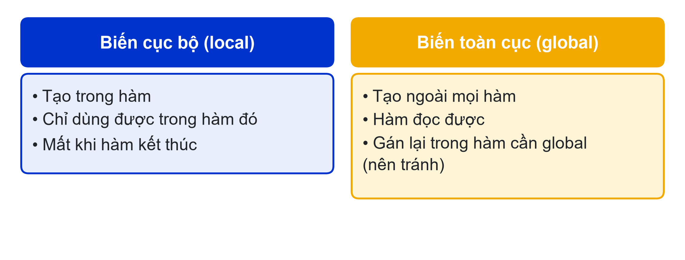
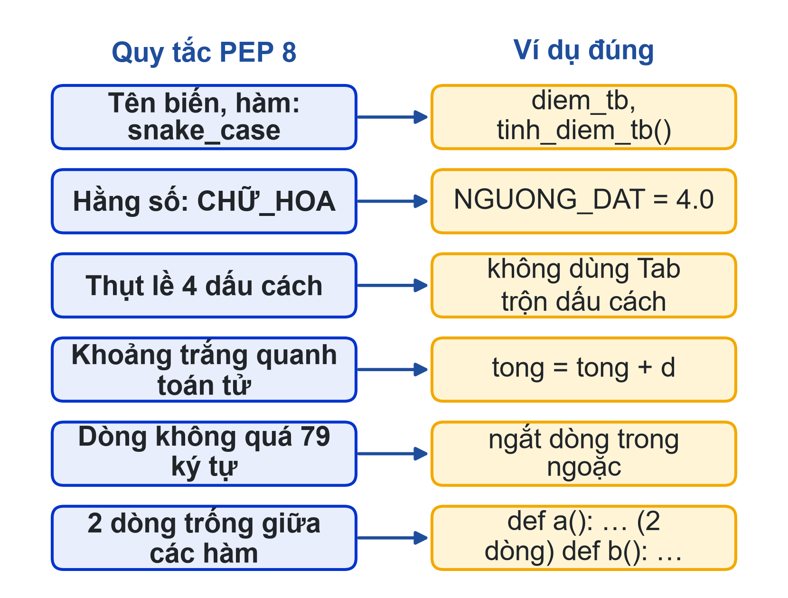
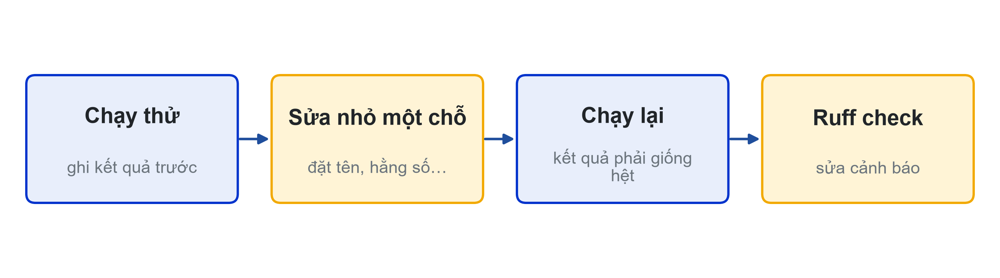

# Bài 09: Tổ chức mã nguồn và chuẩn PEP 8
Code được đọc nhiều hơn được viết

---

## Slide 1: Mục tiêu buổi học
**Nội dung chính**:
- Hiểu phạm vi biến cục bộ và toàn cục
- Đặt tên, trình bày code theo PEP 8
- Viết docstring và chú thích có ích
- Refactor có kiểm soát, dùng Ruff
**Ghi chú giảng viên**:
- 1,5 tiết lý thuyết, 3,5 tiết thực hành. CLO1. Chuẩn bị sẵn một chương trình "xấu" cho lab.

---

## Slide 2: Câu hỏi mở đầu
**Nội dung chính**:
- Ba tuần nữa đọc lại hàm f(a, b, c): bạn còn nhớ nó làm gì?
- Bạn cùng nhóm đọc thì sao?
- Mini Project sắp bắt đầu: code của bạn phải để người khác đọc được
**Hoạt động**: Đổi file v8 với bạn bên cạnh, đọc 2 phút và đoán từng hàm làm gì.

---

# Phần 1: Phạm vi biến

---

## Slide 3: Biến cục bộ và toàn cục

**Ghi chú giảng viên**:
- Hàm gán cho một tên thì Python coi tên đó là biến cục bộ của hàm, kể cả khi bên ngoài có biến cùng tên.

---

## Slide 4: UnboundLocalError
**Nội dung chính**:
```python
tong = 0


def cong_diem(d):
    tong = tong + d      # lỗi ở dòng này
    return tong
```
- UnboundLocalError: cannot access local variable 'tong'
- Sửa: def cong_diem(tong, d): return tong + d
- Học phần này không dùng global

---

# Phần 2: PEP 8 và Ruff

---

## Slide 5: Các quy tắc PEP 8 dùng nhiều nhất

**Ghi chú giảng viên**:
- PEP 8 là hướng dẫn trình bày chính thức của Python (peps.python.org/pep-0008).

---

## Slide 6: Ruff trong VS Code
**Nội dung chính**:
- Cài extension Ruff (hoặc pip install ruff)
- ruff check: lỗi và vi phạm (nhiều lệnh một dòng, import thừa, biến không dùng)
- ruff format: tự sửa khoảng trắng, thụt lề, xuống dòng
- Công cụ không đặt lại tên giúp bạn
**Ghi chú giảng viên**:
- Demo: ruff format đoạn f(a,b,c) xấu, kết quả trình bày đẹp nhưng tên vẫn là f, a, b, c.

---

## Slide 7: Docstring và chú thích
**Nội dung chính**:
```python
def thong_ke(diem_list):
    """Trả về (thấp nhất, cao nhất, trung bình) của list khác rỗng."""
    return min(diem_list), max(diem_list), sum(diem_list) / len(diem_list)
```
- Docstring: ngay dưới def, ba dấu nháy; help(thong_ke) in ra
- Chú thích giải thích "vì sao", không lặp lại code

---

# Phần 3: Refactor có kiểm soát

---

## Slide 8: Quy trình refactor

**Ghi chú giảng viên**:
- Refactor không thêm chức năng, không đổi kết quả. Sửa từng bước nhỏ, chạy lại sau mỗi bước.

---

## Slide 9: Trước refactor
**Nội dung chính**:
```python
def f(a,b,c):
  x=a*0.3+b*0.3+c*0.4
  if x>=4: print("Dau")
  else: print("Rot")
  return x
```
**Hoạt động**: Liệt kê mọi điểm chưa ổn của đoạn code này.

---

## Slide 10: Sau refactor
**Nội dung chính**:
```python
NGUONG_DAT = 4.0


def tinh_diem_tb(qt, gk, ck):
    """Trả về điểm học phần theo trọng số 30-30-40."""
    return qt * 0.3 + gk * 0.3 + ck * 0.4


def ket_qua(diem):
    """Trả về "Đậu" nếu diem đạt NGUONG_DAT, ngược lại "Rớt"."""
    return "Đậu" if diem >= NGUONG_DAT else "Rớt"
```
**Ghi chú giảng viên**:
- Tên có nghĩa; số ma thuật thành hằng số; tách hàm làm hai việc; return thay print; docstring; PEP 8. Biểu thức điều kiện một dòng là kiến thức mở rộng của bài 03; có thể viết bằng if-else đầy đủ như trong bài học.

---

## Slide 11: Refactor cùng AI
**Nội dung chính**:
- "Refactor theo PEP 8, giữ nguyên chức năng, liệt kê từng thay đổi và lý do."
- Chạy bản cũ và bản AI với cùng dữ liệu
- Chỉ nhận thay đổi giữ đúng kết quả và nằm trong kiến thức đã học

---

## Slide 12: Thực hành
**Nội dung chính**:
- Có hướng dẫn: sửa UnboundLocalError; refactor chương trình "xấu" từng bước; bảng thay đổi AI đề xuất
- Tự làm: Student Dashboard v9 theo PEP 8, đủ docstring, ruff check sạch
- Nộp: 3 file .py, bảng thay đổi, ảnh "All checks passed!", Nhật ký Prompt
**Ghi chú giảng viên**:
- Link nộp bài: {{LINK_NOP_BAI_09}}.

---

## Slide 13: Tóm tắt
**Nội dung chính**:
- Truyền dữ liệu bằng tham số và return, không dựa vào biến toàn cục
- PEP 8: snake_case, CHỮ_HOA cho hằng số, thụt 4 dấu cách
- Docstring cho mọi hàm; chú thích giải thích vì sao
- Refactor từng bước nhỏ, chạy lại sau mỗi bước, kết thúc bằng ruff check
