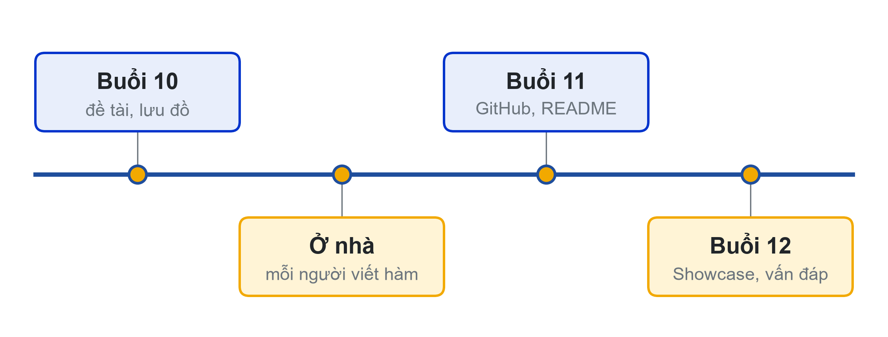
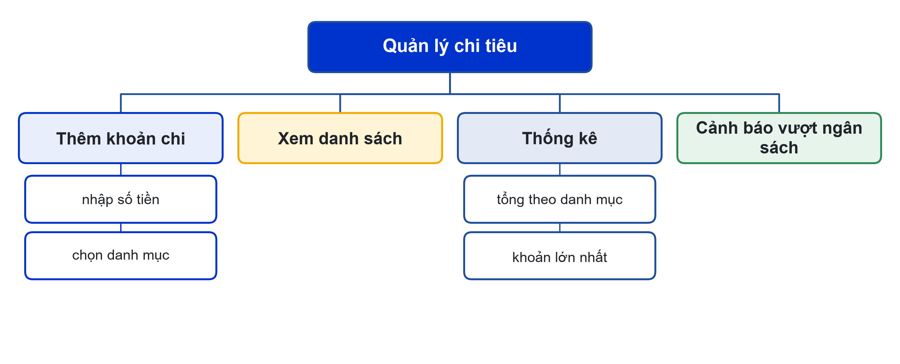

# Bài 10: Khởi động Mini Project và vẽ lưu đồ
Thiết kế kỹ ở buổi đầu, đỡ sửa ở buổi cuối

---

## Slide 1: Mục tiêu buổi học
**Nội dung chính**:
- Chọn và mô tả đề tài nhóm
- Lập bảng IPO cho từng chức năng
- Vẽ sơ đồ phân rã và lưu đồ trên Draw.io
- Phân công rõ ràng cho từng thành viên
**Ghi chú giảng viên**:
- 1,5 tiết lý thuyết, 3,5 tiết làm việc nhóm. CLO2, CLO3. Nhắc quy định điểm cộng truyền thông.

---

## Slide 2: Lịch trình 3 buổi cuối

**Ghi chú giảng viên**:
- Hết buổi 10: kế hoạch được duyệt. Hết buổi 11: code trên GitHub, README. Buổi 12: Showcase.

---

## Slide 3: Yêu cầu Mini Project
**Nội dung chính**:
- Nhóm 3–4 sinh viên; chương trình dòng lệnh có menu, ít nhất 4 chức năng
- Bắt buộc: rẽ nhánh, vòng lặp, list, hàm (tách ít nhất 2 file), try – except, PEP 8
- Nộp: GitHub, README, báo cáo ngắn, Nhật ký Prompt nhóm

---

## Slide 4: Đề tài gợi ý
**Nội dung chính**:
- Quản lý chi tiêu cá nhân · Thư viện mini
- Bán vé xem phim · Quiz trắc nghiệm
- Quản lý điểm lớp · Quản lý kho cửa hàng tiện lợi
- Hoặc tự đề xuất, giảng viên duyệt phạm vi
**Hoạt động**: Mỗi nhóm trình bày đề tài trong 2 phút.

---

# Phần 1: Phân tích đề tài

---

## Slide 5: Bảng IPO cho từng chức năng
**Nội dung chính**:
- Thêm khoản chi: Input số tiền, danh mục → kiểm tra, thêm vào list → thông báo
- Thống kê: Input các list đã lưu → tổng theo danh mục, khoản lớn nhất → bảng thống kê
- Mỗi chức năng một bảng, viết trước khi code

---

## Slide 6: Sơ đồ phân rã mẫu

**Ghi chú giảng viên**:
- Mỗi nhánh lá là một hàm. Sơ đồ này là căn cứ chia việc ở bước phân công.

---

## Slide 7: Lưu đồ trên Draw.io
**Nội dung chính**:
- Mỗi chức năng chính một lưu đồ, đúng 4 ký hiệu
- Vòng lặp có mũi tên quay lại
- File .drawio lưu trong thư mục docs/ của dự án; xuất .png cho báo cáo
- Lưu đồ phải khớp code: sửa code thì sửa lưu đồ

---

# Phần 2: Làm việc nhóm

---

## Slide 8: Bảng phân công
**Nội dung chính**:
- Cột: thành viên, hàm/chức năng, file, hạn, người kiểm tra chéo
- Mỗi người tự viết ít nhất một chức năng hoàn chỉnh
- Không ai chỉ làm báo cáo
- Bảng phân công là minh chứng CLO3

---

## Slide 9: Brainstorm cùng AI
**Nội dung chính**:
- Nêu rõ kiến thức đã học: biến, if, vòng lặp, list, hàm, try-except
- "Gợi ý 6 chức năng, kèm độ khó. Không viết code."
- Nhóm tự quyết phạm vi; ghi prompt và quyết định vào Nhật ký Prompt

---

## Slide 10: Hoạt động nhóm (3 tiết)
**Nội dung chính**:
- Chọn đề tài, trình bày 2 phút, giảng viên duyệt
- Bảng IPO từng chức năng; sơ đồ phân rã
- Lưu đồ cho 2 chức năng phức tạp nhất
- Bảng phân công và lịch làm việc tới buổi 11
**Ghi chú giảng viên**:
- Link nộp kế hoạch: {{LINK_NOP_BAI_10}}.

---

## Slide 11: Tóm tắt
**Nội dung chính**:
- Đề tài vừa sức: 4 chức năng chạy chắc hơn 9 chức năng chạy dở
- IPO → sơ đồ phân rã → lưu đồ → phân công
- Mỗi thành viên có phần code của mình
- Chụp ảnh nhóm làm việc cho bài đăng truyền thông
