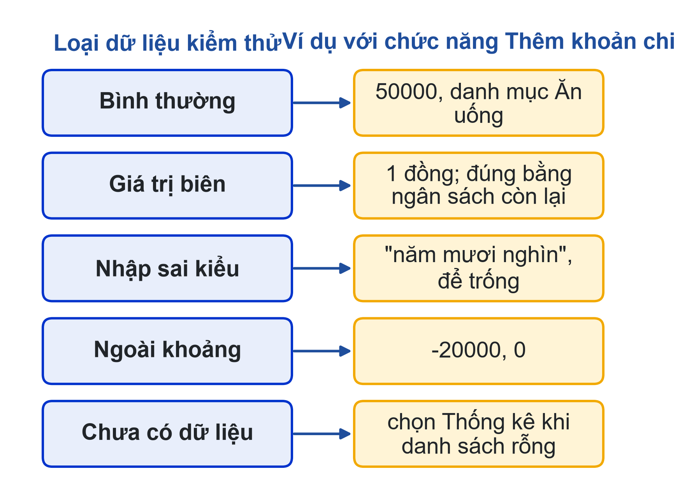
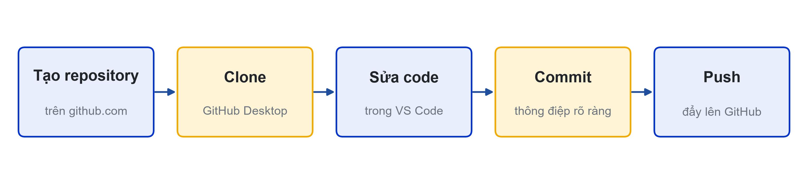

# Bài 11: Hoàn thiện project và quản lý mã nguồn với GitHub
Ghép code, kiểm thử tích hợp, commit và README

---

## Slide 1: Mục tiêu buổi học
**Nội dung chính**:
- Ghép code của các thành viên, kiểm thử tích hợp
- Dùng GitHub: repository, clone, commit, push, pull
- Viết README.md
- Rà soát cùng AI, chuẩn bị kịch bản demo
**Ghi chú giảng viên**:
- 1,5 tiết lý thuyết, 3,5 tiết làm việc nhóm. CLO1, CLO3.

---

## Slide 2: Câu hỏi mở đầu
**Nội dung chính**:
- main_final.py, main_final_2.py, main_final_thật_sự.py…
- Gửi qua tin nhắn, ghép lại thì mất hàm của nhau
- Ai đã viết phần nào?
**Hoạt động**: Nhóm bạn đang trao đổi code bằng cách nào?

---

# Phần 1: Kiểm thử tích hợp

---

## Slide 3: Năm loại dữ liệu kiểm thử

**Ghi chú giảng viên**:
- Hàm chạy đúng khi thử riêng chưa chắc đúng khi ghép. Ghi bảng: dữ liệu, mong đợi, thực tế, đạt/chưa đạt.

---

# Phần 2: GitHub cơ bản

---

## Slide 4: Git và GitHub
**Nội dung chính**:
- Git: lưu lịch sử thay đổi của mã nguồn
- GitHub: nơi lưu repository trên mạng cho cả nhóm
- Commit: một lần lưu kèm thông điệp · Push: đẩy lên · Pull: lấy về
- Lịch sử commit là minh chứng ai làm phần nào (CLO3)

---

## Slide 5: Quy trình với GitHub Desktop

**Ghi chú giảng viên**:
- Trưởng nhóm tạo repo, Settings → Collaborators mời thành viên. Trước khi commit luôn Pull origin để lấy code mới nhất.

---

## Slide 6: Thông điệp commit
**Nội dung chính**:
- Tốt: "Thêm hàm thong_ke_theo_danh_muc"
- Tốt: "Sửa lỗi chia cho 0 khi chưa có khoản chi"
- Chưa tốt: "update", "sửa", "final"
- Mỗi người commit phần mình phụ trách

---

## Slide 7: Khi push bị từ chối hoặc xung đột
**Nội dung chính**:
- Push rejected: Pull origin trước, rồi push lại
- Conflict: hai người sửa cùng đoạn trong cùng file
- Mở file trong VS Code, chọn Accept Current/Incoming/Both, lưu, commit
- Phòng tránh: mỗi người làm ở file hoặc hàm riêng

---

# Phần 3: README và demo

---

## Slide 8: README.md
**Nội dung chính**:
- Tên đề tài, giới thiệu một câu
- Thành viên và vai trò
- Cách chạy: python main.py
- Ảnh chụp màn hình; khai báo sử dụng AI

---

## Slide 9: Rà soát cùng AI và kịch bản demo
**Nội dung chính**:
- "Liệt kê các trường hợp nhập liệu làm chương trình dừng hoặc sai, kèm số dòng. Không viết lại code."
- Kịch bản demo 3 phút: dữ liệu chuẩn bị sẵn, cố ý nhập sai một lần
- Tập vấn đáp chéo: hỏi nhau về phần không phải của mình

---

## Slide 10: Làm việc nhóm
**Nội dung chính**:
- Tạo repo, mời thành viên, mỗi người clone và thử commit
- Ghép code; kiểm thử 5 loại dữ liệu; sửa lỗi và commit
- Cập nhật lưu đồ; ruff check; README; kịch bản demo
- Hoàn thành khi mỗi người có ít nhất 2 commit có nội dung code
**Ghi chú giảng viên**:
- Link nộp repository: {{LINK_NOP_BAI_11}}.

---

## Slide 11: Tóm tắt
**Nội dung chính**:
- Kiểm thử tích hợp với dữ liệu thường, biên, sai, rỗng
- Pull → sửa → commit (thông điệp rõ) → push
- README giúp người khác chạy được sản phẩm của bạn
- Mỗi thành viên giải thích được phần mình và phần của nhóm
