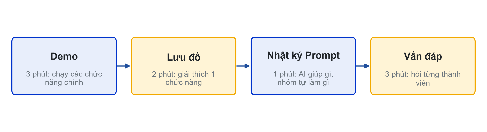
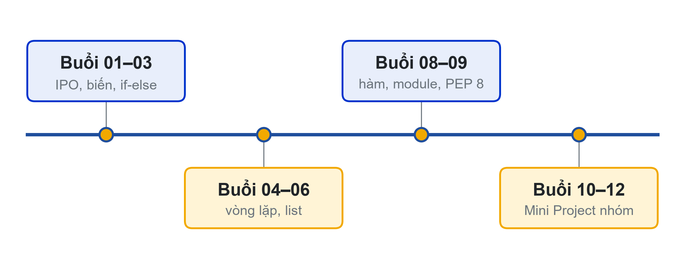

# Bài 12: Showcase và tổng kết học phần
Bạn viết, bạn hiểu, bạn giải thích

---

## Slide 1: Cấu trúc buổi Showcase

**Ghi chú giảng viên**:
- Mỗi nhóm 7–10 phút. Nhóm sau chuẩn bị máy trong lúc nhóm trước vấn đáp.

---

## Slide 2: Vấn đáp: câu hỏi thường gặp
**Nội dung chính**:
- Hàm này nhận gì, trả về gì?
- Nhập chữ ở đây thì sao, dòng nào xử lý?
- Vòng lặp này dừng khi nào?
- Muốn thêm chức năng X thì sửa ở đâu?
- Đoạn này AI gợi ý hay bạn tự viết, đã kiểm tra thế nào?

---

## Slide 3: Rubric cuối kỳ (thang 10)
**Nội dung chính**:
- CLO1 – Hiện thực thuật toán: 6 điểm
- CLO2 – Bảng IPO, lưu đồ, sơ đồ phân rã: 2 điểm
- CLO3 – Vai trò cá nhân (chấm riêng từng người): 2 điểm
- Không giải thích được đoạn code mình nộp thì phần đó không tính điểm

---

## Slide 4: Hồ sơ nộp
**Nội dung chính**:
- Link GitHub: chạy được bằng python main.py, ruff check sạch
- README; báo cáo ngắn (IPO, lưu đồ, phân rã, phân công, kiểm thử)
- Nhật ký Prompt nhóm
- Phụ lục: link bài đăng truyền thông (+0,5 đến +1,0 điểm đồ án)
**Ghi chú giảng viên**:
- Link nộp đồ án: {{LINK_NOP_DO_AN_CUOI_KY}}.

---

# Tổng kết học phần

---

## Slide 5: Hành trình 12 buổi

**Ghi chú giảng viên**:
- Gợi lại Student Dashboard v1 (in thẻ hồ sơ) và bản v9 nhiều file, có hàm, ruff sạch.

---

## Slide 6: Bạn mang theo gì sau học phần
**Nội dung chính**:
- Nghĩ trước, code sau: IPO và lưu đồ
- Python cơ bản: biến, rẽ nhánh, vòng lặp, list, try – except, hàm, module
- Thói quen: kiểm thử giá trị biên, PEP 8, GitHub
- AI là co-pilot: hỏi để hiểu, tự viết, tự kiểm chứng

---

## Slide 7: Bước tiếp theo
**Nội dung chính**:
- Học kỳ 2: Kỹ thuật lập trình (học phần nhận học phần này làm học phần học trước)
- Giữ repository Mini Project: sản phẩm đầu tiên trong portfolio
- Luyện thêm trên các trang bài tập lập trình có chấm tự động
**Hoạt động**: Diễn đàn: lời khuyên của bạn cho sinh viên khóa sau.
