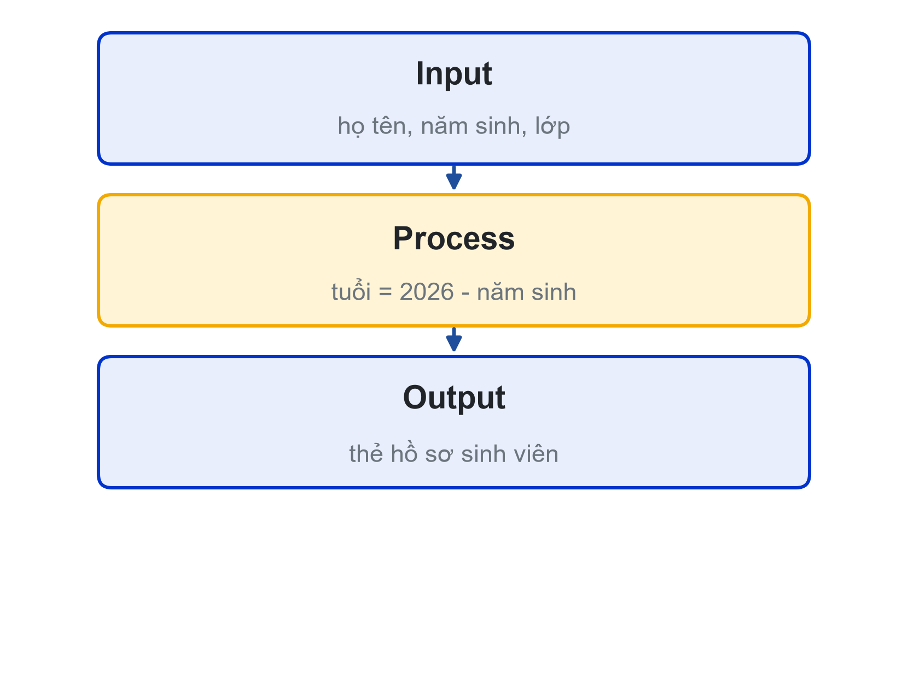

# Chương 1. Chương trình, Python và tư duy Input – Process – Output

## Mục tiêu chương

Sau khi học chương này, người học có thể:

- Giải thích chương trình, ngôn ngữ lập trình và vai trò của trình thông dịch Python (CLO1).
- Cài đặt Python và Visual Studio Code; tạo, chạy một chương trình Python ở hai chế độ: chạy file và tương tác (CLO1).
- Phân tích một bài toán đơn giản thành bảng Input – Process – Output (CLO2).
- Khai báo biến với các kiểu `int`, `float`, `str`, `bool`; chuyển kiểu dữ liệu; nhập, xuất dữ liệu bằng `input()`, `print()` và f-string (CLO1).
- Đặt câu hỏi cho trợ lý AI đúng cách và ghi Nhật ký Prompt.

## 1.1. Chương trình và ngôn ngữ lập trình

### 1.1.1. Từ bài toán đến chương trình

Giả sử Phòng Đào tạo cần in 3.000 thẻ hồ sơ tân sinh viên, mỗi thẻ gồm họ tên, lớp và tuổi. Làm bằng tay, mỗi thẻ mất vài phút, cả đợt mất nhiều ngày và dễ sai sót. Một chương trình khoảng mười dòng có thể làm việc đó trong vài giây, với điều kiện người viết biết rõ chương trình **nhận vào gì, xử lý gì và in ra gì**.

**Chương trình** (program) là một dãy lệnh được viết bằng một ngôn ngữ lập trình để máy tính thực hiện theo đúng thứ tự. Máy tính không đoán ý người viết: nó làm chính xác những gì được viết, kể cả khi điều được viết là sai. Vì vậy công việc của người lập trình gồm hai phần tách biệt:

1. **Giải bài toán:** hiểu yêu cầu, xác định dữ liệu và các bước xử lý. Kết quả của phần này là **thuật toán** (algorithm): một dãy hữu hạn các bước rõ ràng, thực hiện xong thì cho ra kết quả.
2. **Viết chương trình:** diễn đạt thuật toán bằng một ngôn ngữ lập trình cụ thể.

Người mới học thường bỏ qua phần thứ nhất và mở trình soạn thảo ngay. Khi đó lỗi không nằm ở cú pháp mà nằm ở chỗ chưa hiểu bài toán, và không công cụ nào, kể cả trợ lý AI, sửa được lỗi đó thay người học. Giáo trình này vì thế luôn bắt đầu mỗi bài toán bằng bước phân tích (mục 1.3).

### 1.1.2. Python và trình thông dịch

Python là ngôn ngữ lập trình bậc cao do Guido van Rossum tạo ra vào đầu những năm 1990 tại Hà Lan [1]. Python có cú pháp gọn, dùng thụt lề để thể hiện cấu trúc chương trình, nên mã nguồn dễ đọc. Ngôn ngữ này được dùng rộng rãi trong khoa học dữ liệu, trí tuệ nhân tạo, tự động hóa và phát triển web.

Máy tính chỉ thực thi được mã máy, không hiểu trực tiếp mã Python. Người viết soạn mã nguồn trong file có phần mở rộng `.py`; **trình thông dịch** (interpreter) Python đọc file đó và thực hiện từng lệnh theo thứ tự [2]. Người học không cần một bước biên dịch riêng như ở một số ngôn ngữ khác: viết xong là chạy được ngay, sai ở đâu thì trình thông dịch báo ở đó.

Trình thông dịch còn có **chế độ tương tác** (interactive mode): gõ `python` trong terminal sẽ thấy dấu nhắc `>>>`, gõ lệnh nào thì lệnh đó chạy ngay và kết quả hiện ra [2]. Chế độ này tiện để thử nhanh một phép tính hoặc một hàm trước khi đưa vào chương trình. Gõ `exit()` để thoát.

## 1.2. Cài đặt môi trường làm việc

### 1.2.1. Cài Python và VS Code

Học phần dùng Python 3.10 trở lên và trình soạn thảo Visual Studio Code (VS Code). Trên Windows, các bước cài đặt như sau [3], [4]:

1. Tải bộ cài Python tại trang python.org (mục Downloads). Ở màn hình đầu tiên của bộ cài, đánh dấu ô **Add python.exe to PATH**, rồi chọn **Install Now**. Bỏ qua ô này là nguyên nhân phổ biến nhất khiến terminal báo không tìm thấy lệnh `python`.
2. Tải và cài VS Code tại code.visualstudio.com.
3. Mở VS Code, vào mục **Extensions**, tìm và cài extension **Python** của Microsoft. Extension này giúp VS Code tô màu cú pháp, gợi ý lệnh, chạy và gỡ lỗi chương trình Python.
4. Mở terminal trong VS Code (phím tắt `` Ctrl + ` ``) và gõ `python --version`. Trên Windows có thể dùng `py --version`. Kết quả dạng `Python 3.1x.x` là cài đặt thành công.

| Bảng 1.1. Lỗi cài đặt thường gặp trên Windows | Cách xử lý |
|---|---|
| Gõ `python` báo "not recognized" | Chạy lại bộ cài, chọn **Modify** và bật tùy chọn thêm Python vào PATH; hoặc dùng lệnh `py` [3] |
| Gõ `python` mở Microsoft Store | Vào Windows Settings, mục **App execution aliases**, tắt hai mục `python.exe` của App Installer |
| Nút chạy của VS Code báo chưa chọn trình thông dịch | Nhấn `Ctrl + Shift + P`, chọn **Python: Select Interpreter** và chọn bản Python vừa cài [4] |

Máy yếu hoặc chưa cài được Python có thể tạm dùng Google Colab trên trình duyệt để làm bài, nhưng cần cài đặt đầy đủ trước buổi học thứ hai vì các chương sau dùng debugger và công cụ của VS Code.

### 1.2.2. Chương trình đầu tiên

Tạo thư mục `nhap-mon-lap-trinh` để lưu bài cả học kỳ, mở thư mục này bằng VS Code (**File → Open Folder**). Tạo file `hello.py` với nội dung:

```python
print("Hello, LHU!")
```

Bấm nút **Run Python File** ở góc trên bên phải, hoặc gõ `python hello.py` trong terminal. Dòng chữ `Hello, LHU!` xuất hiện trong terminal.

`print` là một **hàm có sẵn** (built-in function) của Python: nó nhận giá trị nằm trong cặp ngoặc tròn và in ra màn hình [5]. Chuỗi ký tự đặt trong cặp ngoặc kép `"..."` hoặc ngoặc đơn `'...'`.

**Ví dụ 1.1.** Cố ý viết sai để làm quen với thông báo lỗi. Đổi dòng lệnh thành `Print("Hello, LHU!")` (chữ P hoa) và chạy lại. Python báo:

```text
NameError: name 'Print' is not defined. Did you mean: 'print'?
```

Python phân biệt chữ hoa và chữ thường, nên `Print` và `print` là hai tên khác nhau. Thông báo lỗi luôn cho biết **loại lỗi** (`NameError`), **nguyên nhân** và thường cả **dòng bị lỗi**. Đọc kỹ thông báo lỗi là kỹ năng sẽ được rèn luyện xuyên suốt giáo trình, đặc biệt ở Chương 6.

### 1.2.3. Chế độ tương tác và chạy file

| Bảng 1.2. Hai cách chạy Python | Chạy file | Chế độ tương tác |
|---|---|---|
| Cách bắt đầu | `python ten_file.py` hoặc nút Run | Gõ `python`, thấy dấu nhắc `>>>` |
| Kết quả hiển thị | Chỉ những gì `print()` in ra | Giá trị của mỗi biểu thức hiện ngay |
| Lưu lại được | Có, mã nằm trong file | Không, đóng là mất |
| Dùng khi | Viết chương trình hoàn chỉnh | Thử nhanh một phép tính, một hàm |

**Ví dụ 1.2.** Ở chế độ tương tác:

```text
>>> 2026 - 2007
19
>>> "Ha" * 3
'HaHaHa'
>>> type(8.25)
<class 'float'>
```

Trong file `.py`, dòng `2026 - 2007` đứng riêng không in gì ra màn hình; muốn thấy kết quả phải viết `print(2026 - 2007)`.

## 1.3. Tư duy Input – Process – Output

### 1.3.1. Ba thành phần của một bài toán

Hầu hết các chương trình trong học phần đều có thể mô tả bằng ba câu hỏi:

- **Input (đầu vào):** chương trình cần nhận những dữ liệu nào? Dữ liệu đến từ đâu (người dùng gõ, file, hằng số trong chương trình)?
- **Process (xử lý):** cần tính toán, so sánh hay biến đổi gì từ đầu vào?
- **Output (đầu ra):** chương trình đưa ra kết quả gì, trình bày theo dạng nào?

Mô hình Input – Process – Output (viết tắt IPO) là cách đơn giản nhất để biến một yêu cầu bằng lời thành một đặc tả đủ rõ để lập trình.



### 1.3.2. Lập bảng IPO

**Ví dụ 1.3.** Bài toán "in thẻ hồ sơ tân sinh viên" có bảng IPO như sau:

| Bảng 1.3. Bảng IPO bài toán in thẻ hồ sơ | |
|---|---|
| Input | Họ tên, năm sinh, lớp (người dùng nhập từ bàn phím) |
| Process | Tuổi = 2026 − năm sinh |
| Output | Thẻ hồ sơ có khung, gồm họ tên, lớp, tuổi |

Lập bảng IPO trước khi viết mã đem lại ba lợi ích:

1. **Phát hiện thiếu dữ liệu sớm.** Đề bài yêu cầu in tuổi, nhưng tuổi không có sẵn; bảng IPO buộc người học nhận ra phải hỏi năm sinh.
2. **Biết chương trình đã xong hay chưa.** Mọi ô ở cột Output đều được in ra thì chương trình đã đáp ứng yêu cầu.
3. **Có mô tả rõ ràng để trao đổi.** Khi hỏi giảng viên, bạn cùng nhóm hay trợ lý AI, một bảng IPO giúp người nghe hiểu đúng bài toán ngay lần đầu.

**Ví dụ 1.4.** Chức năng "tính tiền khi gọi món trên ứng dụng đặt đồ ăn":

| Bảng 1.4. Bảng IPO chức năng tính tiền đơn hàng | |
|---|---|
| Input | Đơn giá, số lượng của món; phí giao hàng |
| Process | Thành tiền = đơn giá × số lượng + phí giao hàng |
| Output | Số tiền phải trả, định dạng có dấu phân cách hàng nghìn |

Khi phân tích kỹ hơn, người học sẽ đặt thêm câu hỏi: có mã giảm giá không, số lượng có thể bằng 0 không? Đó chính là lúc bảng IPO giúp làm rõ yêu cầu trước khi viết mã.

## 1.4. Biến và kiểu dữ liệu cơ bản

### 1.4.1. Biến và phép gán

**Biến** (variable) là một cái tên gắn với một giá trị được lưu trong bộ nhớ. Dấu `=` trong Python là **phép gán** (assignment): lấy giá trị ở vế phải gắn cho tên ở vế trái [6]. Phép gán không phải là dấu bằng trong toán học. Câu lệnh `tuoi = tuoi + 1` hoàn toàn hợp lệ: lấy giá trị hiện tại của `tuoi`, cộng 1, rồi gắn kết quả trở lại cho tên `tuoi`.

```python
ho_ten = "Nguyễn Văn An"
nam_sinh = 2007
tuoi = 2026 - nam_sinh
print(ho_ten, tuoi)        # Nguyễn Văn An 19
```

Một biến chỉ dùng được sau khi đã được gán giá trị. Dùng một tên chưa được gán sẽ gây lỗi `NameError`, giống Ví dụ 1.1.

### 1.4.2. Quy tắc đặt tên

Tên biến phải tuân theo các quy tắc của ngôn ngữ [7]:

- Chỉ gồm chữ cái, chữ số và dấu gạch dưới `_`; không chứa dấu cách.
- Không bắt đầu bằng chữ số: `nam_sinh_1` hợp lệ, `1_nam_sinh` không hợp lệ.
- Phân biệt chữ hoa, chữ thường: `diem` và `Diem` là hai biến khác nhau.
- Không trùng **từ khóa** (keyword) của Python như `if`, `for`, `while`, `True`, `def`.

Ngoài quy tắc bắt buộc, giáo trình dùng quy ước: tên có nghĩa, viết thường, các từ nối bằng dấu gạch dưới, gọi là kiểu `snake_case` (ví dụ `nam_sinh`, `diem_tb`). Tránh tên vô nghĩa như `x1`, `ns`, `a`. Chương 8 trình bày đầy đủ quy ước đặt tên theo PEP 8.

### 1.4.3. Bốn kiểu dữ liệu cơ bản và hàm type()

Mỗi giá trị trong Python có một **kiểu dữ liệu** (data type), quyết định giá trị đó được lưu thế nào và có thể làm gì với nó [8].

| Bảng 1.5. Bốn kiểu dữ liệu cơ bản | Ý nghĩa | Ví dụ |
|---|---|---|
| `int` | Số nguyên, không giới hạn độ lớn | `2007`, `-5`, `0` |
| `float` | Số thực, dùng dấu chấm thập phân | `8.25`, `1.70`, `-0.5` |
| `str` | Chuỗi ký tự, đặt trong ngoặc kép hoặc ngoặc đơn | `"Nguyễn Văn An"`, `'26CT111'` |
| `bool` | Giá trị logic, chỉ có `True` hoặc `False` | `True`, `False` |

Hàm có sẵn `type()` cho biết kiểu của một giá trị [5]:

```python
print(type(2007))        # <class 'int'>
print(type(8.25))        # <class 'float'>
print(type("2007"))      # <class 'str'>
print(type(True))        # <class 'bool'>
```

Chú ý dòng thứ ba: `"2007"` nằm trong ngoặc kép nên là chuỗi, không phải số. Hai giá trị nhìn giống nhau nhưng khác kiểu sẽ hành xử khác nhau:

```python
print(2007 + 1)          # 2008
print("2007" + "1")      # 20071  (nối chuỗi)
print("2007" + 1)        # TypeError: can only concatenate str (not "int") to str
```

Python không tự đổi kiểu khi cộng chuỗi với số; người viết phải tự chuyển kiểu (mục 1.5.2).

## 1.5. Nhập, xuất và f-string

### 1.5.1. print() và input()

Hàm `print()` in một hoặc nhiều giá trị, mặc định cách nhau một dấu cách và kết thúc bằng ký tự xuống dòng. Hai tham số thường dùng [5]:

- `sep` đổi ký tự ngăn cách: `print("26", "CT", "111", sep="-")` in `26-CT-111`.
- `end` đổi ký tự kết thúc: `print("Đang tải", end="...")` in xong không xuống dòng.

Hàm `input(loi_nhac)` in lời nhắc, dừng chương trình chờ người dùng gõ và nhấn Enter, rồi trả về **chuỗi** người dùng đã gõ [5]. Điểm quan trọng: kết quả của `input()` **luôn là chuỗi**, kể cả khi người dùng gõ một con số.

```python
nam_sinh = input("Năm sinh: ")     # người dùng gõ 2007
print(type(nam_sinh))              # <class 'str'>
```

### 1.5.2. Chuyển kiểu dữ liệu

Muốn tính toán với dữ liệu nhập vào, phải chuyển chuỗi sang số bằng `int()` hoặc `float()`; ngược lại, `str()` chuyển một giá trị thành chuỗi [5].

| Bảng 1.6. Hàm chuyển kiểu | Ví dụ | Kết quả |
|---|---|---|
| `int()` | `int("2007")` | `2007` |
| `float()` | `float("8.5")` | `8.5` |
| `str()` | `str(19)` | `"19"` |

Cách viết thường gặp là lồng hai hàm vào nhau: `nam_sinh = int(input("Năm sinh: "))`. Python thực hiện hàm bên trong trước (`input` trả về chuỗi), rồi đến hàm bên ngoài (`int` đổi chuỗi thành số nguyên).

Chuyển kiểu có thể thất bại: `int("8.5")` và `int("hai nghìn")` đều gây lỗi `ValueError` vì chuỗi không biểu diễn một số nguyên. Hiện tại, người học chỉ cần nhập đúng dữ liệu; Chương 6 sẽ trình bày cách xử lý để chương trình không bị dừng khi người dùng nhập sai.

### 1.5.3. Định dạng bằng f-string

Ghép nhiều biến vào một câu bằng dấu `+` vừa dài vừa phải chuyển kiểu. **f-string** (formatted string literal) giải quyết việc này: đặt chữ `f` trước dấu ngoặc mở chuỗi, rồi đặt biến hoặc biểu thức trong cặp ngoặc nhọn `{ }` [9].

```python
ho_ten = "Nguyễn Văn An"
tuoi = 19
print(f"{ho_ten} - {tuoi} tuổi")       # Nguyễn Văn An - 19 tuổi
print(f"Năm sau: {tuoi + 1} tuổi")     # Năm sau: 20 tuổi
```

Quên chữ `f` thì Python in nguyên văn `{ho_ten} - {tuoi} tuổi`. Đây là lỗi không có thông báo, chỉ phát hiện được khi đọc kỹ kết quả.

**Ví dụ 1.5.** Chương trình in thẻ hồ sơ theo bảng IPO ở Ví dụ 1.3:

```python
# ho_so.py - in thẻ hồ sơ tân sinh viên
ho_ten = input("Họ tên: ")
nam_sinh = int(input("Năm sinh: "))
lop = input("Lớp: ")
tuoi = 2026 - nam_sinh
print("=" * 36)
print(f"  HỒ SƠ SỐ HÓA: {ho_ten}")
print(f"  Lớp: {lop}  |  Tuổi: {tuoi}")
print("=" * 36)
```

Nhập `Nguyễn Văn An`, `2007`, `26CT111`, chương trình in:

```text
====================================
  HỒ SƠ SỐ HÓA: Nguyễn Văn An
  Lớp: 26CT111  |  Tuổi: 19
====================================
```

Biểu thức `"=" * 36` lặp chuỗi `"="` 36 lần để vẽ đường khung. Đối chiếu với bảng IPO: ba dòng `input` là Input, dòng tính `tuoi` là Process, các dòng `print` là Output.

## 1.6. Học lập trình cùng trợ lý AI

### 1.6.1. AI là trợ giảng, không phải người làm hộ

Các trợ lý AI tạo sinh như ChatGPT, Claude, Gemini có thể viết một chương trình như Ví dụ 1.5 trong vài giây. Vì vậy câu hỏi đặt ra cho người học không phải "có dùng AI không" mà là "dùng AI thế nào để vẫn học được". Nếu AI viết hộ, người học có sản phẩm nhưng không có kỹ năng; đến khi kiểm tra trên lớp hoặc gặp một lỗi AI không sửa được, người học không biết bắt đầu từ đâu.

Học phần quy ước:

- **Nên hỏi AI:** giải thích một câu lệnh, giải thích thông báo lỗi, chỉ ra dòng sai, gợi ý hướng giải, cho ví dụ tương tự ở mức nhập môn.
- **Không nên:** dán nguyên đề bài để lấy lời giải và nộp lại. Mã nộp phải do người học tự gõ và giải thích được từng dòng.
- **Luôn kiểm chứng:** AI có thể trả lời sai một cách rất tự tin. Mọi câu trả lời phải được kiểm tra bằng cách chạy thử.

### 1.6.2. Viết prompt hỏi để hiểu

Một câu hỏi (prompt) tốt dành cho người mới học có ba phần: **bối cảnh**, **câu hỏi cụ thể** và **giới hạn**.

**Ví dụ 1.6.** So sánh hai prompt:

- Prompt chưa tốt: *"Giải thích f-string."* AI có thể trả lời rất dài, dùng cả những tính năng người học chưa biết.
- Prompt tốt: *"Tôi là sinh viên năm nhất, mới học Python buổi đầu. Giải thích dòng `print(f"Tuổi: {tuoi}")` làm gì, chữ f và dấu ngoặc nhọn có ý nghĩa gì. Đừng viết thêm code mới, chỉ giải thích."*

Phần giới hạn ("đừng viết thêm code mới", "chỉ dùng kiến thức đã học") giữ cho câu trả lời ở đúng trình độ và buộc người học tự viết mã.

### 1.6.3. Nhật ký Prompt

Mỗi bài thực hành, người học ghi lại việc dùng AI vào file `nhat-ky-prompt.md`. Nhật ký giúp người học nhìn lại mình đã học được gì từ AI, đồng thời là minh chứng cho thấy bài làm là của mình.

| Bảng 1.7. Mẫu Nhật ký Prompt | Nội dung ví dụ |
|---|---|
| Prompt đã dùng | Prompt tốt ở Ví dụ 1.6 |
| AI trả lời (tóm tắt) | f-string chèn giá trị của biến vào chuỗi; chữ f báo cho Python biết phải thay `{tuoi}` bằng giá trị |
| Mình kiểm tra hoặc sửa gì | Tự viết lại dòng in lớp và tuổi; thử bỏ chữ f để xem kết quả |
| Bài học rút ra | Thiếu chữ f thì in nguyên văn `{tuoi}`, không báo lỗi |

## Tóm tắt chương

- Chương trình là dãy lệnh máy tính thực hiện đúng thứ tự; trước khi viết chương trình phải giải bài toán, tức là tìm ra thuật toán.
- Python là ngôn ngữ thông dịch; có hai cách chạy: chạy file `.py` và chế độ tương tác `>>>`.
- Bảng Input – Process – Output giúp phân tích bài toán, phát hiện thiếu dữ liệu và xác định khi nào chương trình đã xong.
- Biến là tên gắn với giá trị; `=` là phép gán. Tên biến tuân theo quy tắc của ngôn ngữ và nên có nghĩa, viết kiểu `snake_case`.
- Bốn kiểu dữ liệu cơ bản: `int`, `float`, `str`, `bool`; `type()` cho biết kiểu của một giá trị.
- `input()` luôn trả về chuỗi; muốn tính toán phải chuyển kiểu bằng `int()` hoặc `float()`.
- f-string `f"...{bien}..."` chèn giá trị vào chuỗi khi in.
- AI là trợ giảng: hỏi để hiểu, tự viết, tự kiểm chứng và ghi Nhật ký Prompt.

## Câu hỏi ôn tập

1. Phân biệt "giải bài toán" và "viết chương trình". Vì sao người mới học không nên mở trình soạn thảo ngay khi nhận đề?
2. Trình thông dịch Python làm gì với một file `.py`? Khi nào nên dùng chế độ tương tác thay cho chạy file?
3. Lập bảng IPO cho chức năng rút tiền của máy ATM. Có dữ liệu đầu vào nào dễ bị bỏ sót không?
4. Giải thích vì sao `tuoi = tuoi + 1` hợp lệ trong Python dù sai trong toán học.
5. Những tên biến nào sau đây không hợp lệ, vì sao: `diem_tb`, `2diem`, `ho ten`, `for`, `Lop`?
6. `"2007" + 1` gây lỗi gì? Viết hai cách sửa cho hai mục đích khác nhau: ra số `2008` và ra chuỗi `"20071"`.
7. Vì sao phải viết `int(input("Năm sinh: "))` thay vì chỉ `input("Năm sinh: ")` trong chương trình tính tuổi?
8. Prompt "Viết chương trình in thẻ hồ sơ sinh viên" có vấn đề gì với một người đang học lập trình? Hãy viết lại theo cấu trúc ba phần.

## Bài tập

1. **Đổi tiền.** Lập bảng IPO và viết chương trình nhập số tiền đô la Mỹ và tỷ giá (đồng/USD), in số tiền quy đổi ra đồng. Chạy với ít nhất hai bộ dữ liệu đã tính tay trước.
2. **Chỉ số BMI.** Nhập cân nặng (kg) và chiều cao (m), tính BMI = cân nặng / (chiều cao × chiều cao), in kết quả. Bảng IPO phải ghi rõ kiểu dữ liệu của từng đầu vào.
3. **Thử lỗi có chủ đích.** Trong chương trình ở Ví dụ 1.5, lần lượt: bỏ dấu ngoặc kép đóng một chuỗi; bỏ `int()` ở dòng nhập năm sinh; bỏ chữ `f` ở một dòng in. Ghi lại thông báo lỗi hoặc kết quả sai của từng trường hợp và giải thích.
4. **IPO cho ứng dụng quen thuộc.** Chọn một ứng dụng dùng hằng ngày (ví điện tử, ứng dụng đặt xe…), lập bảng IPO cho một chức năng của nó.

## Tài liệu tham khảo

[1] Python Software Foundation, “History and License,” *Python 3 Documentation*. Accessed: Oct. 31, 2026. [Online]. Available: https://docs.python.org/3/license.html

[2] Python Software Foundation, “Using the Python Interpreter,” *The Python Tutorial*. Accessed: Oct. 31, 2026. [Online]. Available: https://docs.python.org/3/tutorial/interpreter.html

[3] Python Software Foundation, “Using Python on Windows,” *Python 3 Documentation*. Accessed: Oct. 31, 2026. [Online]. Available: https://docs.python.org/3/using/windows.html

[4] Microsoft, “Getting Started with Python in VS Code,” *Visual Studio Code Documentation*. Accessed: Oct. 31, 2026. [Online]. Available: https://code.visualstudio.com/docs/python/python-tutorial

[5] Python Software Foundation, “Built-in Functions,” *Python 3 Documentation*. Accessed: Oct. 31, 2026. [Online]. Available: https://docs.python.org/3/library/functions.html

[6] Python Software Foundation, “An Informal Introduction to Python,” *The Python Tutorial*. Accessed: Oct. 31, 2026. [Online]. Available: https://docs.python.org/3/tutorial/introduction.html

[7] Python Software Foundation, “Lexical analysis,” *The Python Language Reference*. Accessed: Oct. 31, 2026. [Online]. Available: https://docs.python.org/3/reference/lexical_analysis.html

[8] Python Software Foundation, “Built-in Types,” *Python 3 Documentation*. Accessed: Oct. 31, 2026. [Online]. Available: https://docs.python.org/3/library/stdtypes.html

[9] Python Software Foundation, “Input and Output,” *The Python Tutorial*. Accessed: Oct. 31, 2026. [Online]. Available: https://docs.python.org/3/tutorial/inputoutput.html
