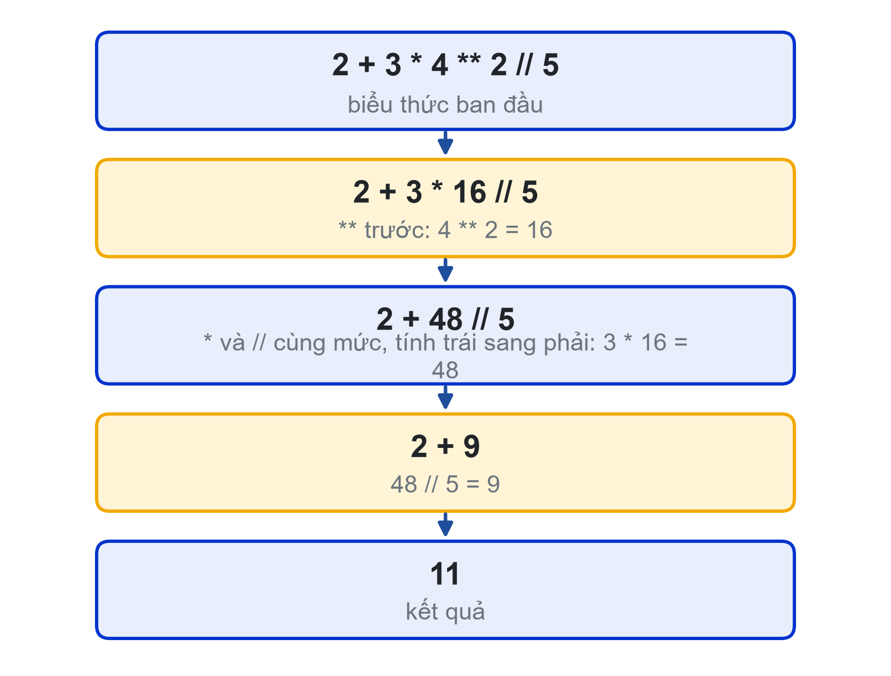

# Chương 2. Toán tử và biểu thức

## Mục tiêu chương

Sau khi học chương này, người học có thể:

- Sử dụng đúng các toán tử số học, đặc biệt là chia lấy nguyên `//`, chia lấy dư `%` và lũy thừa `**` (CLO1).
- Xác định thứ tự tính của một biểu thức và dùng dấu ngoặc để công thức đúng, dễ đọc (CLO1).
- Viết biểu thức so sánh, biểu thức logic và phép gán kết hợp (CLO1).
- Làm tròn, định dạng số khi in; giải thích được sai số của số thực (CLO1).
- Chuyển một công thức trong bảng IPO thành chương trình và kiểm tra kết quả bằng tính tay (CLO1, CLO2).

## 2.1. Toán tử số học

### 2.1.1. Bảy toán tử số học

Điểm quá trình 8, giữa kỳ 7, cuối kỳ 9: điểm học phần là 8,0 hay 8,1? Viết sai một dấu ngoặc trong công thức, chương trình vẫn chạy, không báo lỗi, nhưng tính sai cho cả lớp. Chương này giúp người học viết biểu thức đúng ngay từ đầu.

**Biểu thức** (expression) là sự kết hợp của giá trị, biến và toán tử, được Python tính ra một giá trị duy nhất. Python có bảy toán tử số học [1], [2]:

| Bảng 2.1. Toán tử số học | Ý nghĩa | Ví dụ | Kết quả |
|---|---|---|---|
| `+` | Cộng | `7 + 2` | `9` |
| `-` | Trừ | `7 - 2` | `5` |
| `*` | Nhân | `7 * 2` | `14` |
| `/` | Chia, kết quả luôn là `float` | `7 / 2` | `3.5` |
| `//` | Chia lấy phần nguyên | `7 // 2` | `3` |
| `%` | Chia lấy phần dư | `7 % 2` | `1` |
| `**` | Lũy thừa | `2 ** 10` | `1024` |

Hai điểm cần nhớ về kiểu của kết quả:

- Phép `/` luôn cho `float`, kể cả khi chia hết: `6 / 3` cho `2.0`, không phải `2`.
- Khi có một toán hạng là `float`, kết quả của `+`, `-`, `*`, `//`, `%` cũng là `float`: `7.0 // 2` cho `3.0`.

Chia cho 0 bằng `/`, `//` hay `%` đều gây lỗi `ZeroDivisionError` [2].

### 2.1.2. Chia lấy nguyên và chia lấy dư

Hai phép `//` và `%` đi đôi với nhau: với số nguyên `a` và `b` khác 0, luôn có `a == (a // b) * b + a % b` [2]. Chúng rất hữu ích trong các bài toán đổi đơn vị và tách chữ số.

**Ví dụ 2.1.** Đổi tổng số phút sang giờ và phút. Với 135 phút: `135 // 60` là 2 giờ, `135 % 60` là 15 phút.

```python
tong_phut = int(input("Số phút: "))
gio = tong_phut // 60
phut = tong_phut % 60
print(f"{tong_phut} phút = {gio} giờ {phut} phút")
```

Nhập `135`, chương trình in `135 phút = 2 giờ 15 phút`.

**Ví dụ 2.2.** Tách chữ số. Với số nguyên dương `n`, `n % 10` là chữ số hàng đơn vị, `n // 10` là số còn lại sau khi bỏ chữ số đó: `2007 % 10` cho `7`, `2007 // 10` cho `200`. Lặp lại thao tác này sẽ tách được từng chữ số; Chương 4 sẽ dùng vòng lặp để làm việc đó với số có độ dài bất kỳ.

Một tính chất khác của `%` thường dùng ở Chương 3: `n % 2 == 0` khi và chỉ khi `n` là số chẵn.

**Lưu ý với số âm.** Python làm tròn kết quả của `//` xuống phía âm vô cùng, không làm tròn về 0 [2]. Vì vậy `-7 // 2` cho `-4` (không phải `-3`) và `-7 % 2` cho `1`. Các bài toán trong học phần chủ yếu dùng số không âm, nhưng người học nên biết để không bất ngờ khi gặp.

## 2.2. Thứ tự ưu tiên và dấu ngoặc

Khi một biểu thức có nhiều toán tử, Python tính theo **thứ tự ưu tiên** (operator precedence) quy định trong tài liệu ngôn ngữ [2]. Bảng dưới đây liệt kê các toán tử dùng trong giáo trình, từ ưu tiên cao xuống thấp.

| Bảng 2.2. Thứ tự ưu tiên (cao đến thấp) | Toán tử |
|---|---|
| 1 | `( )` dấu ngoặc |
| 2 | `**` lũy thừa |
| 3 | `-x` dấu âm đứng trước một số |
| 4 | `*`, `/`, `//`, `%` |
| 5 | `+`, `-` |
| 6 | `==`, `!=`, `<`, `>`, `<=`, `>=` |
| 7 | `not` |
| 8 | `and` |
| 9 | `or` |

Các toán tử cùng mức được tính từ trái sang phải, riêng `**` tính từ phải sang trái: `2 ** 3 ** 2` là `2 ** 9 = 512`, không phải `8 ** 2 = 64` [2]. Vì `**` ưu tiên cao hơn dấu âm đứng trước, `-2 ** 2` cho `-4`; muốn bình phương số âm phải viết `(-2) ** 2`.

**Ví dụ 2.3.** Tính từng bước biểu thức `2 + 3 * 4 ** 2 // 5`:

1. `**` có ưu tiên cao nhất: `4 ** 2 = 16`, còn `2 + 3 * 16 // 5`.
2. `*` và `//` cùng mức, tính từ trái sang phải: `3 * 16 = 48`, rồi `48 // 5 = 9`.
3. Còn lại `2 + 9 = 11`.

Kiểm tra ở chế độ tương tác cho đúng `11`.

**Ví dụ 2.4.** Lỗi thường gặp khi tính trung bình. Biểu thức `8 + 9 / 2` cho `12.5`, vì phép chia được thực hiện trước phép cộng. Viết đúng là `(8 + 9) / 2`, cho `8.5`. Python không báo lỗi trong trường hợp này: chương trình chạy bình thường và cho kết quả sai. Đây là **lỗi logic**, loại lỗi khó phát hiện nhất (Chương 6).

Nguyên tắc thực hành: khi không chắc thứ tự tính, hãy thêm dấu ngoặc. Ngoặc thừa không làm chương trình chậm đi, nhưng giúp người đọc, kể cả chính người viết sau vài tuần, hiểu đúng ý định.



## 2.3. Toán tử so sánh, logic và gán kết hợp

### 2.3.1. So sánh và kiểu bool

Toán tử so sánh cho kết quả kiểu `bool`, tức `True` hoặc `False` [3]:

| Bảng 2.3. Toán tử so sánh | Ý nghĩa | Ví dụ | Kết quả |
|---|---|---|---|
| `==` | Bằng | `8 == 8.0` | `True` |
| `!=` | Khác | `8 != 9` | `True` |
| `<`, `>` | Nhỏ hơn, lớn hơn | `8 < 9` | `True` |
| `<=`, `>=` | Nhỏ hơn hoặc bằng, lớn hơn hoặc bằng | `8 >= 9` | `False` |

Đừng nhầm `==` (so sánh) với `=` (gán). Viết `if diem = 10:` sẽ gây lỗi cú pháp.

Python cho phép **so sánh nối**: `0 <= diem <= 10` tương đương `0 <= diem and diem <= 10` [2]. Cách viết này gần với ký hiệu toán học và rất tiện để kiểm tra một giá trị nằm trong khoảng.

So sánh chuỗi phân biệt chữ hoa và chữ thường: `"C" == "c"` cho `False`. Đây là lý do trong bài tập hướng dẫn Chương 1, nhập `C` cho câu hỏi ký túc xá bị hiểu là "không".

### 2.3.2. Các toán tử logic and, or, not

Toán tử logic kết hợp các điều kiện [3]:

| Bảng 2.4. Toán tử logic | Đúng khi |
|---|---|
| `a and b` | Cả `a` và `b` đều đúng |
| `a or b` | Ít nhất một trong `a`, `b` đúng |
| `not a` | `a` sai |

Python tính `and`, `or` theo kiểu **ngắn mạch** (short-circuit): với `a and b`, nếu `a` đã sai thì không cần tính `b`; với `a or b`, nếu `a` đã đúng thì không tính `b` [2]. Tính chất này sẽ hữu ích ở các chương sau, ví dụ kiểm tra danh sách khác rỗng trước khi chia cho số phần tử.

**Ví dụ 2.5.**

```python
diem = 8.5
hop_le = 0 <= diem <= 10            # True
du_hoc_bong = diem >= 8 and hop_le  # True
print(hop_le, du_hoc_bong, not hop_le)
```

Chương trình in `True True False`. Ngưỡng 8 điểm ở đây là giả định cho ví dụ.

### 2.3.3. Gán kết hợp

Các phép gán kết hợp viết gọn việc cập nhật giá trị của một biến [2]: `tong += 5` tương đương `tong = tong + 5`; tương tự với `-=`, `*=`, `/=`, `//=`, `%=`. Cách viết này dùng rất nhiều trong vòng lặp ở Chương 4 và 5.

```python
so_du = 2000000
so_du -= 500000       # rút 500.000
so_du += 200000       # nạp 200.000
print(so_du)          # 1700000
```

## 2.4. Làm tròn, định dạng số và sai số số thực

### 2.4.1. round() và định dạng khi in

Có hai cách hiển thị số thực gọn gàng, khác nhau ở chỗ có làm thay đổi giá trị hay không:

- `round(x, n)` trả về **một giá trị mới** đã làm tròn đến `n` chữ số thập phân [4]. Dùng khi cần giá trị đã làm tròn để tính tiếp hoặc lưu lại.
- f-string với định dạng `{x:.2f}` chỉ **định dạng khi in**, giá trị của `x` không đổi [5]. Dùng khi chỉ cần hiển thị.

| Bảng 2.5. Một số định dạng số trong f-string | Ví dụ | Kết quả in |
|---|---|---|
| `:.2f` | `f"{8.1:.2f}"` | `8.10` |
| `:.1f` | `f"{98.64:.1f}"` | `98.6` |
| `:,` | `f"{315000:,}"` | `315,000` |
| `:,.0f` | `f"{1234567.8:,.0f}"` | `1,234,568` |

Định dạng `:,` dùng dấu phẩy ngăn cách hàng nghìn theo kiểu tiếng Anh. Muốn in theo kiểu Việt Nam (315.000), có thể viết `f"{tien:,}".replace(",", ".")`.

Hàm `round()` làm tròn trường hợp "đúng nửa" về số chẵn gần nhất: `round(2.5)` cho `2`, `round(3.5)` cho `4` [4]. Quy tắc này giảm sai lệch khi làm tròn nhiều số, nhưng khác cách làm tròn người học quen dùng ở trường phổ thông.

### 2.4.2. Vì sao 0.1 + 0.2 khác 0.3

Gõ thử ở chế độ tương tác:

```text
>>> 0.1 + 0.2
0.30000000000000004
>>> 0.1 + 0.2 == 0.3
False
```

Đây không phải lỗi của Python. Máy tính lưu số thực ở hệ nhị phân với số bit hữu hạn; nhiều số thập phân đơn giản như 0,1 không biểu diễn chính xác được trong hệ nhị phân, giống như 1/3 không viết chính xác được bằng số thập phân hữu hạn [6]. Sai số rất nhỏ nhưng làm phép so sánh `==` cho kết quả bất ngờ.

Ba nguyên tắc khi làm việc với số thực:

1. **Không so sánh hai số thực bằng `==`.** Nếu cần, kiểm tra hiệu của chúng đủ nhỏ, ví dụ `abs(a - b) < 1e-9`.
2. **Định dạng khi in** bằng `:.2f` thay vì in nguyên giá trị.
3. **Bài toán tiền tệ cần chính xác tuyệt đối** (ngân hàng, kế toán) dùng số nguyên (đơn vị đồng) hoặc kiểu `decimal.Decimal`. Kiểu `Decimal` nằm ngoài phạm vi học phần.

Hàm `round()` cũng chịu ảnh hưởng của sai số này: `round(2.675, 2)` cho `2.67` chứ không phải `2.68`, vì giá trị 2,675 được lưu thực tế nhỏ hơn 2,675 một chút [4].

## 2.5. Từ công thức đến chương trình

### 2.5.1. Bài toán tính tiền điện theo bậc

**Ví dụ 2.6.** Tính tiền điện theo bậc với **bảng giá giả định** cho bài tập (không phải biểu giá điện thực tế): 50 kWh đầu giá 2.000 đồng/kWh, 50 kWh tiếp theo giá 2.500 đồng/kWh, phần còn lại giá 3.000 đồng/kWh.

| Bảng 2.6. Bảng IPO bài toán tiền điện | |
|---|---|
| Input | Số kWh tiêu thụ (số nguyên không âm) |
| Process | Chia số kWh vào ba bậc; tiền = bậc 1 × 2.000 + bậc 2 × 2.500 + bậc 3 × 3.000 |
| Output | Tiền điện, có dấu ngăn cách hàng nghìn |

Chưa học lệnh rẽ nhánh, ta dùng hai hàm có sẵn `min()` và `max()` [4] để chia số kWh vào từng bậc:

```python
kwh = int(input("Số kWh tiêu thụ: "))
bac1 = min(kwh, 50)                  # tối đa 50 kWh
bac2 = min(max(kwh - 50, 0), 50)     # phần từ 51 đến 100
bac3 = max(kwh - 100, 0)             # phần trên 100
tien = bac1 * 2000 + bac2 * 2500 + bac3 * 3000
print(f"Tiền điện: {tien:,} đồng")
```

Với 130 kWh: bậc 1 là 50, bậc 2 là `min(80, 50) = 50`, bậc 3 là 30. Tiền điện = 50 × 2.000 + 50 × 2.500 + 30 × 3.000 = 315.000 đồng, chương trình in `Tiền điện: 315,000 đồng`.

### 2.5.2. Kiểm tra kết quả bằng tính tay

Chương trình chạy không báo lỗi chưa chắc đã đúng. Trước khi tin kết quả, người học lập **bảng kiểm thử**: chọn dữ liệu, tự tính tay kết quả mong đợi, rồi so với kết quả chương trình. Nên chọn dữ liệu nằm ở từng bậc và ở đúng ranh giới giữa các bậc.

| Bảng 2.7. Bảng kiểm thử bài toán tiền điện | Tính tay | Mong đợi |
|---|---|---|
| 0 kWh | 0 | 0 |
| 40 kWh | 40 × 2.000 | 80,000 |
| 50 kWh (ranh giới bậc 1) | 50 × 2.000 | 100,000 |
| 100 kWh (ranh giới bậc 2) | 50 × 2.000 + 50 × 2.500 | 225,000 |
| 130 kWh | 50 × 2.000 + 50 × 2.500 + 30 × 3.000 | 315,000 |

Các giá trị nằm đúng ranh giới như 50 và 100 gọi là **giá trị biên**. Lỗi tính toán thường nằm ở đó; Chương 3 sẽ dùng giá trị biên một cách có hệ thống.

**Ví dụ 2.7.** Trợ lý AI có thể giúp kiểm tra cách hiểu về thứ tự tính. Prompt gợi ý: *"Trình bày từng bước Python tính biểu thức `17 // 5 * 2 + 17 % 5 ** 2`. Không cần viết code."* Sau khi đọc câu trả lời, người học tự tính lại và chạy biểu thức để đối chiếu (kết quả đúng là 23). Nếu AI và Python cho kết quả khác nhau, Python là căn cứ cuối cùng.

## Tóm tắt chương

- Bảy toán tử số học: `+ - * / // % **`; `/` luôn cho `float`; `//` và `%` dùng để đổi đơn vị, tách chữ số, kiểm tra chẵn lẻ.
- Python tính theo thứ tự ưu tiên: ngoặc, `**`, `* / // %`, `+ -`, so sánh, `not`, `and`, `or`. Cùng mức thì tính trái sang phải, riêng `**` tính phải sang trái.
- Sai thứ tự ưu tiên gây lỗi logic: chương trình không báo lỗi nhưng cho kết quả sai. Không chắc thì thêm ngoặc.
- So sánh cho `True`/`False`; có thể so sánh nối `0 <= x <= 10`. Logic `and`, `or`, `not` tính theo kiểu ngắn mạch.
- `round()` tạo giá trị mới đã làm tròn; `:.2f` chỉ định dạng khi in; `:,` thêm dấu ngăn cách hàng nghìn.
- Số thực có sai số do lưu ở hệ nhị phân: không so sánh số thực bằng `==`.
- Luôn kiểm tra chương trình bằng bảng kiểm thử với kết quả đã tính tay, có giá trị biên.

## Câu hỏi ôn tập

1. `7 / 2`, `7 // 2`, `7 % 2`, `7.0 // 2` cho kết quả gì, kiểu dữ liệu nào?
2. Không chạy máy, tính `17 // 5 * 2 + 17 % 5 ** 2` theo từng bước.
3. Vì sao `8 + 9 / 2` không phải trung bình cộng của 8 và 9? Lỗi này thuộc loại lỗi gì, vì sao khó phát hiện?
4. `-2 ** 2` và `(-2) ** 2` cho kết quả gì? Giải thích dựa vào thứ tự ưu tiên.
5. Viết biểu thức kiểm tra một năm là năm nhuận: chia hết cho 400, hoặc chia hết cho 4 nhưng không chia hết cho 100.
6. Phân biệt `round(x, 2)` và `f"{x:.2f}"`. Khi nào dùng cách nào?
7. Vì sao `0.1 + 0.2 == 0.3` cho `False`? Nêu cách kiểm tra hai số thực "bằng nhau" an toàn hơn.
8. Với bài toán tiền điện, vì sao phải thử thêm 50 kWh và 100 kWh dù đã thử 40 kWh và 130 kWh?

## Bài tập

1. **Đổi nhiệt độ.** Nhập nhiệt độ °C, in °F theo công thức F = C × 9/5 + 32, làm tròn 1 chữ số thập phân khi in. Kiểm tra với 0 °C, 37 °C và 100 °C.
2. **Tổng chữ số.** Nhập một số nguyên có đúng 3 chữ số, in tổng các chữ số chỉ dùng `//` và `%` (ví dụ 527 cho 14).
3. **Đổi giây.** Nhập tổng số giây, in ra dạng giờ:phút:giây (ví dụ 3725 giây thành 1:02:05; gợi ý định dạng `{phut:02d}`).
4. **Chia đều tiền.** Một nhóm bạn đi ăn hết một số tiền (đồng). Mỗi người trả một khoản bằng nhau, chẵn đến hàng nghìn; phần lẻ còn lại do người đặt bàn trả thêm. Dùng `//` và `%`, in số tiền mỗi người và phần lẻ (ví dụ 425.000 đồng cho 4 người: mỗi người 106.000, phần lẻ 1.000). Lập bảng IPO và bảng kiểm thử trước khi viết mã.
5. **Kiểm chứng câu trả lời của AI.** Nhờ AI giải thích vì sao `round(2.5)` cho 2. Chạy thử `round(0.5)`, `round(1.5)`, `round(2.5)`, `round(3.5)` và ghi nhận xét vào Nhật ký Prompt.

## Tài liệu tham khảo

[1] Python Software Foundation, “An Informal Introduction to Python,” *The Python Tutorial*. Accessed: Oct. 31, 2026. [Online]. Available: https://docs.python.org/3/tutorial/introduction.html

[2] Python Software Foundation, “Expressions,” *The Python Language Reference*. Accessed: Oct. 31, 2026. [Online]. Available: https://docs.python.org/3/reference/expressions.html

[3] Python Software Foundation, “Built-in Types,” *Python 3 Documentation*. Accessed: Oct. 31, 2026. [Online]. Available: https://docs.python.org/3/library/stdtypes.html

[4] Python Software Foundation, “Built-in Functions,” *Python 3 Documentation*. Accessed: Oct. 31, 2026. [Online]. Available: https://docs.python.org/3/library/functions.html

[5] Python Software Foundation, “Format Specification Mini-Language,” *Python 3 Documentation*. Accessed: Oct. 31, 2026. [Online]. Available: https://docs.python.org/3/library/string.html#format-specification-mini-language

[6] Python Software Foundation, “Floating-Point Arithmetic: Issues and Limitations,” *The Python Tutorial*. Accessed: Oct. 31, 2026. [Online]. Available: https://docs.python.org/3/tutorial/floatingpoint.html
